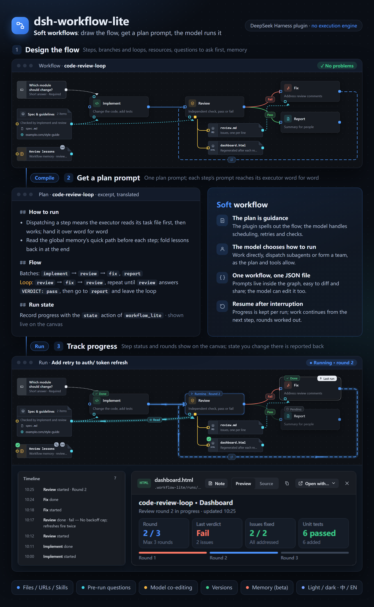
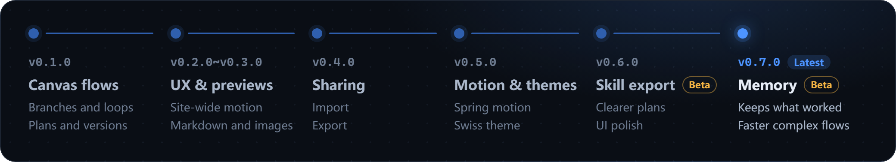

<div align="center">
  <br>
  
</div>

<div align="center">

[简体中文](./README.md) | English

</div>

<div align="center">

[](https://www.npmjs.com/package/@xiaoso/dsh-workflow-lite)
[](./LICENSE)
[](https://nodejs.org)
[](https://github.com/deepseek-ai/deepseek-harness)

</div>

A soft-workflow plugin for [DeepSeek Harness](https://github.com/deepseek-ai/deepseek-harness), built on prompt orchestration: design a flow on a canvas, compile it into a plan prompt, and let the model carry it out. Edges can carry **any condition**, and flows can be sequential, parallel, joined, conditionally branched, looped or rolled back, with no extra execution engine required.

> **Experimental**: features and data formats are still changing, and any release may include breaking changes.



[](./CHANGELOG.md)

## Install

Works with DeepSeek Harness 0.2.0 and 0.2.1, including their preview builds (such as 0.2.1-rc.2).

### Web

Requires Node.js 22 or later.

```bash
dsh plugin --profile web add @xiaoso/dsh-workflow-lite
dsh web
```

### Desktop

1. Open **Plugins** in the sidebar, then click **Add plugin** → **Install a third-party plugin**.
2. Enter `@xiaoso/dsh-workflow-lite` and click **Install**.
3. Restart DeepSeek Harness.

Once installed, a **Workflow** tab appears at the top of the session page.

## Usage

### Ask the model

Describe the flow in one sentence in the conversation, for example:

> Create a workflow: write the code, then review it; if the review fails, go back and fix it, at most three rounds.

The model creates the workflow and the canvas shows it as it is built. When it looks right, click **Run** in the top-right corner, or ask the model to run it.

### Edit by hand

1. Open the **Workflow** tab and create a workflow.
2. Drag steps from the library on the left onto the canvas, fill in their prompts, and connect them.
3. Click **Run** in the top-right corner, or ask the model in the conversation to run the workflow.

### Follow progress

Turn on **Record run state** in **Workflow settings**. Every run then leaves a record and the canvas updates as the model works. Run records, workflows and versions are managed in the **Workflow hub**, opened from the top-left corner of the canvas.

## Features

| Feature | Description |
|---|---|
| Canvas editing | Drag steps and connect them, with pass / fail branches and loops; tidy the layout in one click |
| Resources | Attach files, folders, URLs or Skills that a step reads or writes |
| Pre-run questions | Collect the information a run needs from the user; answers are passed to the model with the plan |
| Model co-editing | The model can create and edit workflows directly, and the canvas updates live |
| Run state | Progress appears on the canvas as it happens; read each step's summary, adjust its state, and the model is notified |
| File preview | Open a run's resources in place: Markdown, HTML pages (make one a dashboard updated every round to follow a loop's output), images; browse folders in a two-pane view |
| Versions | Save versions with notes, compare differences, switch back at any time |
| Import / export | Pack a workflow and the versions you pick into one `.wflite.zip`, optionally with the files and Skills it uses; before importing, see where each item will go |
| Export as a Skill (beta) | Compile one version into a skill (SKILL.md, a task description per step, plus the files and Skills you pack) that works without the plugin; download a zip or install it straight into `~/.agents/skills` |
| Memory (beta) | A workflow keeps what worked and its pitfalls as a skill and follows it on the next run; manage and version it on the **Memory** page, and export it with a workflow pack |
| Workflow hub | One place for run records across sessions, all workflows and their versions, and plugin settings |
| Interface | Four light and four dark color themes that follow DSH light or dark mode; English / 中文 |

## Workflow memory (beta)

A complex workflow has to re-explore the environment and re-learn its pitfalls on every run. Memory lets a workflow keep what worked and follow it next time, with the aim of speeding up complex workflows.

- **Adding it**: turn it on for a single step (on the step, or click the **+** beside a step and pick **Memory**), or drag **Memory** from **Basics** in the step library onto the canvas as one shared by the whole workflow. When you add it, pick an existing entry or create a new one; several workflows can share the same one.
- **What it keeps**: an entry is a skill folder. The "Quick path" at the top of `SKILL.md` is the cheapest way to do the task next time, a series of commands or script calls you can copy as they are; below it come the steps, the pitfalls and how to verify, and the scripts and templates you use often sit in the same folder.
- **Who writes it**: each step reports what it learned in its reply, and when the workflow ends the model folds that into the memory. You don't have to write anything.
- **Managing it**: the **Memory** page in the workflow hub lets you rename an entry, edit its description, browse its files, save versions, switch back to an older one, and see which workflows use it. When you export a workflow pack or a Skill, you can choose whether to include the memory content.
- **Known limits**: instances running at the same time that change the same memory are not locked, so the later write overwrites the earlier one; re-exporting a Skill over an installed copy overwrites the memory it has built up.

> Memory is only a shortcut for setting this up: it creates the folder that holds the experience and writes into the plan when to read and when to update it. For anything more elaborate, build it yourself with a resource plus prompts, for example your own folder layout, your own read and write timing, and your own rules for tidying it up.

**We are still checking whether it helps, and we'd like your feedback.** In early trials that repeated one workflow, we saw no steady speedup; the "Quick path" was added afterwards, and whether it helps needs more real workflows to tell. If you try memory on a complex workflow, please tell us on [Issues](https://github.com/xiaoso456/dsh-workflow-lite/issues): did the time of repeated runs change, was what the memory recorded useful, and what was awkward.

## Path variables

Resource paths and the output root accept two variables, replaced with real locations at run time:

| Variable | Where | Becomes |
|---|---|---|
| `{workflow}` | File and folder paths in resources, e.g. `{workflow}/refs/notes.md` | The workflow's own folder (by default `~/.dsh/workflow-lite/assets/<workflow name>/`). Every workspace reads and writes the same copy, and it moves with the workflow when you rename or export it |
| `{instance}` | **Output root** in **Workflow settings**, e.g. the default `.workflow-lite/runs/{instance}/out` | The id of this run's instance, so each run keeps its outputs apart |

Paths written as `{assets}/…` by earlier versions still work and become `{workflow}/…` when the workflow is opened.

## How it works

1. **Design**: arrange steps on the canvas, write the prompt each executor receives, and describe the flow with branches and loops.
2. **Compile**: the plugin turns the workflow into one plan prompt that states the order of work, loop conditions, and each step's inputs and outputs.
3. **Run**: the model decides how to carry out the plan (working directly, dispatching subagents or forming a team) and reports progress back to the canvas.

The plugin ships no execution engine and needs no extra service; scheduling and judgement stay with the model in your current session.

## License

[MIT](./LICENSE) © xiaoso
