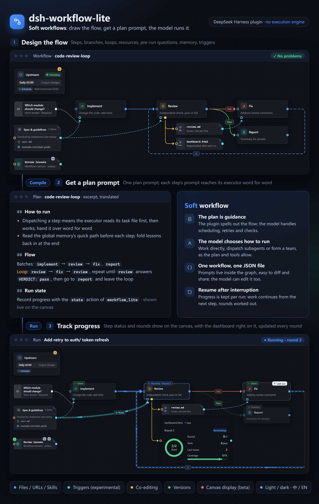
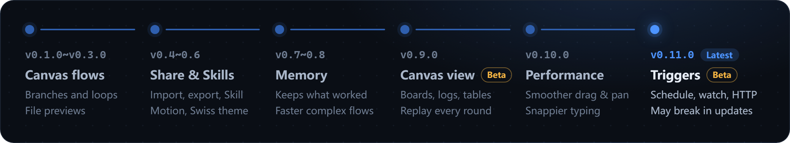

<div align="center">
  <br>
  
</div>

<div align="center">

[简体中文](./README.md) | English

</div>

<div align="center">

[](https://www.npmjs.com/package/@xiaoso/dsh-workflow-lite)
[](./LICENSE)
[](https://nodejs.org)
[](https://github.com/deepseek-ai/deepseek-harness)
[](https://xiaoso456.github.io/dsh-workflow-lite/)

</div>

A soft-workflow plugin for [DeepSeek Harness](https://github.com/deepseek-ai/deepseek-harness) that turns the way a model works into a workflow you can see and edit. Design it on the canvas yourself or let the model draw it; then run it, run it automatically on a schedule, or export it as a procedural skill to share. Edges can carry **any condition**, and flows can be sequential, parallel, joined, conditionally branched, looped or rolled back, with no extra execution engine required.

> **Experimental**: features and data formats are still changing, and any release may include breaking changes.

**Documentation**: <https://xiaoso456.github.io/dsh-workflow-lite/> (installation, first steps, canvas display and settings, with screenshots).



[](./CHANGELOG.md)

## Install

Works with DeepSeek Harness 0.2.0, 0.2.1 and 0.2.2, including their preview builds (such as 0.2.2-rc.1).

### Web

Requires Node.js 24.9 or later.

```bash
dsh plugin --profile web add @xiaoso/dsh-workflow-lite
dsh web
```

### Desktop

1. Open **Plugins** in the sidebar, then click **Add plugin** → **Install a third-party plugin**.
2. Enter `@xiaoso/dsh-workflow-lite` and click **Install**.
3. Restart DeepSeek Harness.

Once installed, a **Workflow** tab appears at the top of the session page.

## Use cases

### Make procedural skills visible

Many procedural skills are written by a model after it works through a task once, and a person can hardly tell how many steps they have, where they branch or loop, or what each step reads and writes. Built as a workflow, the process is drawn on the canvas: easy to follow, editable in place, and runnable as is. Once it runs smoothly, export it as a skill that works without the plugin, or pack it with the files it uses and share it.

### Automated tasks (experimental)

> Every morning at 9, check whether main has new commits; if so, review them and write the report to reports/.

The model builds the workflow and a trigger card, writes the check script, test-runs it to confirm it fires, and then switches it on. Trigger history and output are on the **Triggers** page of the Workflow hub. Triggers are still experimental and may break in future versions; see [Experimental features](#experimental-features).

### Loops with conditions in plain language

A condition on an edge is just a sentence, judged by the model at run time, with no expressions or code to write. When to go back, which step to go back to, and when to stop all follow that sentence.

> Create a workflow: design an approach, then write the code and review it; if the review fails, go back and fix it, and if the same problem is still there after two fixes, go back to the design step and try another approach. At most five rounds.

### Follow long tasks

Turn on **Record run state** in **Workflow settings** and progress shows on the canvas as it happens. With canvas display (beta), dashboards, logs and tables update during the run, and every round of a loop can be reviewed and compared. Run records are managed in the **Workflow hub**, opened from the top-left corner of the canvas.

## Usage

### Ask the model

Describe the flow in one sentence in the conversation (see the use cases above for examples). The model creates the workflow and the canvas shows it as it is built. When it looks right, click **Run** in the top-right corner, or ask the model to run it.

### Edit by hand

1. Open the **Workflow** tab and create a workflow.
2. Drag steps from the library on the left onto the canvas, fill in their prompts, and connect them.
3. Click **Run** in the top-right corner, or ask the model in the conversation to run the workflow.

## Features

| Feature | Description |
|---|---|
| Canvas editing | Drag steps and connect them, with pass / fail branches and loops; tidy the layout in one click |
| Resources | Attach files, folders, URLs or Skills that a step reads or writes |
| Pre-run questions | Collect the information a run needs from the user; answers are passed to the model with the plan |
| Model co-editing | The model can create and edit workflows directly, and the canvas updates live |
| Run state | Progress appears on the canvas as it happens; read each step's summary, adjust its state, and the model is notified |
| Canvas display (beta) | Dashboards, images, documents, logs, tables and folders show right on the canvas and update during a run; review and compare each round of a loop |
| File preview | Open a run's resources in place: Markdown, HTML pages (make one a dashboard updated every round to follow a loop's output), images; browse folders in a two-pane view |
| Versions | Save versions with notes, compare differences, switch back at any time |
| Import / export | Pack a workflow and the versions you pick into one `.wflite.zip`, optionally with the files and Skills it uses; before importing, see where each item will go |
| Export as a Skill | Compile one version into a skill (SKILL.md, a task description per step, plus the files and Skills you pack) that works without the plugin; download a zip or install it straight into `~/.agents/skills` |
| Memory | A workflow keeps what worked and its pitfalls as a skill and follows it on the next run; manage and version it on the **Memory** page, and export it with a workflow pack |
| Triggers (experimental) | Run a workflow automatically on a schedule, when a check command succeeds, when a long-running program prints a `::trigger::` line, on an HTTP request, or after another workflow finishes; the model can set one up and test it for you |
| Workflow hub | One place for run records across sessions, all workflows and their versions, triggers, and plugin settings; tag workflows and group or filter by tag |
| Interface | Four light and four dark color themes that follow DSH light or dark mode; English / 中文 |

## Path variables

Resource paths and the output root accept two variables, replaced with real locations at run time:

| Variable | Where | Becomes |
|---|---|---|
| `{workflow}` | File and folder paths in resources, e.g. `{workflow}/refs/notes.md` | The workflow's own folder (by default `~/.dsh/workflow-lite/assets/<workflow name>/`). Every workspace reads and writes the same copy, and it moves with the workflow when you rename or export it |
| `{instance}` | **Output root** in **Workflow settings**, e.g. the default `.workflow-lite/runs/{instance}/out` | The id of this run's instance, so each run keeps its outputs apart |

Paths written as `{assets}/…` by earlier versions still work and become `{workflow}/…` when the workflow is opened.

## Experimental features

These features are still being tried out, and their behavior and data formats may change. **Canvas display** in the feature table above is in beta: mostly stable, with details still being polished.

### Triggers

Run a workflow automatically when something happens, instead of clicking **Run** each time.

> **Likely to break in future versions.** Trigger cards and their settings will still change; after updating the plugin you may need to set up or rebuild your triggers again. Don't rely on them for automation you can't do without.

- **Use**: drag **Trigger** from **Basics** in the step library onto the canvas and pick how it fires: Schedule (optionally running a check command first), Watch, HTTP or After. You can also ask the model; it writes the script, test-runs it, and switches it on once it works.
- **Manage**: the **Triggers** page in the Workflow hub shows every trigger's state, trigger history and recent output, and can pause them all.
- **Export**: triggers are left out by default; switch them on to pick cards one by one. Each card keeps its on/off state in the pack; on import the switches start from that state and can be changed card by card. Secrets used by scripts are left out unless you tick them, and then go into the pack as plain text.
- **Limits**: triggers only fire while DSH is running. Check commands and watchers run on this machine as the DSH process, outside the sandbox, and start as soon as you switch the card on, so only enable commands you trust.

## How it works

1. **Design**: arrange steps on the canvas, write the prompt each executor receives, and describe the flow with branches and loops.
2. **Compile**: the plugin turns the workflow into one plan prompt that states the order of work, loop conditions, and each step's inputs and outputs.
3. **Run**: the model decides how to carry out the plan (working directly, dispatching subagents or forming a team) and reports progress back to the canvas.

The plugin ships no execution engine and needs no extra service; scheduling and judgement stay with the model in your current session.

## License

[MIT](./LICENSE) © xiaoso
