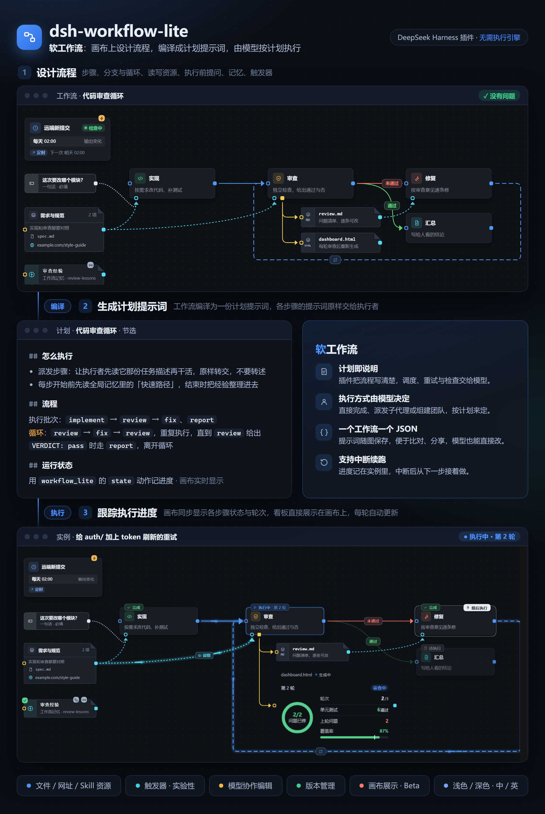
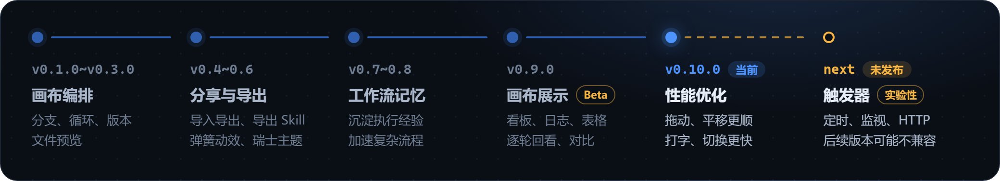

<div align="center">
  <br>
  
</div>

<div align="center">

简体中文 | [English](./README.en.md)

</div>

<div align="center">

[](https://www.npmjs.com/package/@xiaoso/dsh-workflow-lite)
[](./LICENSE)
[](https://nodejs.org)
[](https://github.com/deepseek-ai/deepseek-harness)
[](https://xiaoso456.github.io/dsh-workflow-lite/)

</div>

[DeepSeek Harness](https://github.com/deepseek-ai/deepseek-harness) 的软工作流插件：把模型做事的流程画成看得见、改得动的工作流。可以在画布上自己设计，也可以让模型来画；画好后照着执行、定时自动执行，或导出成流程性 skill 分享。连线可带**任意条件**，支持顺序、并行、汇合、条件分支、循环、回退等流程结构，无需额外的执行引擎。

> **实验阶段**：功能和数据格式仍在调整，后续任何版本都可能包含不兼容的改动。

**使用文档**：<https://xiaoso456.github.io/dsh-workflow-lite/>——安装、上手、画布展示和各项设置，带截图。



[](./CHANGELOG.md)

## 安装

适配 DeepSeek Harness 0.2.0、0.2.1 与 0.2.2，包括它们的各个预览版（如 0.2.2-rc.1）。

### 网页版

需要 Node.js 24.9 及以上。

```bash
dsh plugin --profile web add @xiaoso/dsh-workflow-lite
dsh web
```

### 桌面端

1. 在侧边栏打开「**插件**」，点击「**添加插件**」→「**安装第三方插件**」。
2. 填入 `@xiaoso/dsh-workflow-lite`，点击「**安装**」。
3. 重启 DeepSeek Harness。

安装完成后，会话页顶部会出现「**工作流**」标签页。

## 典型场景

### 让流程性 skill 看得见

流程性 skill 很多是模型自己走一遍后写下来的，人很难看出里面分几步、哪里分支、哪里循环、每一步读写什么。用工作流来做，流程就画在画布上：看得懂、能直接改，也能照着执行。跑顺之后导出成 skill，不装插件也能用；也可以连同用到的文件一起打包分享。

### 自动化任务（实验性）

> 每天早上 9 点看看 main 有没有新提交，有的话审查一遍，报告写到 reports/。

模型会建好工作流和触发卡片，写好检查脚本，先试跑一次确认会触发，再打开开关。之后在工作流中心的「触发」页查看触发记录和输出。触发器还在试验，后续版本可能不兼容，见[实验性功能](#实验性功能)。

### 用自然语言写条件的循环

连线上的条件就是一句话，由模型在执行时判断，不用写成表达式或代码。什么时候回退、回到哪一步、什么时候停，都按这句话来。

> 建一个工作流：先设计方案，再写代码、审查；审查不通过就回去修复，同一个问题连修两轮还没好，就回到设计那一步换个方案。最多五轮。

### 长任务看进度

在「工作流设置」中开启「**记录运行状态**」后，执行进度实时显示在画布上。配合画布展示（Beta），看板、日志、表格随执行更新，循环每一轮的产出都可以回看、对比。执行记录统一在画布左上角的「**工作流中心**」中管理。

## 使用

### 让模型创建

在对话中用一句话描述流程（例子见上面的典型场景），模型会创建工作流，画布上会同步显示。检查无误后，点击右上角「**执行**」，或让模型直接执行。

### 手动编辑

1. 打开「工作流」标签页，新建一个工作流。
2. 从左侧步骤库将步骤拖到画布上，填写提示词并连线。
3. 点击右上角「**执行**」，或在对话中请模型执行该工作流。

## 功能

| 功能 | 说明 |
|---|---|
| 画布编辑 | 拖拽步骤与连线，支持「通过 / 不通过」分支和循环，一键整理布局 |
| 资源 | 为步骤指定要读写的文件、文件夹、网址或 Skill |
| 执行前提问 | 执行前向用户收集必要信息，答案随计划交给模型 |
| 模型协作编辑 | 模型可以直接创建、修改工作流，画布实时同步 |
| 运行状态 | 执行进度实时显示在画布上；可查看每一步的摘要、调整状态并通知模型 |
| 画布展示（Beta） | 看板、图片、文档、日志、表格和文件夹直接显示在画布上，执行时自动更新；循环每一轮的产出可以回看、对比 |
| 文件预览 | 实例里的资源点开就能看：Markdown、HTML 页面（可做成每轮更新的看板，随时查看循环产出）、图片；文件夹分左右两栏浏览 |
| 版本管理 | 保存版本、添加说明、对比差异、随时切换 |
| 导入导出 | 把工作流和选中的版本打成一个 `.wflite.zip`，可以连同用到的文件与 Skill 一起打包；导入前列出每样东西放到哪 |
| 导出成 Skill | 把一个版本编译成 skill（SKILL.md + 每步的任务描述 + 打包的文件与 Skill），不装插件也能用；下载 zip，或直接装到本机的 `~/.agents/skills` |
| 记忆 | 工作流把跑通的做法和踩过的坑记成 skill，下次执行照着走；可以在「记忆」页管理、存版本，随工作流包导出 |
| 触发器（实验性） | 定时、到点先跑一条命令看结果、常驻程序打出一行 `::trigger::`、收到 HTTP 请求或另一个工作流跑完时自动执行；可以在对话里让模型建好、试好 |
| 工作流中心 | 集中管理各会话的执行记录、全部工作流与版本、触发器，以及插件设置；工作流可以加标签、分组筛选 |
| 界面 | 浅色、深色各四套配色主题，跟随 DSH 自动切换；中文 / English |

## 路径变量

资源里的路径和产出根目录可以写下面两个变量，执行时换成实际的位置：

| 变量 | 写在哪 | 换成什么 |
|---|---|---|
| `{workflow}` | 资源里的文件、文件夹路径，如 `{workflow}/refs/notes.md` | 这个工作流自己的目录（默认 `~/.dsh/workflow-lite/assets/<工作流名>/`）。在哪个工作区执行都读写同一份，工作流改名、导出时一起带走 |
| `{instance}` | 「工作流设置」里的「产出根目录」，如默认值 `.workflow-lite/runs/{instance}/out` | 这次执行的实例 id，每次执行的产出各放一处 |

旧版本写的 `{assets}/…` 照样能用，打开工作流时会自动改成 `{workflow}/…`。

## 实验性功能

下面的功能还在试验，行为和数据格式后续可能调整。上面功能表里的「画布展示」是 Beta：基本稳定，细节还会打磨。

### 触发器

让工作流在某件事发生时自动执行，不用每次手动点「执行」。

> **后续版本很可能不兼容。** 触发卡片的格式和设置还会改，升级插件后可能要重新设置或重建触发器；别拿它承担离不开的自动化。

- **使用**：从步骤库「基础」把「触发」拖到画布上，选触发方式：定时（可以先跑一条检查命令）、监视、HTTP、接续；也可以在对话里让模型建，模型会写好脚本、试跑确认之后再打开。
- **管理**：在工作流中心的「触发」页查看所有触发器的状态、触发记录和最近的输出，可以全部暂停。
- **导出**：导出时默认不带触发器，打开后逐张选择；开关状态随包带走，导入时按导出时的状态预选、可以逐张调整；脚本用的密钥默认不带，勾上才以明文打进包里。
- **限制**：只在 DSH 运行期间触发；检查命令和监视程序以 DSH 的身份在本机运行、不进沙箱，打开开关就开始运行，只启用信得过的命令。

## 工作原理

1. **设计**：在画布上编排步骤，为每一步写好交给执行者的提示词，用分支和循环描述流程。
2. **编译**：插件把工作流整理成一份计划提示词，写明执行顺序、循环条件、每一步的输入与产出。
3. **执行**：模型按计划自行安排执行方式（直接完成、派发子代理或组建团队），并把进度同步回画布。

插件本身不包含执行引擎，也无需额外服务；调度与判断交由当前会话中的模型完成。

## License

[MIT](./LICENSE) © xiaoso
