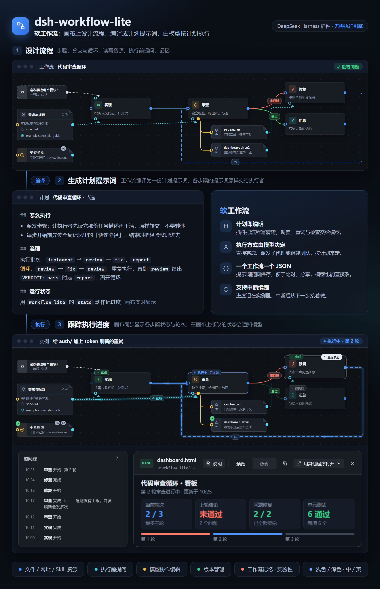
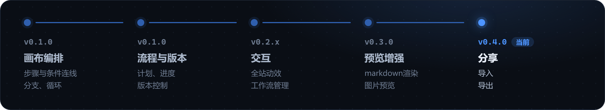

<div align="center">
  <br>
  
</div>

<div align="center">

简体中文 | [English](./README.en.md)

</div>

<div align="center">

[](https://www.npmjs.com/package/@xiaoso/dsh-workflow-lite)
[](./LICENSE)
[](https://nodejs.org)
[](https://github.com/deepseek-ai/deepseek-harness)

</div>

[DeepSeek Harness](https://github.com/deepseek-ai/deepseek-harness) 的软工作流插件，基于提示词编排：在画布上设计流程，编译成计划提示词，由模型按计划执行。连线可带**任意条件**，支持顺序、并行、汇合、条件分支、循环、回退等流程结构，无需额外的执行引擎。

> **实验阶段**：功能和数据格式仍在调整，后续任何版本都可能包含不兼容的改动。



[](./CHANGELOG.md)

## 安装

适配 DeepSeek Harness 0.2.0 与 0.2.1，包括它们的各个预览版（如 0.2.1-rc.2）。

### 网页版

需要 Node.js 22 及以上。

```bash
dsh plugin --profile web add @xiaoso/dsh-workflow-lite
dsh web
```

### 桌面端

1. 在侧边栏打开「**插件**」，点击「**添加插件**」→「**安装第三方插件**」。
2. 填入 `@xiaoso/dsh-workflow-lite`，点击「**安装**」。
3. 重启 DeepSeek Harness。

安装完成后，会话页顶部会出现「**工作流**」标签页。

## 使用

### 让模型创建

在对话中用一句话描述流程，例如：

> 建一个工作流：先写代码，再审查，审查不通过就回去修复，最多三轮。

模型会创建工作流，画布上会同步显示。检查无误后，点击右上角「**执行**」，或让模型直接执行。

### 手动编辑

1. 打开「工作流」标签页，新建一个工作流。
2. 从左侧步骤库将步骤拖到画布上，填写提示词并连线。
3. 点击右上角「**执行**」，或在对话中请模型执行该工作流。

### 跟踪进度

在「工作流设置」中开启「**记录运行状态**」，此后每次执行都会生成一条记录，画布随进度更新。执行记录、工作流与版本统一在画布左上角的「**工作流中心**」中管理。

## 功能

| 功能 | 说明 |
|---|---|
| 画布编辑 | 拖拽步骤与连线，支持「通过 / 不通过」分支和循环，一键整理布局 |
| 资源 | 为步骤指定要读写的文件、文件夹、网址或 Skill |
| 执行前提问 | 执行前向用户收集必要信息，答案随计划交给模型 |
| 模型协作编辑 | 模型可以直接创建、修改工作流，画布实时同步 |
| 运行状态 | 执行进度实时显示在画布上；可查看每一步的摘要、调整状态并通知模型 |
| 文件预览 | 实例里的资源点开就能看：Markdown、HTML 页面（可做成每轮更新的看板，随时查看循环产出）、图片；文件夹分左右两栏浏览 |
| 版本管理 | 保存版本、添加说明、对比差异、随时切换 |
| 导入导出 | 把工作流和选中的版本打成一个 `.wflite.zip`，可以连同用到的文件与 Skill 一起打包；导入前列出每样东西放到哪 |
| 导出成 Skill（实验性） | 把一个版本编译成 skill（SKILL.md + 每步的任务描述 + 打包的文件与 Skill），不装插件也能用；下载 zip，或直接装到本机的 `~/.agents/skills` |
| 记忆（实验性） | 工作流把跑通的做法和踩过的坑记成 skill，下次执行照着走；可以在「记忆」页管理、存版本，随工作流包导出 |
| 工作流中心 | 集中管理各会话的执行记录、全部工作流与版本，以及插件设置 |
| 界面 | 浅色、深色各四套配色主题，跟随 DSH 自动切换；中文 / English |

## 工作流记忆（实验性）

复杂的工作流每次执行都要重新摸一遍环境、重新踩一遍坑。记忆让工作流把跑通的做法记下来，下次照着走，目的是加快复杂工作流的执行。

- **怎么加**：给单个步骤开一份（在步骤上开启，或点步骤右侧的「＋」选「记忆」），或从步骤库的「基础」里把「记忆」拖到画布上，作为整个工作流共用的一份。加的时候选已有的一条，或新建一条；多个工作流可以共用同一条。
- **记什么**：一条记忆是一个 skill 文件夹。`SKILL.md` 开头的「快速路径」是下次最省事的走法，一串可以直接复制的命令或脚本调用；后面是步骤、踩过的坑和验证方法，常用的脚本和模板放在同一个文件夹里。
- **谁来写**：每个步骤把学到的经验写在回复里，工作流结束时由模型整理进记忆，不需要自己动手。
- **怎么管**：工作流中心的「记忆」页可以改名称和描述、查看文件、存版本、切回旧版本，也能看哪些工作流在用；导出工作流包或 Skill 时，可以选带不带记忆的内容。
- **已知限制**：多个实例同时改同一条记忆不加锁，后写的会盖掉先写的；重新导出并覆盖安装 Skill 时，已装 skill 里攒下的记忆会被覆盖。

**效果还在验证，欢迎反馈。** 早期在同一个工作流上重复执行的试验里，没有看到稳定的提速；后来加入了「快速路径」，是否有用需要更多真实的工作流来检验。如果你在复杂工作流上用了记忆，请到 [Issues](https://github.com/xiaoso456/dsh-workflow-lite/issues) 说说：同一个工作流前后几次执行的耗时有没有变化，记忆里记下的内容有没有用，哪里不好用。

## 路径变量

资源里的路径和产出根目录可以写下面两个变量，执行时换成实际的位置：

| 变量 | 写在哪 | 换成什么 |
|---|---|---|
| `{workflow}` | 资源里的文件、文件夹路径，如 `{workflow}/refs/notes.md` | 这个工作流自己的目录（默认 `~/.dsh/workflow-lite/assets/<工作流名>/`）。在哪个工作区执行都读写同一份，工作流改名、导出时一起带走 |
| `{instance}` | 「工作流设置」里的「产出根目录」，如默认值 `.workflow-lite/runs/{instance}/out` | 这次执行的实例 id，每次执行的产出各放一处 |

旧版本写的 `{assets}/…` 照样能用，打开工作流时会自动改成 `{workflow}/…`。

## 工作原理

1. **设计**：在画布上编排步骤，为每一步写好交给执行者的提示词，用分支和循环描述流程。
2. **编译**：插件把工作流整理成一份计划提示词，写明执行顺序、循环条件、每一步的输入与产出。
3. **执行**：模型按计划自行安排执行方式（直接完成、派发子代理或组建团队），并把进度同步回画布。

插件本身不包含执行引擎，也无需额外服务；调度与判断交由当前会话中的模型完成。

## License

[MIT](./LICENSE) © xiaoso
