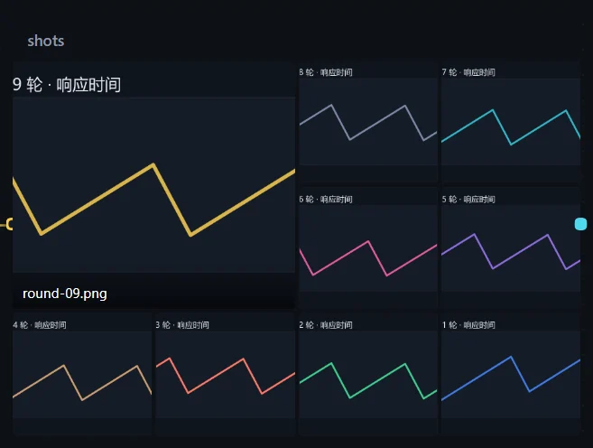
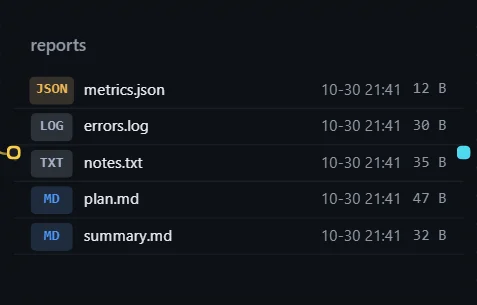

文件夹资源打开「在画布上展示」后，可以排成图片墙或文件列表。步骤把图片产出到同一个文件夹，画布上就能从新到旧看到每一张。

## 使用

1. 选中含文件夹的资源卡，打开「在画布上展示」。
2. 在「画布展示设置」选择「展示」方式。
3. 点击图片墙里的某一张，在查看框里浏览。

文件夹为空时显示「文件夹是空的」；文件太多只列一部分，提示「还有 N 项」。

## 设置

| 配置项 | 说明 |
|---|---|
| 展示 | 「自动」（有图片排墙，否则列文件）、「图片墙」、「文件列表」。 |
| 匹配 | 按名字筛选，`*` 代表任意字，用逗号隔开多个，如 `*.png, report-*`。 |
| 顺序 | 「最新在前」「按文件名」「按大小」。 |
| 图片墙排法 | 「图墙」「大图 + 胶片」「最新一张」。 |
| 张数 | 「自动」跟着卡片大小；「固定」指定几列几行，拖大卡片只放大格子。 |
| 最新一张放大 | 第一张占两列两行，至少需要三列两行。 |
| 文件列表排法 | 「列表」或「格子」，可选「显示修改时间」。 |

## 在实例里浏览

点开文件夹资源进入左右两栏：左边是路径栏、筛选框和文件列表，右边预览 Markdown、HTML 和图片。

- 键盘：上下键选择，右键或回车进入，左键或 Backspace 返回。
- 筛选框无结果时提示「没有名字里含『…』的项」。

## 注意

选择文件夹的窗口只列出文件夹；什么都不勾选时主按钮是「选当前文件夹」，勾选后变成「添加」。
