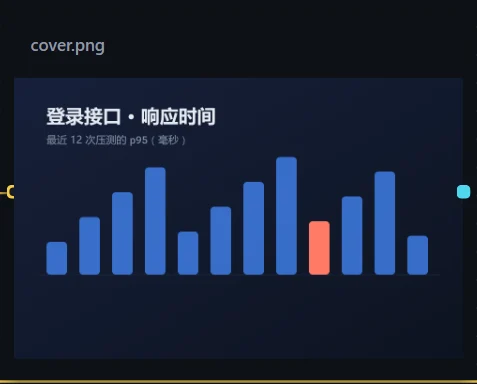
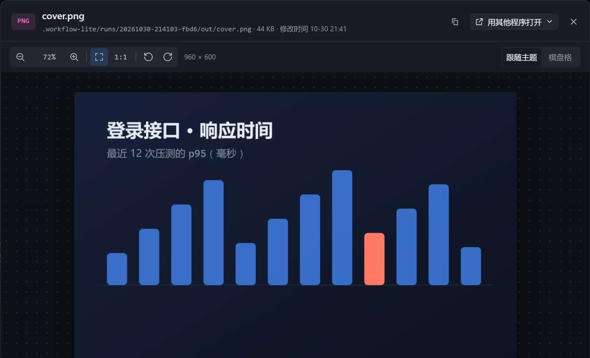

适合把步骤生成的图表、截图、渲染结果放在画布上，随执行更新。

## 使用

选中指向图片文件的资源卡，打开「在画布上展示」。执行后换成最新一张。

## 摆放

在「画布展示设置」的「摆放」里选择：

| 选项 | 效果 |
|---|---|
| 适应（默认） | 整张图可见，小图不放大。 |
| 填满 | 铺满卡片，超出的部分裁掉。 |
| 原大 | 按原始尺寸显示，只有这一项可以用「缩放」。 |

开启「隐藏标题」后，卡片没有选中、没有悬停时标题淡出，图片更干净。

## 查看框

双击卡片打开查看框：

| 操作 | 方式 |
|---|---|
| 缩放 | 滚轮，或工具栏的放大、缩小。 |
| 平移 | 拖动。 |
| 适应与原大 | 双击切换；`0` 适应窗口，`1` 原大。 |
| 旋转 | `R` 顺时针，`Shift+R` 逆时针。 |
| 背景 | 右上角可换成棋盘格，便于看透明图的边缘。 |
| 关闭 | `Esc`。 |

## 注意

- 让写图片的步骤按卡片比例出图（「让模型适配展示」默认开启），卡片里看起来更合适。
- 循环里每一轮的图片会各存一版，可并排或拖动分隔线对比，见[各轮产出回看](/dsh-workflow-lite/display/rounds/)。
