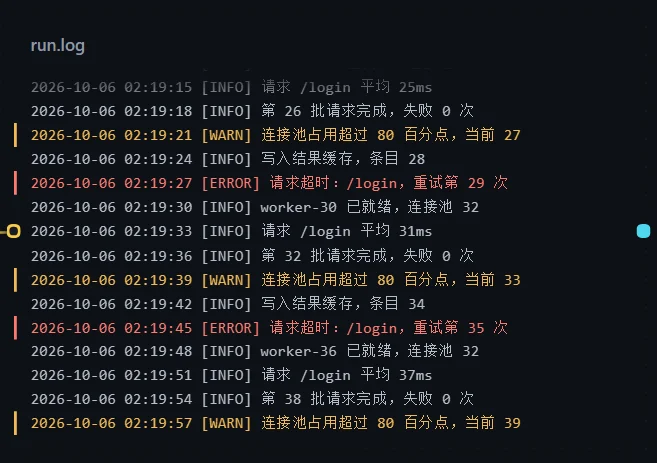
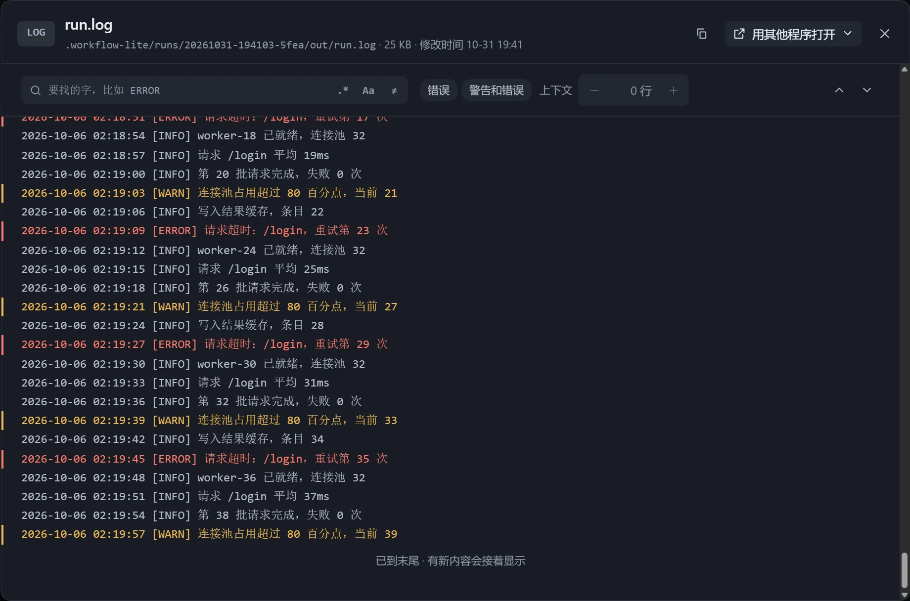

写日志的步骤执行时，卡片停在末尾并跟着新内容滚动，右上角显示「生成中」。文件很大时只读取看得到的几百行，更新时只读新增部分。

## 显示

- 按行折行，续行缩进；代码、配置、表格不折行。
- 往上翻看时不会被拉回，底部出现「回到最新」，并提示有几行新内容。
- 错误行标红，警告行标黄（可用「错误、警告着色」关闭）。
- 「位置」选「自动」（日志和很大的文件停在末尾，其他从头）、「末尾」或「开头」。
- 「让模型适配展示」开启时，写日志的步骤一行写一条，并带上时间和级别。

## 只看

在「画布展示设置」使用「只看」，只显示匹配的行，卡片左上角显示匹配行数。

| 选项 | 说明 |
|---|---|
| 要找的字 | 只显示包含它的行。 |
| 按正则 | 把输入当正则，写法不对时提示原因。 |
| 区分大小写 | 默认不区分。 |
| 反选 | 只看不匹配的行。 |
| 上下文 | 每处匹配前后各带 0–10 行，需先填要找的字。 |
| 现成筛选 | 「错误」「警告和错误」。 |

匹配从末尾往前找，最多最近 64 MB。

## 查看框

- 沿用卡片上的筛选；点击某一行，清掉筛选并定位到全文中的那一行。
- Ctrl+F 直接修改筛选。
- 滚到头自动接着读，几百 MB 的日志也不卡。
