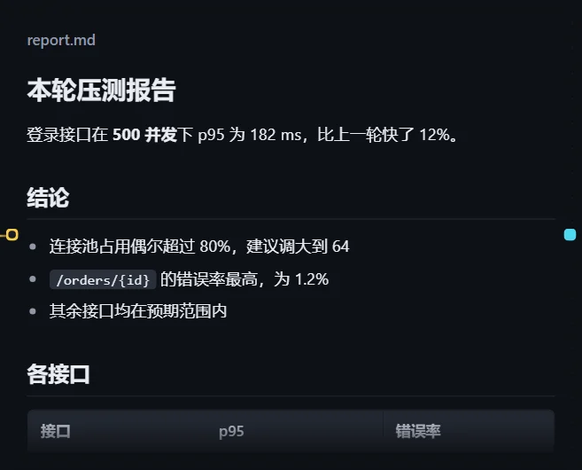
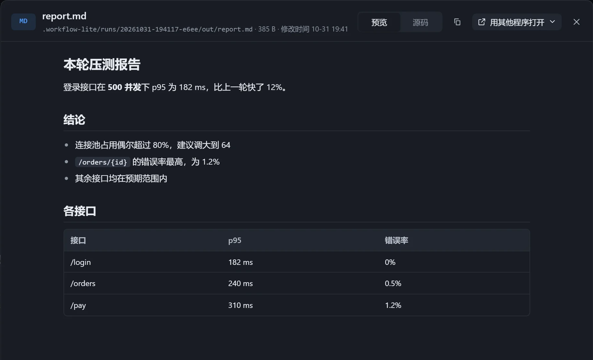

步骤写出的 Markdown 报告，在卡片里按排版显示：标题、列表、表格、代码。资源里的「自定义」文字也同样渲染。

## 使用

选中指向 `.md` 文件的资源卡，打开「在画布上展示」，尺寸选「中」或「大」。「缩放」调整的是字号。

## 查看框

双击卡片打开查看框，可在「预览」与「源码」间切换。

## 注意

- 报告里按相对路径引用的图片可以显示。
- 循环里每一轮的报告会各存一版，可在查看框用「版本」逐行对比，或并排比较排版，见[各轮产出回看](/dsh-workflow-lite/display/rounds/)。
- 「让模型适配展示」开启时，报告会把结论写在最前面。
