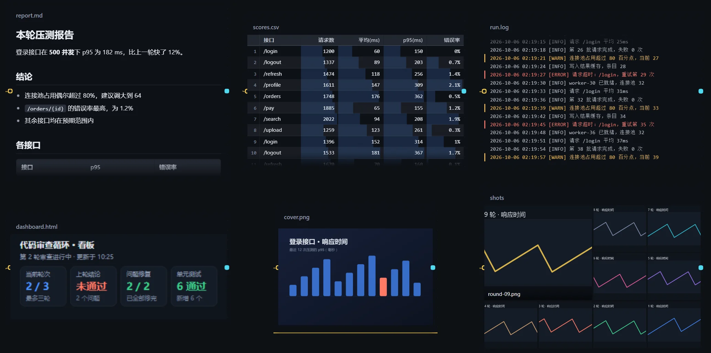
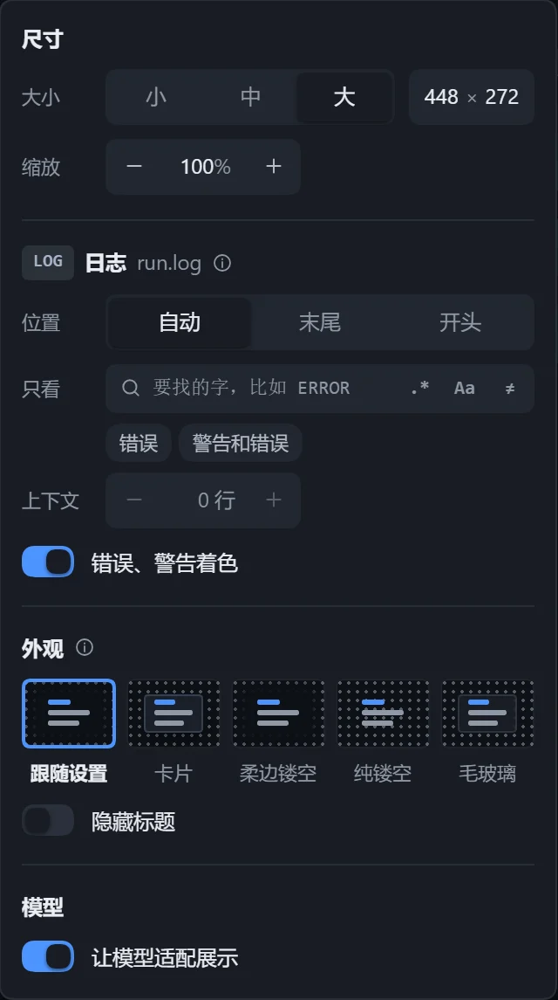
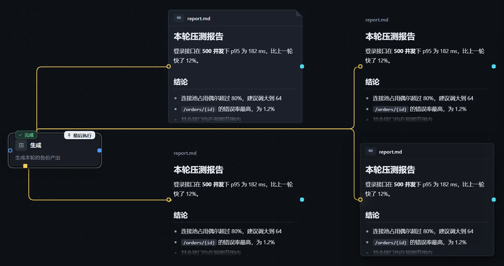

打开「在画布上展示」后，资源卡变成一块展示区：步骤写出的文件执行后自动显示在画布上，更新后自动换成最新内容。看板、报告、截图、日志不用再一个个打开文件。

## 支持的内容

| 内容 | 页面 |
|---|---|
| 图片 | [图片](/dsh-workflow-lite/display/image/) |
| HTML 网页、看板 | [网页与看板](/dsh-workflow-lite/display/web/) |
| Markdown | [Markdown](/dsh-workflow-lite/display/markdown/) |
| 日志、纯文本 | [日志与纯文本](/dsh-workflow-lite/display/log/) |
| CSV、TSV | [表格](/dsh-workflow-lite/display/table/) |
| JSON、代码、配置 | [JSON、代码与配置](/dsh-workflow-lite/display/text/) |
| 文件夹 | [文件夹与图片墙](/dsh-workflow-lite/display/folder/) |

网址和 Skill 不能展示。循环里每一轮的产出还可以回看对比，见[各轮产出回看](/dsh-workflow-lite/display/rounds/)。

## 打开展示

1. 选中资源卡，在右侧面板打开「在画布上展示」。资源里有多项内容时，用「内容」选择展示哪一项。
2. 拖动卡片右下角改大小；按住 Ctrl 拖动是缩放。
3. 点击「调整」，或点击卡片标题栏的设置按钮，打开「画布展示设置」，改动当场生效。

## 在卡片里查看

- 点击「交互」，可以在卡片里滚动、点击网页，Esc 退出。
- 双击展示区，打开完整的查看框，可在「预览」与「源码」间切换，也可「用其他程序打开」「在文件管理器中显示」「复制路径」。
- 文件更新后，卡片自动换成最新内容，右上角亮起「刚更新」，新写进来的部分高亮一下再淡去。

| 卡片显示 | 含义 |
|---|---|
| 执行后显示 | 还没执行过，显示一张淡色草图。 |
| 正在生成 | 写这个文件的步骤正在执行。 |
| 还没生成、读取失败 | 文件不存在，或读取失败。 |
| 文件太大，画布上放不下 | 超出上限，用查看框或其他程序打开。 |

工作流画布（不是实例）上，卡片显示最近一次执行的内容，悬停标题栏可看到执行时间。

## 画布展示设置

浮层按「尺寸」、内容、「外观」、「模型」分组，只列出当前内容用得上的选项。

| 配置项 | 说明 |
|---|---|
| 大小 | 小、中、大，或「自定义」宽（160–1600）和高（100–1200）。 |
| 缩放 | 25%–400%，默认 100%。 |
| 外观 | 「跟随设置」或单独指定，见下文。 |
| 隐藏标题 | 未选中、未悬停时标题淡出，适合图片、贴纸这类内容。 |
| 让模型适配展示 | 默认开启，让写文件的步骤知道卡片多大，在卡片里和单独打开时都好看。 |

默认尺寸（宽 × 高）：

| 内容 | 小 | 中 | 大 |
|---|---|---|---|
| 图片、文件夹 | 208 × 136 | 320 × 216 | 448 × 296 |
| 网页 | 208 × 128 | 320 × 176 | 448 × 256 |
| Markdown | 208 × 160 | 320 × 232 | 448 × 320 |
| 文本 | 208 × 128 | 320 × 192 | 448 × 272 |

## 四种外观

同一份 Markdown，从左到右、从上到下依次是卡片、柔边镂空、纯镂空、毛玻璃。

| 外观 | 效果 |
|---|---|
| 卡片 | 带边框和标题行。 |
| 柔边镂空（默认） | 内容透明地贴在画布上，下方画布淡出。 |
| 纯镂空 | 连画布点阵也透过来。 |
| 毛玻璃 | 半透明卡面，后面的画布模糊透出。 |

默认外观在「工作流中心 → 设置 → 外观」选择，见[插件设置与配色](/dsh-workflow-lite/settings/plugin/)。

## 注意

- 文本支持 GBK、带 BOM、UTF-16 编码，终端颜色码不会原样显示。
- 导出为 Skill 时，「让模型适配展示」不会带出。
