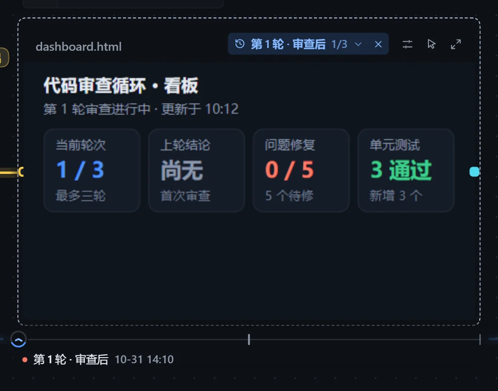

循环里反复执行时，写出产出文件的步骤每做完一轮就保存一个版本，可以回看，也可以挑两轮对比。只在插件里执行时可用，导出为 Skill 后不保存。

## 在展示卡上回看

实例画布上，鼠标移到存过两版以上的展示卡上（或选中它），卡片底下出现一条刻度轴，标题行写出现在看的是哪一版。

| 操作 | 效果 |
|---|---|
| 在刻度轴上悬停到某一版，或按住拖过去 | 卡片换成那一版，鼠标移开后保持不变 |
| 点击标题行的版本名称 | 列出各版，悬停预览，点击选定 |
| 点击标题行的「✕」 | 回到最新；停在旧版本期间有新一版时，「✕」上出现提示点 |
| 键盘 ← → Home End | 切换相邻一版、到头尾 |

- 一版一道刻度。表盘停在卡片显示的那一版上，表圈走到「第几版 / 共几版」，换版时沿着刻度轴滚过去。
- 刻度下方写出这一版的名称和保存时间，评审过的前面带一个圆点，通过和不通过各一色。
- 停在旧版本时，标题行的名称变成强调色。
- 各轮名称形如「第 2 轮 · 审查后」，失败的带「（失败）」。

## 对比

在查看框点击「版本」，可查看任意一轮，或挑两轮作为「旧」和「新」对比。

| 方式 | 适用 | 说明 |
|---|---|---|
| 差异 | 文本 | 逐行标出增删，没变的行折叠。 |
| 并排 | Markdown、网页、图片 | 两版并排比较排版。 |
| 滑动 | 图片 | 拖动分隔线比较。 |

## 存储

- 每份产出最多保存 20 版，超过时保留第一版和最近几版，提示「中间省略了 N 版」。
- 占用空间在「工作流中心 → 存储」查看，可「清空」，现在的产出文件不动。
- 删除实例时各轮版本一起删除。
