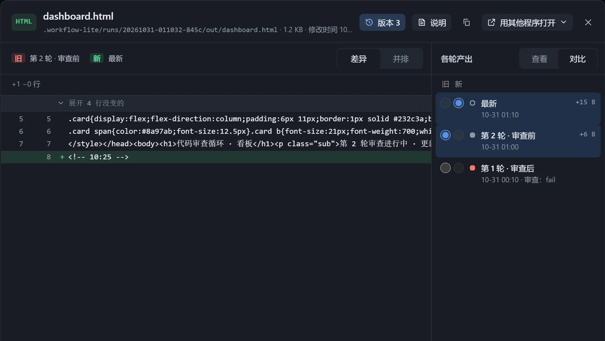

循环里反复执行时，写出产出文件的步骤每做完一轮就保存一个版本，可以回看，也可以挑两轮对比。只在插件里执行时可用，导出为 Skill 后不保存。

## 在展示卡上回看

实例画布上，展示卡左下角有一排点，每个点是一轮。

- 悬停预览，点击钉住，方向键切换相邻轮次。
- 点击「回到最新」返回；有新一版时提示「有新的一版」。
- 各轮按评审结果标成通过或不通过，失败的带「（失败）」。

## 对比

在查看框点击「版本」，可查看任意一轮，或挑两轮作为「旧」和「新」对比。

| 方式 | 适用 | 说明 |
|---|---|---|
| 差异 | 文本 | 逐行标出增删，没变的行折叠。 |
| 并排 | Markdown、网页、图片 | 两版并排比较排版。 |
| 滑动 | 图片 | 拖动分隔线比较。 |

## 存储

- 每份产出最多保存 20 版，超过时保留第一版和最近几版，提示「中间省略了 N 版」。
- 占用空间在「工作流中心 → 存储」查看，可「清空」，现在的产出文件不动。
- 删除实例时各轮版本一起删除。
