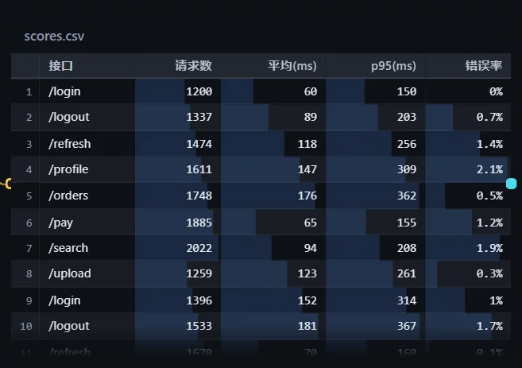
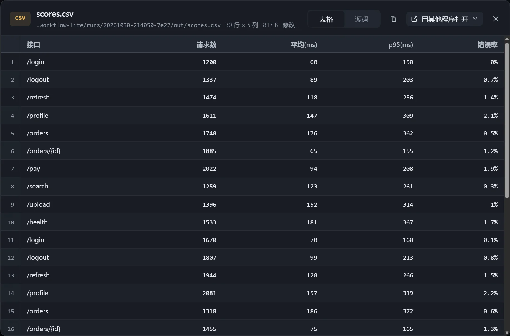

CSV、TSV 在卡片里排成表格：表头和行号固定，数字列右对齐。

## 设置

在「画布展示设置」里调整：

| 选项 | 说明 |
|---|---|
| 位置 | 看开头或末尾；自动时，写它的步骤正在运行就看最后几行，否则从头看。 |
| 列 | 隐藏或显示某一列，只影响卡片，查看框仍显示全部。 |
| 数字列画条 | 数字列格子下垫一条按大小比例的浅条，不用读数也能比较。 |
| 排序 | 选一列排序，或选「原顺序」；交互时点击表头排序，再点倒序。 |

排序只排已读到的行。

## 查看框

查看框标题行写明「几行 × 几列」，可在「表格」与「源码」之间切换。

表格显示不完时提示「还有 N 行没排出来」，切到「源码」可看全部。
