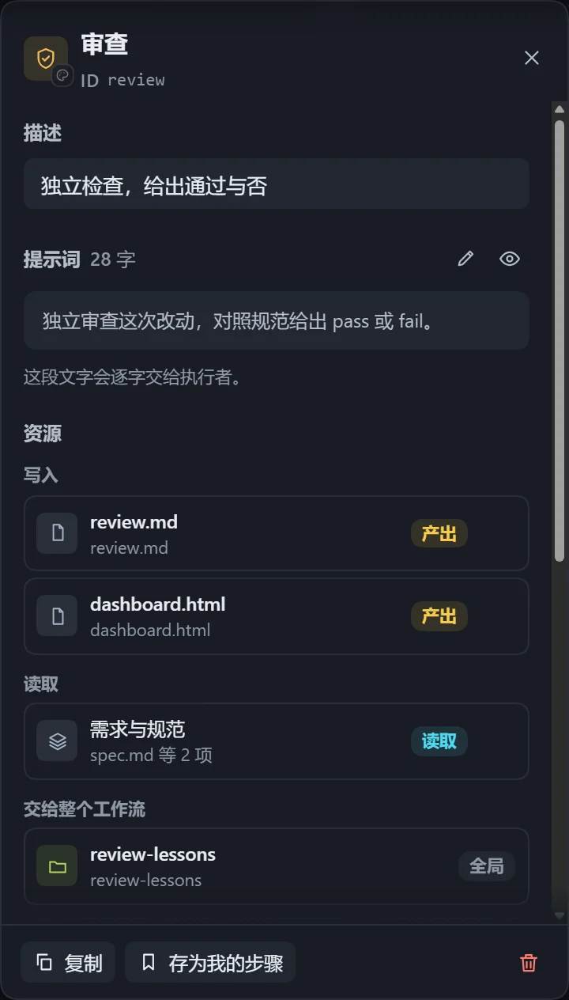
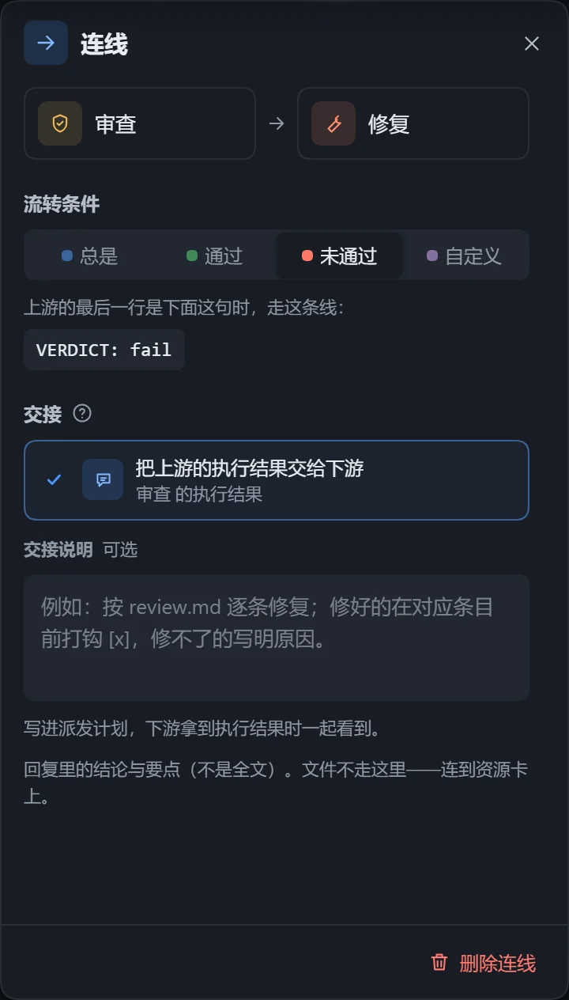

工作流由「步骤」和「连线」组成：步骤写明要做什么，连线决定先后，带上条件就能分支或回头返工。

## 添加步骤

- 从左侧「步骤库」拖到画布上。
- 在画布空白处右键，选择要添加的步骤。
- 选中步骤后点击「添加下一步」。

步骤库有三组：「常用步骤」（侦察、实现、审查、修复、汇总）、「基础」（空白步骤、用户输入、资源、记忆）、「我的步骤」。内置步骤拖到画布后可随意修改，点击「存为我的步骤」可长期复用。

## 编辑步骤

选中步骤，在右侧面板修改。

| 配置项 | 说明 |
|---|---|
| 名称 | 显示在画布和计划中。 |
| 提示词 | 告诉执行者做什么、产出什么，逐字交给执行者。 |
| 描述 | 一句话说明，只给人看。 |
| 图标与颜色 | 点击「换图标和颜色」选择。 |
| 产出文件 | 这一步写出的文件，路径相对于工作目录，下游从这里读取；可另写「生成规则」约定格式。 |

产出文件有三种声明：「写入文件」、「不产出」（只做事、不留文件）、「不声明」。文件也可以放在[资源](/dsh-workflow-lite/materials/resources/)卡里。

「复制」得到带「副本」的新步骤；「删除步骤」后可按 Ctrl+Z 撤销；实例中已执行过的步骤不能删除，改成「跳过」。

## 连线

1. 从上游步骤右侧的实心圆点拖出一条线。
2. 松开在下游步骤上。
3. 点击这条线，在右侧面板设置「流转条件」。

| 流转条件 | 效果 |
|---|---|
| 总是 | 上游完成后就执行下游。 |
| 通过 | 上游判定通过时走这条线。 |
| 未通过 | 上游判定未通过时走这条线，常用于回到前面返工。 |
| 自定义 | 写一句条件，如「测试全部通过」，由执行者判断是否成立。 |

「通过」「未通过」要求上游在回复末尾给出判定。内置的「审查」步骤已包含；自己写的步骤需在提示词里写明。条件连线互斥，同一次只走其中一条。

### 交接

| 选项 | 效果 |
|---|---|
| 把上游的执行结果交给下游 | 默认。交付的是上游回复里的结论与要点，不是全文。 |
| 只管先后 | 下游等上游做完再开始，不接收结果。 |
| 交接说明 | 补充一句话，写进计划，如「按 review.md 逐条修复」。 |

文件不经交接传递，需放进资源。点击连线上的「编辑交接」可直接修改。

## 整理与保存

| 工具条 | 作用 |
|---|---|
| 整理布局 | 自动排列步骤和资源，不同类型的线分道走。 |
| 看全图、放大、缩小 | 也可用滚轮或触控板捏合。 |
| 撤销、重做 | 对修改的撤销与重做。 |
| 预览计划 | 查看编译出的计划。 |

修改自动保存，顶栏显示「保存中」「已保存」「待保存」「保存失败」；文件在别处被改过时提示「重新加载」，有冲突可选「保留我的」或「用磁盘的」。「检查」面板列出「错误」「需修复」「警告」「建议」，显示「没有问题」即可执行，有错误时无法执行。

自动保存等待和步骤数上限见[插件设置与配色](/dsh-workflow-lite/settings/plugin/)。
