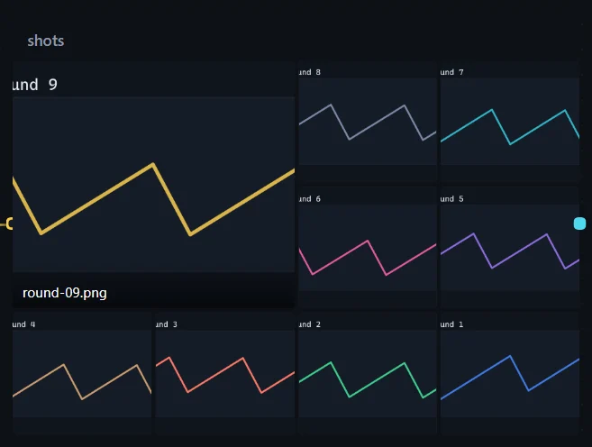
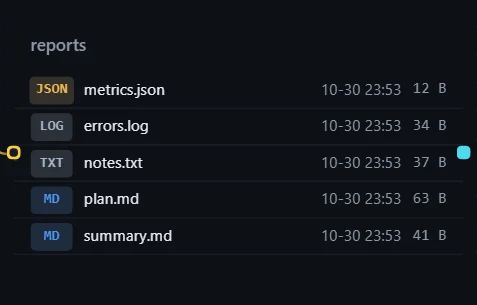
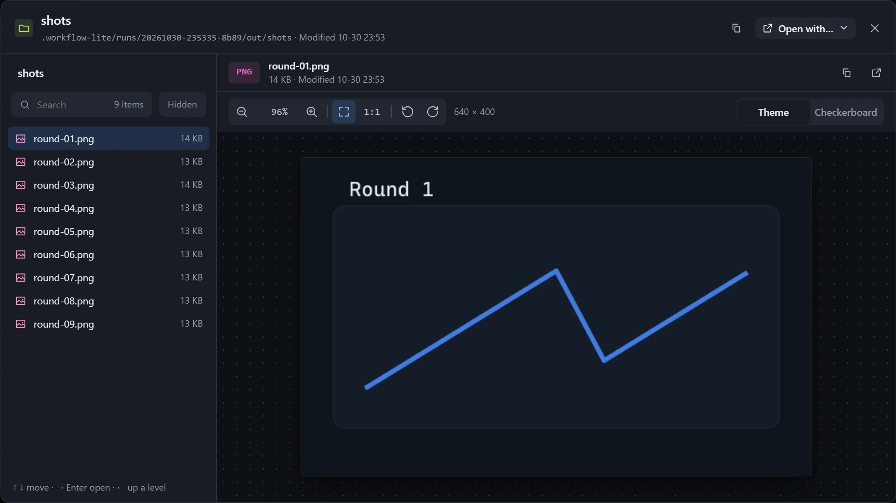

With **Show on the canvas** on, a folder resource can be laid out as an image wall or a file list. When steps write images into one folder, the canvas shows every one of them from newest to oldest.

## Use

1. Select a resource card that holds a folder and turn on **Show on the canvas**.
2. Choose how to **Show** it in **Canvas display settings**.
3. Click an image in the wall to browse it in the viewer.

An empty folder shows "Folder is empty"; when there are too many files only some are listed, with "N more items".

## Settings

| Setting | Description |
|---|---|
| Show | **Auto** (an image wall if there are images, otherwise a file list), **Images**, **Files**. |
| Match | Filter by name; `*` stands for anything and commas separate several patterns, such as `*.png, report-*`. |
| Order | **Newest first**, **By name**, **By size**. |
| Wall layout | **Wall**, **Large + strip**, **Latest only**. |
| Images | **Auto** follows the card size; **Fixed** sets columns and rows, and enlarging the card only enlarges the tiles. |
| Enlarge the newest | The first image takes two columns and two rows; needs at least three columns and two rows. |
| File list layout | **List** or **Grid**, with an optional **Show modified time**. |

## Browse in an instance

Open a folder resource to get two panes: on the left a path bar, a filter box and the file list, on the right a preview of Markdown, HTML and images.

- Keyboard: up and down to select, right arrow or Enter to open, left arrow or Backspace to go back.
- When the filter box finds nothing, it says "Nothing here has '…' in its name".

## Notes

The window for choosing a folder lists folders only; when nothing is ticked the main button reads **This folder**, and once something is ticked it becomes **Add**.
