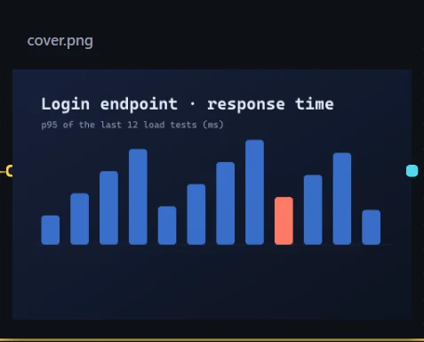
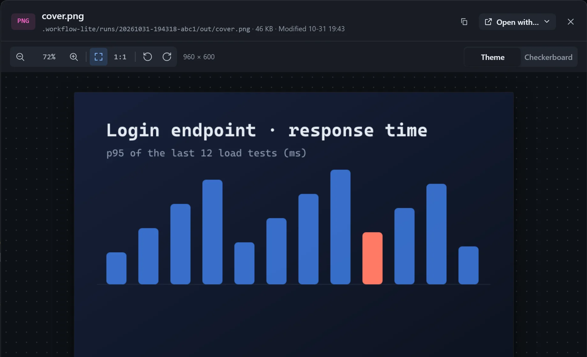

A good place for charts, screenshots and render results produced by steps, updated with every run.

## Use

Select a resource card that points to an image file and turn on **Show on the canvas**. After a run it switches to the latest image.

## Placement

Choose in **Canvas display settings** under **Placement**:

| Option | Effect |
|---|---|
| Fit (default) | The whole image is visible; small images are not enlarged. |
| Fill | Fills the card, and whatever overflows is cropped. |
| Actual | Shown at its original size; the only option where **Zoom** applies. |

With **Hide title** on, the title fades out when the card is neither selected nor hovered, leaving a cleaner image.

## Viewer

Double-click the card to open the viewer:

| Action | How |
|---|---|
| Zoom | Scroll wheel, or zoom in and out on the toolbar. |
| Pan | Drag. |
| Fit and actual size | Double-click to toggle; `0` fits the window, `1` is actual size. |
| Rotate | `R` clockwise, `Shift+R` counter-clockwise. |
| Background | Switch to a checkerboard at the top right to see the edges of transparent images. |
| Close | `Esc`. |

## Notes

- Have the step that writes the image produce it at the card's proportions (**Have the model fit the card** is on by default); it looks better in the card.
- In a loop, each round's image is saved as a version, and you can compare them side by side or with a draggable divider; see [Reviewing each round's output](/dsh-workflow-lite/en/display/rounds/).
