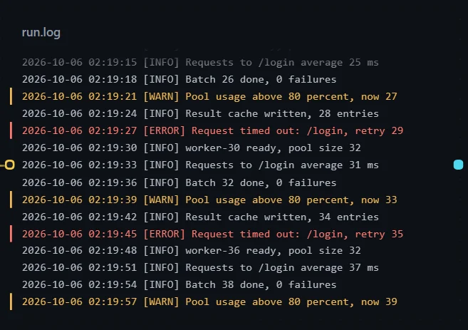
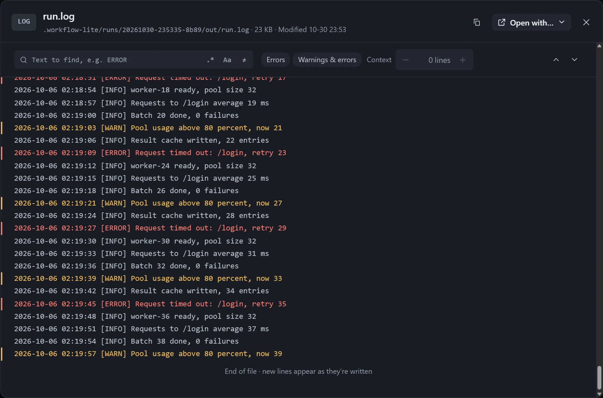

While a step that writes a log is running, the card stays at the end and follows new content, with **Live** at the top right. For big files only the few hundred visible lines are read, and an update reads only what was added.

## Display

- Lines wrap with a hanging indent; code, config and tables do not wrap.
- Scrolling up is never pulled back, and **Back to latest** appears at the bottom with a count of new lines.
- Error lines are red and warning lines amber (turn this off with **Color errors & warnings**).
- Under **Position**, choose **Auto** (logs and very large files stay at the end, others start from the top), **End** or **Start**.

## Only show

Use **Only show** in **Canvas display settings** to display only matching lines; the top left of the card shows how many lines match.

| Option | Description |
|---|---|
| Text to find | Only lines containing it are shown. |
| Regular expression | Treats the input as a regular expression, and says why if it is invalid. |
| Match case | Off by default. |
| Invert | Show only the lines that do not match. |
| Context | Keep 0–10 lines before and after each match; type something to filter first. |
| Presets | **Errors**, **Warnings and errors**. |

Matching searches back from the end, up to the last 64 MB.

## Viewer

- It keeps the filter set on the card; click a line to clear the filter and jump to that line in the full text.
- Press Ctrl+F to edit the filter directly.
- Scrolling to the edge keeps reading automatically, and logs of hundreds of MB stay smooth.
