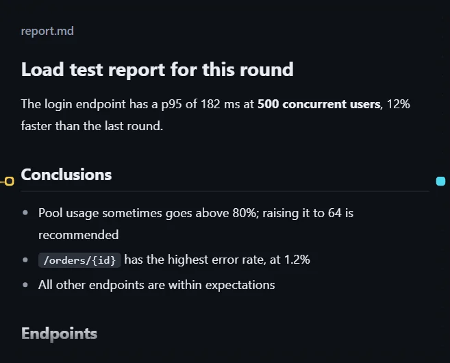
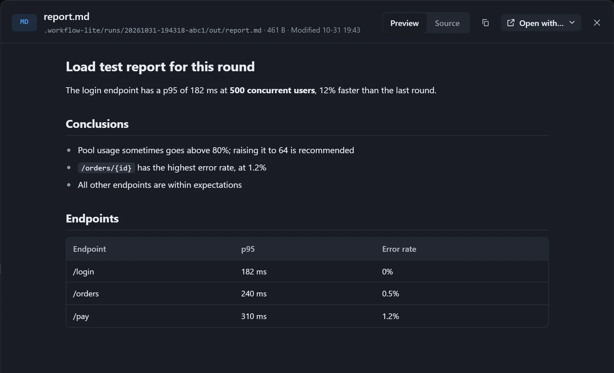

A Markdown report written by a step is shown in the card with its formatting: headings, lists, tables and code. Custom text in a resource is rendered the same way.

## Use

Select a resource card that points to a `.md` file, turn on **Show on the canvas**, and choose size **M** or **L**. **Zoom** adjusts the font size.

## Viewer

Double-click the card to open the viewer, where you can switch between **Preview** and **Source**.

## Notes

- Images referenced by relative path in the report can be shown.
- In a loop, each round's report is saved as a version; in the viewer, use **Versions** to compare line by line or to compare the formatting side by side; see [Reviewing each round's output](/dsh-workflow-lite/en/display/rounds/).
- With **Have the model fit the card** on, the report puts its conclusion first.
