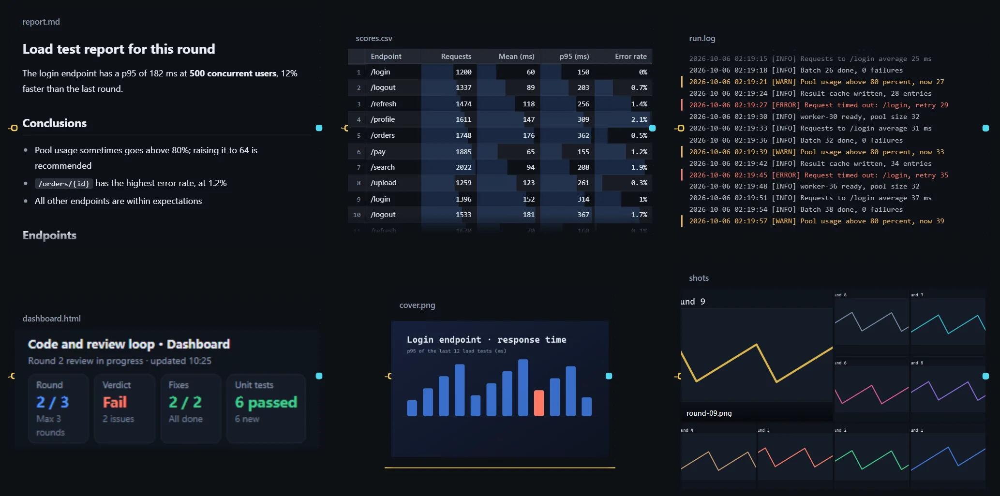
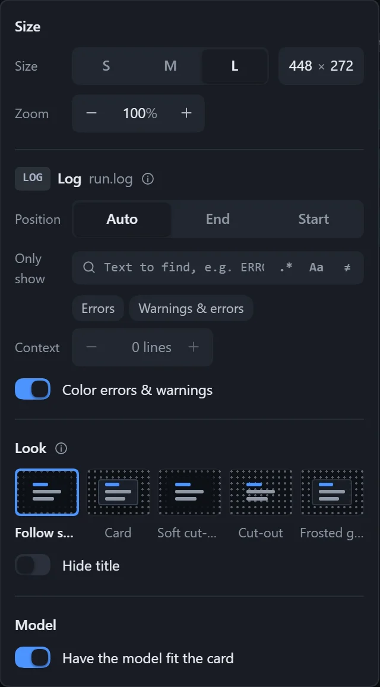
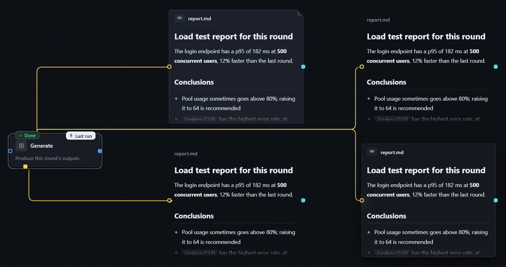

With **Show on the canvas** turned on, a resource card becomes a display area: files written by steps appear on the canvas after a run and switch to the latest content whenever they change. Dashboards, reports, screenshots and logs no longer have to be opened one by one.

:::caution[Experimental feature]
The behavior and settings of canvas display may change later.
:::

## Supported content

| Content | Page |
|---|---|
| Images | [Images](/dsh-workflow-lite/en/display/image/) |
| HTML pages, dashboards | [Web pages and dashboards](/dsh-workflow-lite/en/display/web/) |
| Markdown | [Markdown](/dsh-workflow-lite/en/display/markdown/) |
| Logs, plain text | [Logs and plain text](/dsh-workflow-lite/en/display/log/) |
| CSV, TSV | [Tables](/dsh-workflow-lite/en/display/table/) |
| JSON, code, config | [JSON, code and config](/dsh-workflow-lite/en/display/text/) |
| Folders | [Folders and image walls](/dsh-workflow-lite/en/display/folder/) |

URLs and skills cannot be displayed. In a loop, the output of every round can be looked back at and compared; see [Reviewing each round's output](/dsh-workflow-lite/en/display/rounds/).

## Turn it on

1. Select a resource card and turn on **Show on the canvas** in the right panel. If the resource has several items, use **Content** to choose which one to show.
2. Drag the bottom-right corner of the card to resize it; hold Ctrl while dragging to zoom instead.
3. Click **Adjust**, or the settings button in the card's title bar, to open **Canvas display settings**; changes apply immediately.

## View inside the card

- Click **Interact** to scroll inside the card or click inside a web page; press Esc to leave.
- Double-click the display area to open the full viewer, where you can switch between **Preview** and **Source**, **Open with…**, **Show in file manager** and **Copy path**.
- While the step that writes the file is running, **Live** appears next to the title; after the file changes, the card switches to the latest content, **Updated** lights up next to the title, and newly written parts are briefly highlighted before fading.

| Card shows | Meaning |
|---|---|
| Shows after a run | It has not run yet; a faint sketch is shown. |
| Being written | The step that writes this file is running. |
| Not generated yet, read failed | The file does not exist or could not be read. |
| Too large to show on the canvas | Over the limit; open it in the viewer or another program. |

On the workflow canvas (not an instance), the card shows the content of the most recent run; hover the title bar to see when it ran.

## Canvas display settings

The popover is grouped into **Size**, content, **Look** and **Model**, and lists only the options that apply to the current content.

| Setting | Description |
|---|---|
| Size | S, M, L, or **Custom** width (160–1600) and height (100–1200). |
| Zoom | 25%–400%, default 100%. |
| Look | **Follow settings** or choose one for this card; see below. |
| Hide title | The title fades out when the card is neither selected nor hovered; good for images and sticker-like content. |
| Have the model fit the card | On by default; tells the step that writes the file how big the card is, so it looks good both in the card and when opened on its own. |

Default sizes (width × height):

| Content | S | M | L |
|---|---|---|---|
| Images, folders | 208 × 136 | 320 × 216 | 448 × 296 |
| Web pages | 208 × 128 | 320 × 176 | 448 × 256 |
| Markdown | 208 × 160 | 320 × 232 | 448 × 320 |
| Text | 208 × 128 | 320 × 192 | 448 × 272 |

## Four looks

The same Markdown, from left to right and top to bottom: card, soft cut-out, cut-out and frosted glass.

| Look | Effect |
|---|---|
| Card | With a border and a title row. |
| Soft cut-out (default) | The content sits transparently on the canvas, and the canvas under it fades out. |
| Cut-out | Even the canvas dots show through. |
| Frosted glass | A translucent card face with the canvas blurred behind it. |

The default look is chosen in **Workflow hub → Settings → Appearance**; see [Plugin settings and themes](/dsh-workflow-lite/en/settings/plugin/).

## Notes

- Text in GBK, with a BOM, or in UTF-16 is supported, and terminal color codes are not shown literally.
- When exporting as a skill, **Have the model fit the card** is not carried over.
