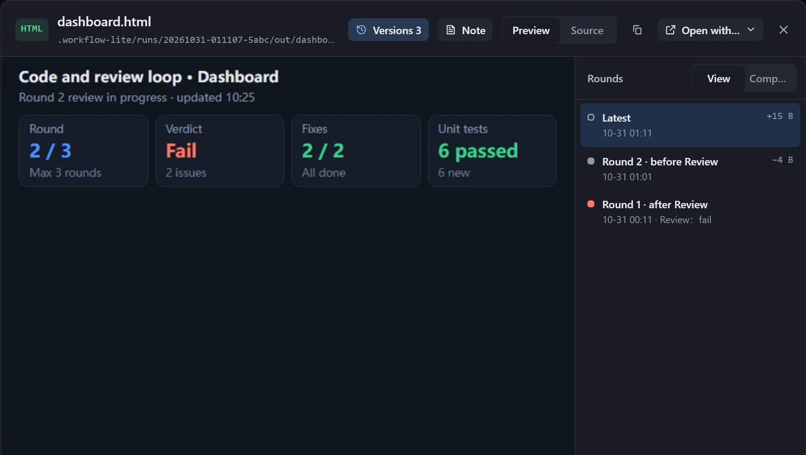
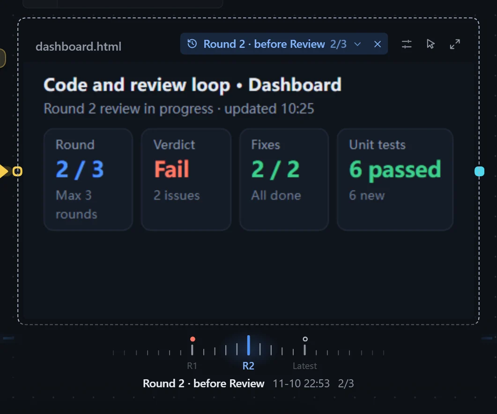
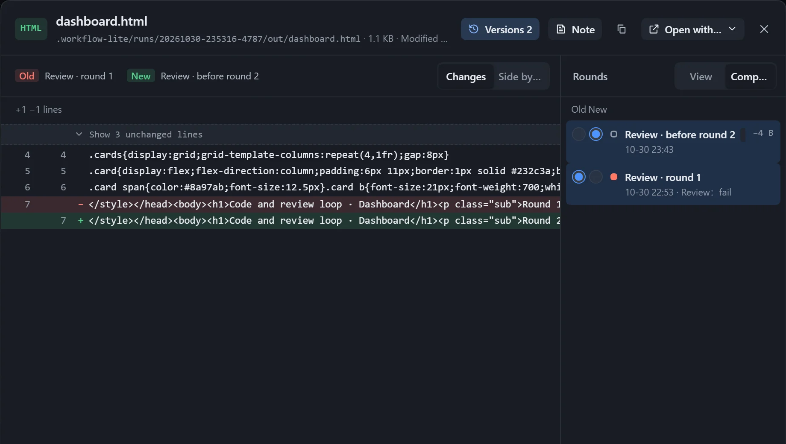

When a loop runs repeatedly, a step that writes an output file saves a version after every round, which you can look back at or compare in pairs. This works only when running inside the plugin; nothing is saved after exporting as a skill.

## Look back on a display card

On an instance's canvas, move the pointer over a display card with two or more saved versions (or select it): a dial appears below the card, and the title row shows which version is on display.

| Action | Effect |
|---|---|
| Hover a version on the dial | The card shows that version for now and switches back when the pointer leaves |
| Click a tick | Switches to that version and stays there |
| Drag the dial sideways, or scroll the wheel over it | The ticks slide and the card follows; on release it settles on the nearest version |
| Click the version name in the title row | Lists every version; hover to preview, click to choose |
| Click the ✕ in the title row | Back to the latest; if a new version arrives meanwhile, a dot appears on the ✕ |
| Keyboard ← → Home End | Step between versions, jump to either end |

- One long tick per version; the lit tick in the middle is the version on display. The first version of each round is labelled "R1", "R2" and so on, a version saved before round 1 is labelled "Start", and the last tick is "Latest".
- Reviewed versions carry a dot above their tick, one color for passed and one for sent back; below the dial are the version's name, the review result and the save time.
- While an older version is on display, the name in the title row turns the accent color.
- Rounds are named like "Round 2 · after Review", and failed ones carry "(failed)".

## Compare

Click **Versions** in the viewer to view any round, or pick two rounds as "old" and "new" to compare.

| Mode | For | Description |
|---|---|---|
| Diff | Text | Marks added and removed lines, and folds the lines that did not change. |
| Side by side | Markdown, web pages, images | Compares the layout of the two versions next to each other. |
| Slider | Images | Drag the divider to compare. |

## Storage

- At most 20 versions are kept per output; beyond that the first version and the latest few are kept, with "N versions omitted in the middle".
- See the space used in **Workflow hub → Storage**, where you can **Clear** it; the current output files are untouched.
- Deleting an instance deletes its per-round versions too.
