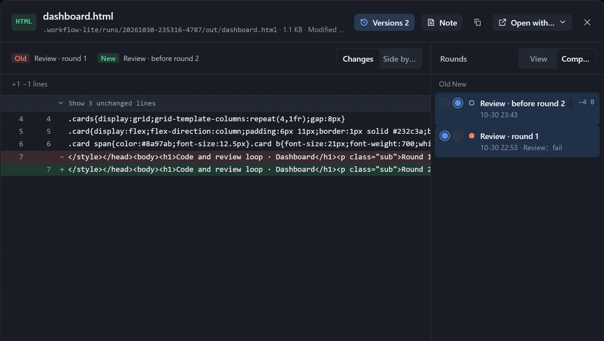

When a loop runs repeatedly, a step that writes an output file saves a version after every round, which you can look back at or compare in pairs. This works only when running inside the plugin; nothing is saved after exporting as a skill.

## Look back on a display card

On an instance's canvas, a row of dots sits at the bottom left of a display card, one dot per round.

- Hover to preview, click to pin, and use the arrow keys to move between adjacent rounds.
- Click **Back to latest** to return; when a new version arrives it says "A newer version is in".
- Rounds are marked as passed or failed by the review result, and failed ones carry "(failed)".

## Compare

Click **Versions** in the viewer to view any round, or pick two rounds as "old" and "new" to compare.

| Mode | For | Description |
|---|---|---|
| Diff | Text | Marks added and removed lines, and folds the lines that did not change. |
| Side by side | Markdown, web pages, images | Compares the layout of the two versions next to each other. |
| Slider | Images | Drag the divider to compare. |

## Storage

- At most 20 versions are kept per output; beyond that the first version and the latest few are kept, with "N versions omitted in the middle".
- See the space used in **Workflow hub → Storage**, where you can **Clear** it; the current output files are untouched.
- Deleting an instance deletes its per-round versions too.
