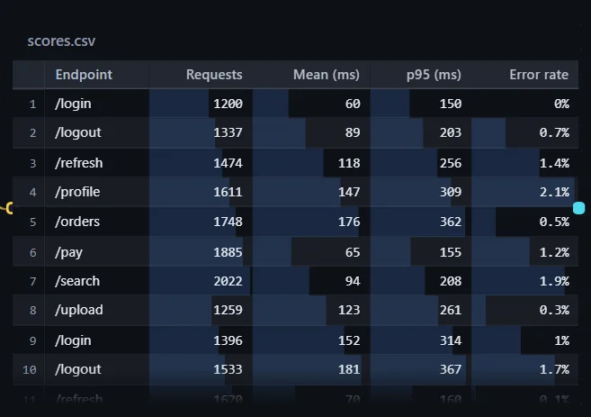
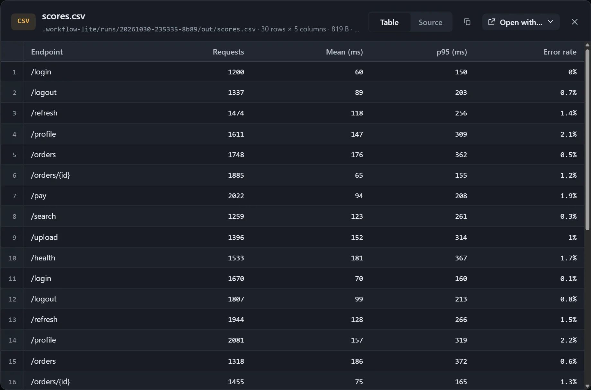

CSV and TSV files are laid out as tables in the card, with a fixed header and row numbers, and number columns right-aligned.

## Settings

Adjust them in **Canvas display settings**:

| Option | Description |
|---|---|
| Position | View the start or the end; on auto, the last rows are shown while the step writing it is running, otherwise it starts from the top. |
| Columns | Hide or show a column; this only affects the card, and the viewer still shows everything. |
| Bars in number columns | A faint bar sized by value under each number cell, so values can be compared without reading them. |
| Sort | Choose a column to sort by, or **File order**; in interact mode, click a header to sort, and again to reverse. |

Sorting only covers the rows already read. With **Have the model fit the card** on, the step writing the table keeps the headers short and appends new rows at the end.

## Viewer

The viewer's title row states the number of rows and columns, and you can switch between **Table** and **Source**.

When the table does not fit, it says "N more rows not shown"; switch to **Source** to see everything.
