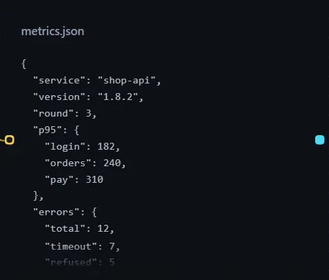
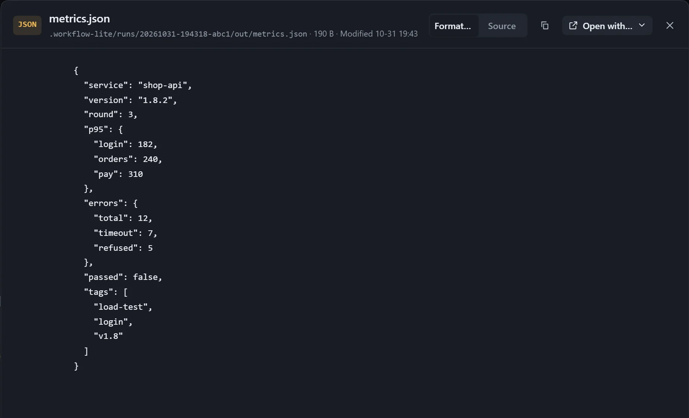

Text such as JSON, code and config keeps its form in the card: monospaced and not wrapped.

## JSON

JSON squeezed onto one line is expanded and indented automatically. In the viewer you can switch between **Formatted** and **Source**; use **Source** to see the original text.

## Other text

- **Zoom** adjusts the font size.
- When a file exceeds the limit, only its size is shown; open it with another program.
- Files in GBK, with a BOM, or in UTF-16 are supported.
