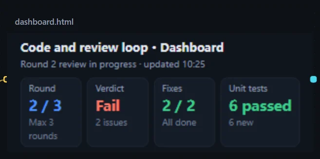

Have a step write its result as an HTML file, and the canvas gains a dashboard that refreshes with the run: the current round, the conclusion and the metrics at a glance.

## Use

1. Have a step produce an HTML file such as `dashboard.html`, overwriting the same file every round.
2. Create a resource card for that file (drag from the step to an empty spot and choose **Output file**), and turn on **Show on the canvas**.
3. **M** usually fits, with zoom left at 100%; lowering the zoom shrinks all the text on the page, so open the viewer for what does not fit.

For the full setup, see [Check each round's output on a dashboard](/dsh-workflow-lite/en/scenarios/dashboard/).

## How it is displayed

- A web page is laid out at "width × height" and then scaled down as a whole; the card's size is "size × zoom".
- The dashboard follows the canvas color theme, so it blends into the canvas; the look can be card, soft cut-out, cut-out or frosted glass.
- The card shows one screen as a summary; open the viewer, or open it in a browser with another program, to see everything.
- With **Have the model fit the card** on, the step that writes the dashboard knows the card size and lays the page out to the card's width, filling one screen.

## Viewer

## Notes

- Images and styles referenced by relative path in the page cannot be shown for now; the viewer's title row tells you how many could not be shown. For the full effect, click **Open with…**.
- After you click **Interact**, you can click inside the page; press Esc to leave.
- A version of the dashboard is saved every round and can be compared later; see [Reviewing each round's output](/dsh-workflow-lite/en/display/rounds/).
