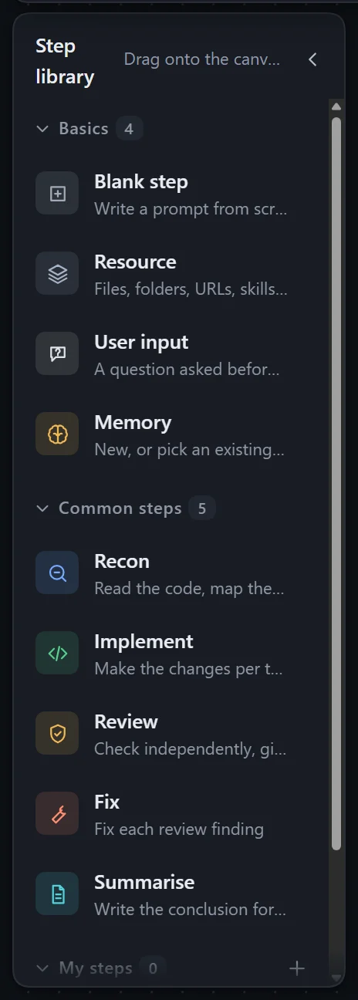
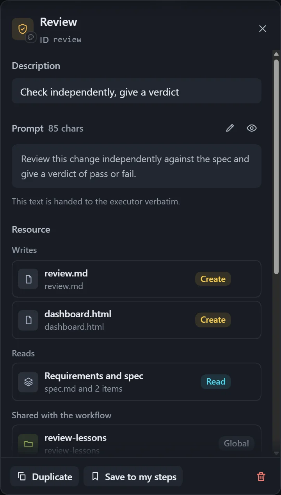
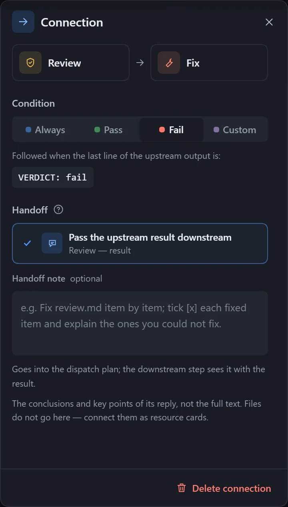

A workflow is made of **steps** and **connections**. A step says what to do; connections decide the order, and with a condition they branch or send the flow back for rework.

## Add a step

- Drag one from the **Step library** on the left onto the canvas.
- Right-click an empty spot on the canvas and choose the step to add.
- Select a step and click **Add next step**.

The library has three groups: **Common steps** (Recon, Implement, Review, Fix, Summarise), **Basics** (blank step, user input, resource, memory) and **My steps**. Built-in steps can be edited freely once on the canvas; click **Save to my steps** to reuse one long term.

## Edit a step

Select a step and edit it in the right panel.

| Setting | Description |
|---|---|
| Name | Shown on the canvas and in the plan. |
| Prompt | Tells the executor what to do and what to produce; handed over word for word. |
| Description | A one-line summary, for people only. |
| Icon and color | Click **Change icon and color** to choose. |
| Output file | A file this step writes, with a path relative to the working folder; downstream steps read it from there. A **Generation rule** can set the format. |

An output file can be declared in three ways: **Write a file**, **No file** (the step only does work and leaves no file) and **Undeclared**. Files can also live in a [resource](/dsh-workflow-lite/en/materials/resources/) card.

**Duplicate** makes a new step with "copy" in its name. After **Delete step**, press Ctrl+Z to undo. A step that has already run in an instance cannot be deleted; set it to **Skipped** instead.

## Connections

1. Drag a line out of the solid dot on the right of the upstream step.
2. Release it on the downstream step.
3. Click the line and set its **Condition** in the right panel.

| Condition | Effect |
|---|---|
| Always | Run the downstream step once the upstream one is done. |
| Pass | Follow this line when the upstream step's verdict is pass. |
| Fail | Follow this line when the verdict is fail; often used to go back for rework. |
| Custom | Write a condition such as "all tests pass"; the executor judges whether it holds. |

**Pass** and **Fail** need the upstream step to give a verdict at the end of its reply. The built-in **Review** step already does; for your own steps, say so in the prompt. Conditional lines are mutually exclusive: only one is followed each time.

### Handoff

| Option | Effect |
|---|---|
| Pass the upstream result downstream | The default. What is delivered is the conclusion and key points from the upstream reply, not the full text. |
| Order only | The downstream step waits for the upstream one to finish but receives no result. |
| Handoff note | Add one sentence to the plan, such as "fix each point in review.md". |

Files are not passed through the handoff; put them in a resource. Click **Edit handoff** on a line to change it directly.

## Tidy up and save

| Toolbar | Effect |
|---|---|
| Tidy up | Arranges steps and resources automatically, routing different kinds of lines apart. |
| Fit view, Zoom in, Zoom out | The wheel or a trackpad pinch also works. |
| Undo, Redo | Undo and redo edits. |
| Preview plan | Shows the compiled plan. |

Edits are saved automatically; the top bar shows **Saving**, **Saved**, **Unsaved** or **Save failed**. If the file was changed elsewhere, you are asked to **Reload**, and on a conflict you can choose **Keep mine** or **Use disk**. The **Checks** panel lists **Errors**, **Must fix**, **Warnings** and **Suggestions**; when it shows **No problems** the workflow can run, and with errors it cannot.

For the autosave delay and the step limit, see [Plugin settings and themes](/dsh-workflow-lite/en/settings/plugin/).
