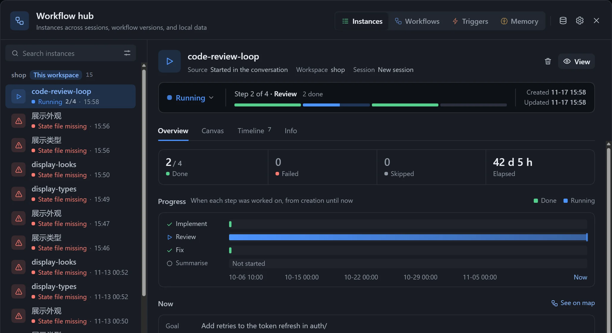
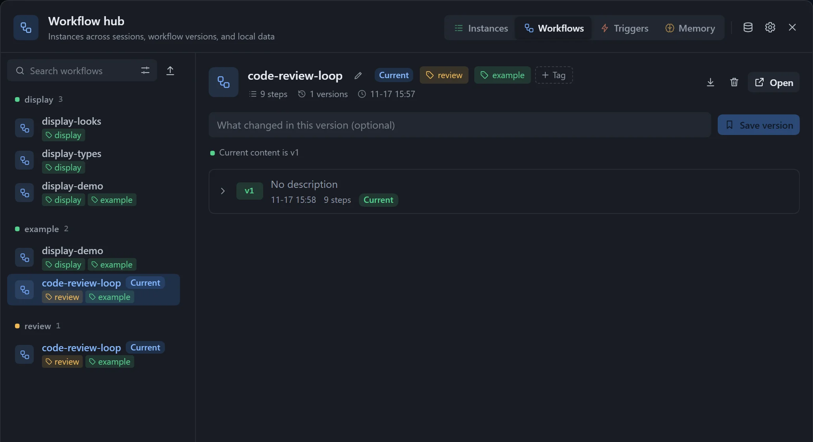
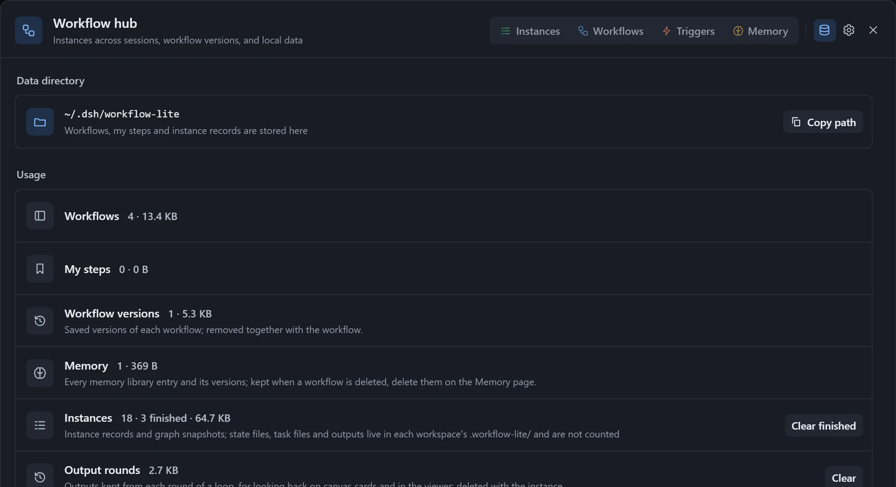
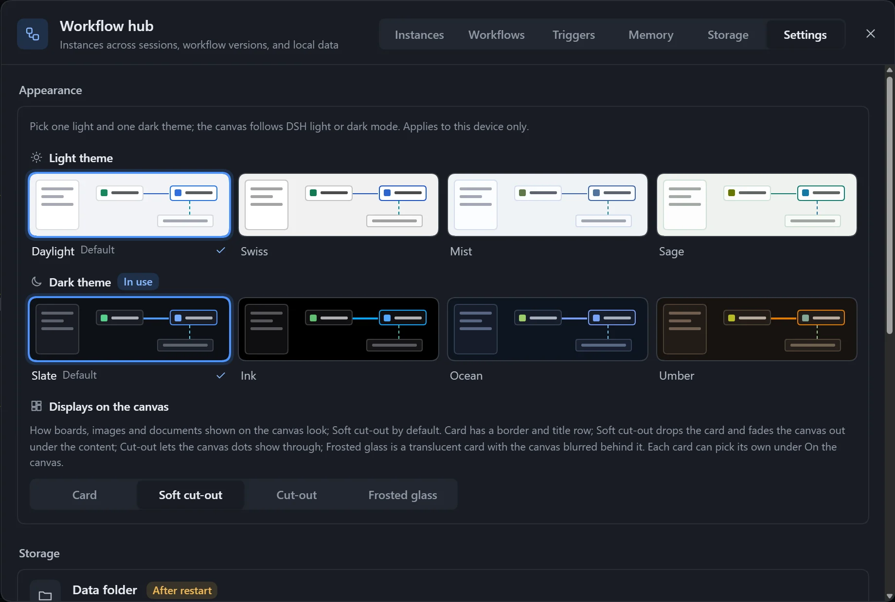

Open the **Workflow hub** at the top left of the canvas to manage the instances of every session, all workflows and versions, triggers, the memory library, local data and settings.

When viewing an instance, the hub opens **Instances** with that instance selected. When editing a workflow, it opens **Workflows** with that workflow selected.

| Page | Use |
|---|---|
| Instances | See the progress, timeline and origin of every instance. |
| Workflows | Manage workflows, tags and versions, export and import. |
| Triggers | Triggers of every workflow and Pause all; see [The Triggers page and Pause all](/dsh-workflow-lite/en/trigger/manage/). |
| Memory | Manage the memory library; see [Memory](/dsh-workflow-lite/en/materials/memory/). |
| Storage | See local data usage and clean up. Next to the close button at the top right. |
| Settings | Themes and plugin settings. Next to the close button at the top right. |

## Lists

The left side of every page is the same kind of list: a search box on top and groups below. **View options** changes:

| Option | Notes |
|---|---|
| Group by | Differs per page; instances, for example, group by workspace, workflow, status or session. Grouping can also be turned off. |
| Sort by | By name, last modified, newest first and so on. |
| Show | Only part of the list, such as instances in progress or failed; the top of the list says so, and **Clear filter** shows everything again. |
| Row height | **Compact** by default; can be switched to **Standard**. This setting is shared by the Workflow hub and the canvas search. |

## Instances

Instances are on the left, grouped by workspace by default with the current workspace first; search works across workspaces by workflow, session and goal. The right side shows the selected instance.

| Tab | Contents |
|---|---|
| Overview | Which step it is on, and each step's progress and summary. |
| Canvas | The graph as it ran, colored by status. |
| Timeline | Step changes and triggers of this instance in time order. |
| Info | Origin, session and workspace, times, and where the state file is. |

| Action | Description |
|---|---|
| View | Opens the instance on the canvas. |
| Change overall status | Click the status label and confirm; steps are untouched. **Notify model** can be turned on with a short note. |
| Move here | An instance belongs to one session only. |
| Delete | Deletes the record and the graph snapshot, and optionally the state file in the workspace. |

For an instance whose state file has a problem, click **Show why**.

## Workflows

Workflows are on the left and can be grouped by tag, trigger or last modified, or narrowed to those with triggers, versions or problems; the right side shows the selected workflow's versions and export. The button next to the search box imports.

1. Rename: click the workflow name at the top right and press Enter when done. The button beside it deletes the workflow (its versions go with it, and this cannot be undone).
2. Tag: click **Tag**, then search existing tags or type a name to create one.
3. Manage tags: click a tag on a workflow to change its color (for every workflow with that tag), remove it from this workflow, rename it or delete it.
4. Filter by tag: tick tags under **Filter by tag** in **View options**.

**Search workflows or instances** at the top of the canvas lists all workflows by last modified, without grouping by default. Grouping, sorting and filters are saved separately from the **Workflows** page.

For versions see [Versions](/dsh-workflow-lite/en/manage/versions/); for export and import see [Import and export](/dsh-workflow-lite/en/manage/import-export/).

## Storage

Shows the data folder (with **Copy path**) and the space used by each kind of data.

| Action | Effect |
|---|---|
| Clear finished | Deletes records and snapshots of done and cancelled instances; state files stay. |
| Clear per-round versions | Deletes older versions; the current output files stay. |
| Delete leftover files of old versions | Task files left by earlier versions that are no longer used; safe to delete. |

Deleting a workflow does not delete its memories; delete them on the **Memory** page.

## Settings

The top part is [themes](/dsh-workflow-lite/en/settings/plugin/#appearance), and the bottom part is [plugin settings](/dsh-workflow-lite/en/settings/plugin/).

## Notes

- An instance with no recorded workspace shows "No workspace recorded", and one whose session no longer exists shows "Session no longer exists".
- If there are no instances yet, clicking **Run** on the canvas creates one.
