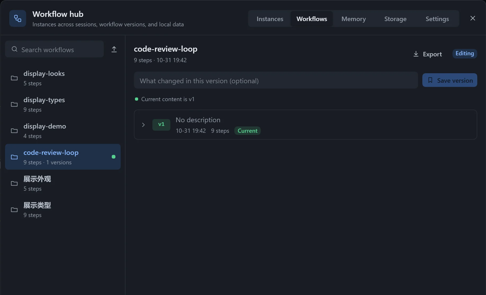
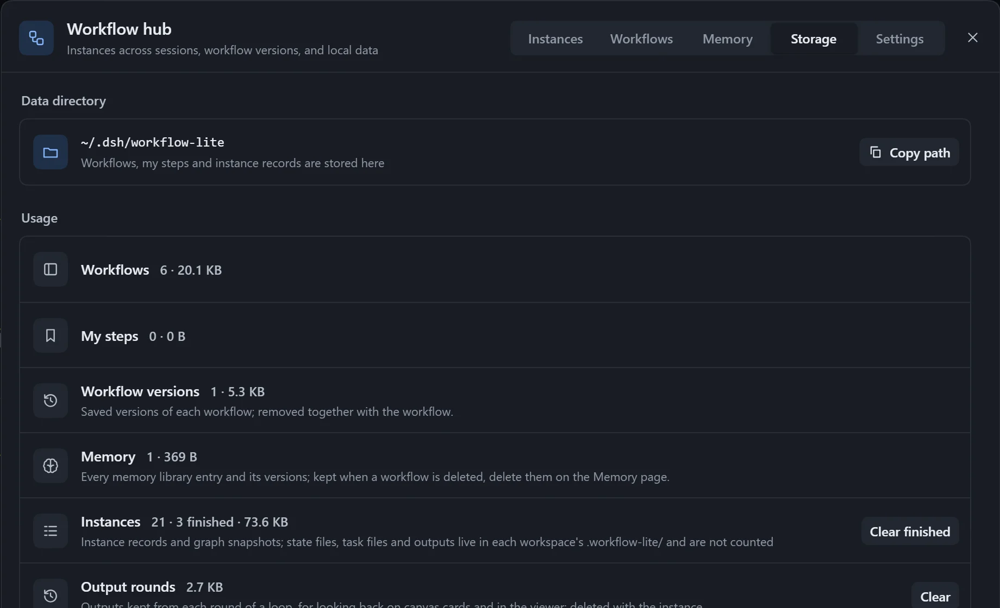
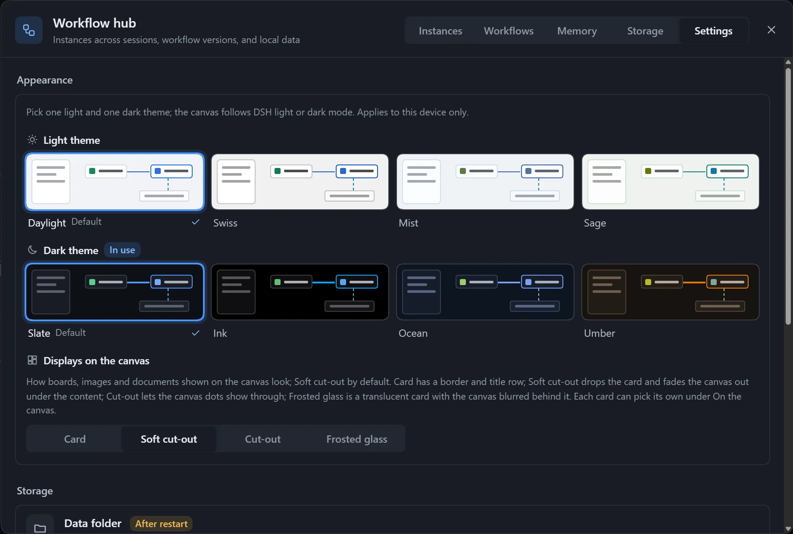

Open the **Workflow hub** at the top left of the canvas to manage the instances of every session, all workflows and versions, the memory library, local data and settings.

| Page | Use |
|---|---|
| Instances | See all instances by workspace. |
| Workflows | Manage workflows and versions, export and import. |
| Memory | Manage the memory library; see [Memory](/dsh-workflow-lite/en/materials/memory/). |
| Storage | See local data usage and clean up. |
| Settings | Appearance and themes, plugin settings. |

## Instances

Workspaces are on the left and their instances on the right; the search box at the top searches across workspaces by workflow, session and goal. The current workspace comes first.

| Action | Description |
|---|---|
| View | Opens the instance. |
| Change overall status | Click the status label and confirm; steps are untouched. You can turn on **Notify model** and add a note. |
| Move here | An instance belongs to one session only. |
| Delete | Deletes the record and the graph snapshot, and optionally the state file in the workspace. |

For an instance whose state file has a problem, click **Show why**.

## Workflows

The workflow list is on the left, and versions, export and import are on the right. You can search, open, rename, or delete a workflow (its versions go with it, and this cannot be undone).

For versions see [Versions](/dsh-workflow-lite/en/manage/versions/); for export and import see [Import and export](/dsh-workflow-lite/en/manage/import-export/).

## Storage

Shows the data folder (with **Copy path**) and the space used by each kind of data.

| Action | Effect |
|---|---|
| Clear finished | Deletes records and snapshots of done and cancelled instances; state files stay. |
| Clear per-round versions | Deletes older versions; the current output files stay. |
| Delete leftover files of old versions | Task files left by earlier versions that are no longer used; safe to delete. |

Deleting a workflow does not delete its memories; delete them on the **Memory** page.

## Settings

The top part is [appearance and themes](/dsh-workflow-lite/en/settings/plugin/), and the bottom part is [plugin settings](/dsh-workflow-lite/en/settings/plugin/).

## Notes

- An instance with no recorded workspace shows "No workspace recorded", and one whose session no longer exists shows "Session no longer exists".
- If there are no instances yet, clicking **Run** on the canvas creates one.
