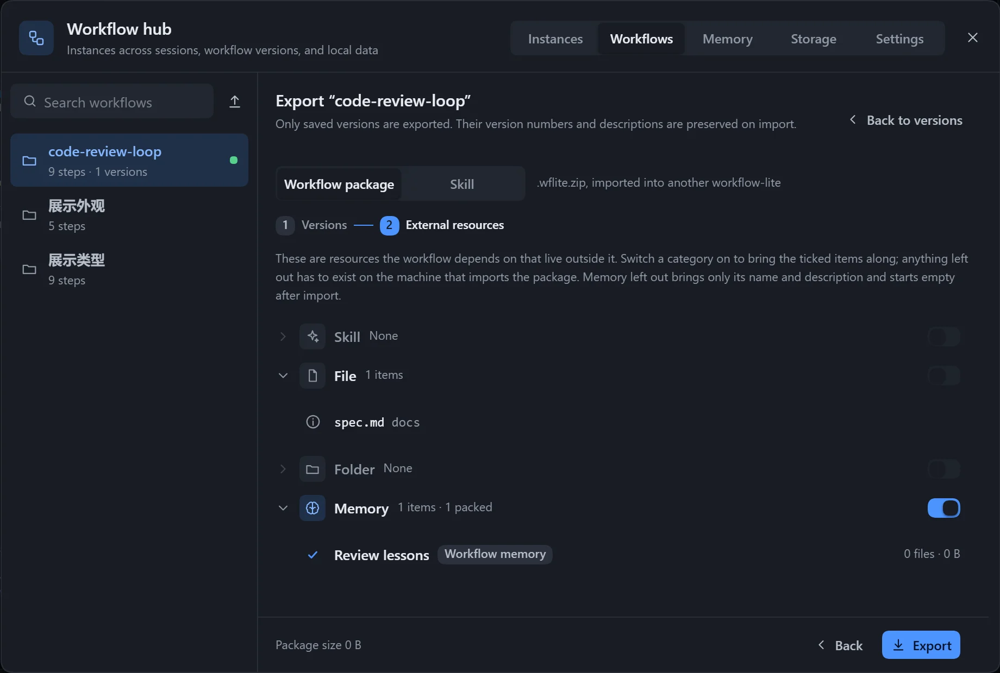
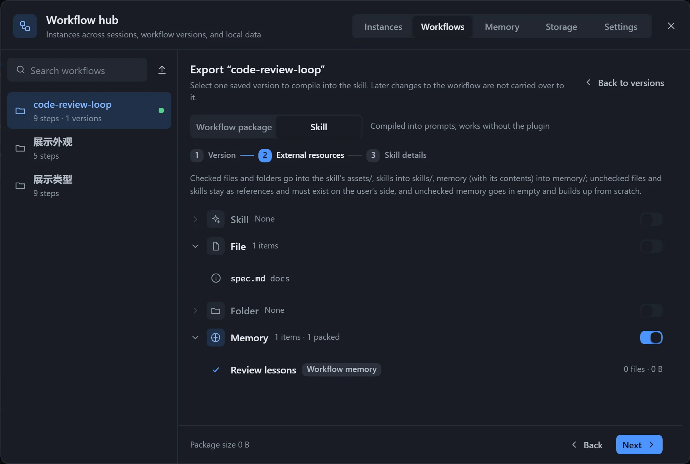

| The other side | Suggestion |
|---|---|
| Also has this plugin installed | Export as a workflow package, which keeps the canvas and versions. |
| Does not have the plugin, or uses another agent | Export as a skill. |

A workflow can be exported as `<workflow name>.wflite.zip`, containing the selected versions plus any files, folders, skills and memories you choose to bring. Import it on another machine to use it.

## Export

Click **Export workflow** next to **Versions** in the canvas top bar, or select a workflow on the **Workflows** page of the **Workflow hub** and click **Export**. Choose **Workflow package** under **Export as**; for **Skill** see [Export as a skill](#export-as-a-skill) below.

**Step 1: choose versions.** Only saved versions are exported, and their version numbers and notes are kept on import. The version matching the current content is selected by default, and at least one must be selected. If the current content has not been saved as a version, it is not exported; save a version on the versions page first.

**Step 2: external resources.** This lists the skills, files and folders that live outside the workflow, with one switch per kind. Ticked items travel with the package; unticked ones must be prepared on the importing machine.

| Status | Meaning |
|---|---|
| Not found on this machine | Cannot be ticked. |
| Too large or too many files | Over the packing limit; cannot be ticked. |
| Built-in skill, no folder | Cannot be ticked. |
| Relative to the workspace, kept as is | The path stays in the package unchanged. |
| Not in the memory library | Its content cannot be exported. |

URLs, custom text and output files are not in the list, and the workflow's own materials folder is included as a whole. For memories you can choose per entry whether to bring the content; otherwise only the name and description are brought. Absolute paths that are not packed stay in the package as they are and contain local folder names; the list tells you how many.

A package is at most 200 MB and 5000 files, excluding `.git`, `node_modules` and links; beyond that it says "Over the limit, tick fewer items". Click **Export** to download.

## Import

On the **Workflows** page, click **Import** and choose a file, or drag a `.wflite.zip` onto the page. A list is shown first, and nothing is written until you confirm.

| Part | Content |
|---|---|
| Versions in the package | Which versions there are, and which version each becomes after import. |
| Import to | If the name already exists, choose to save under a new name or merge into the existing one. |
| Materials | Placed under `assets/<workflow name>/` in the data folder. |
| Memories | New, or already on this machine. |
| Skills | Where they are installed, and whether this machine already has them. |
| References not in the package | Whether external paths can be found on this machine. |

**Merge into an existing workflow**: versions with identical content are not saved again, the rest are numbered on, and the workflow's content is replaced with the version from the package. If the current content has not been saved as a version it is replaced, so save a version before importing. When materials differ from the local ones, choose **Keep local** or use the package's.

**Memories**: when the same entry already exists locally, choose to keep the local one or save a copy.

**Skills**: installed to `~/.agents/skills/<name>/`. When a skill with the same name exists locally:

| Choice | Effect |
|---|---|
| Install | A new install. |
| Do not install | Needs a skill of the same name on this machine. |
| Keep local | Uses the one already here. |
| Overwrite | Replaces it entirely; the original cannot be recovered. |
| Install under another name | Installs under a new name and rewrites the references. |

You must tick the confirmation before skills are installed. Scripts in a skill may be run, so import packages only from sources you trust.

After you confirm, a dialog "Import to '…'?" states the number of versions, materials and skills; when done it says "Imported '…': N new versions".

## Notes

- Import checks paths and content; a package newer than the current plugin is rejected, and the plugin needs upgrading.
- `{workflow}` in a resource path means the workflow's own materials folder; see [Resources](/dsh-workflow-lite/en/materials/resources/).

## Export as a skill

:::caution[Experimental feature]
The structure of the skill may change later.
:::
An exported skill contains `SKILL.md`, a task description for each step and the packed files. It does not depend on DSH's tools, and can be followed in other agents too. Changing the workflow after exporting does not update a skill already exported.

### Steps

1. On the **Workflows** page of the **Workflow hub**, click **Export** and choose **Skill** under **Export as**.
2. Choose a saved version.
3. Tick the resources to bring.
4. Fill in the name and description, and preview.
5. Click **Install here** or **Download zip**.

| Ticked | Goes to |
|---|---|
| Ticked files and folders | The `assets/` folder. |
| Ticked skills | The `skills/` folder. |
| Ticked memories | Placed with their content in the `memory/` folder. |
| Unticked files and skills | Referenced as they are; the other side must prepare them. |
| Unticked memories | An empty one is brought, to accumulate from scratch. |

| Item | Description |
|---|---|
| Name | Lowercase letters, digits and `-`, at most 64 characters, with no `-` at the start, the end or twice in a row; also the folder name. |
| Description | Required, at most 1024 characters. The model uses it to decide when to use the skill, so say what it does and when to use it. |
| When to use | Optional. |

- **Install here**: installs to `~/.agents/skills/`; if the name exists you confirm whether to overwrite, and the original cannot be recovered.
- **Download zip**: gives you an archive.

### Notes

The export page gives hints for specific cases:

- **Record run state** is on: the model maintains `.workflow-lite/runs/<id>/state.yaml` in the workspace itself, with no live view on the canvas.
- A step rewrites files in the workflow's own folder: after export those files are in the skill folder and get changed when it runs.
- The output root is an absolute path: it may not exist on another machine.
- A skill that is not packed: the other side must install it.
- A version has a compile-level problem: it cannot be exported; fix it and export again.

Also, **Have the model fit the card** is not carried over, per-round output versions are not saved, and installing over an existing skill overwrites the memories it has accumulated.
