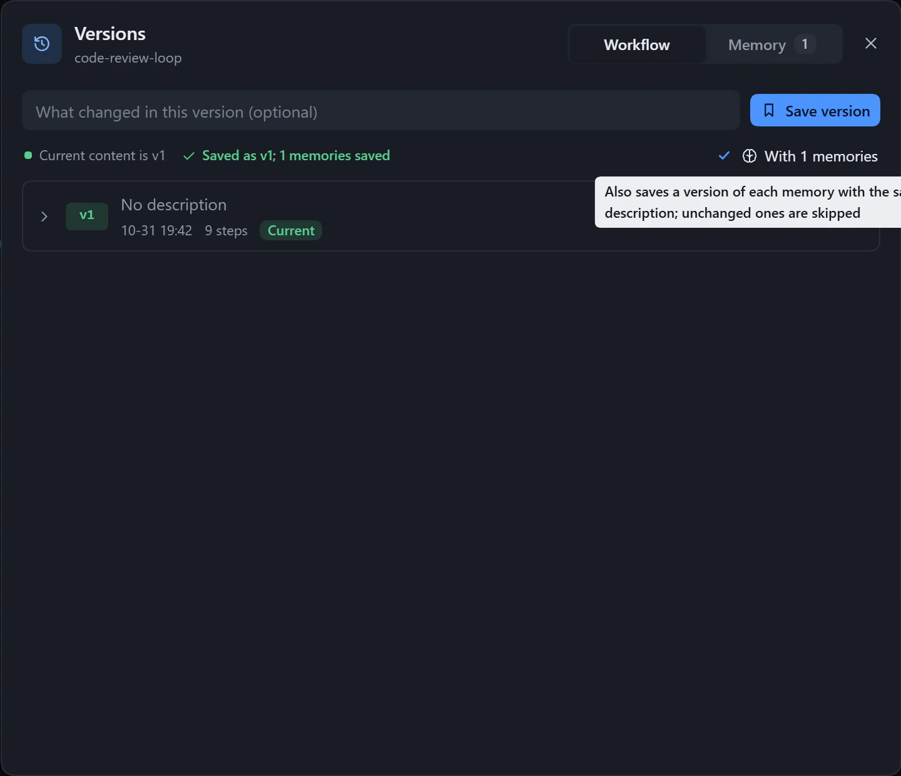

Save a good state as a version, and switch back if later edits go wrong. A version stores the steps, connections and workflow settings as they were.

## Use

1. Click **Versions** in the canvas top bar.
2. Write a short note (optional) and click **Save version**.
3. To go back to a version, expand its row to see the changes that switching to this version brings, then click **Switch to this version** and confirm.

If the current content has not been saved as a version, one is saved automatically before switching, with the note "Auto-saved before switching to vN", so you can always switch back.

A yellow dot on the **Versions** icon means the current content has not been saved as a version. In the list, the version matching the current content is marked **Current**. You can also **Edit description** or **Delete** a version.

## Limits

- A note is at most 500 characters; each workflow keeps at most 100 versions, so delete the oldest once it is full.

## Versions of memories

The dialog has two tabs, **Workflow** and **Memory**. Tick "With N memories" when saving a workflow version and each memory is saved as a version too; unchanged ones are skipped. See [Memory](/dsh-workflow-lite/en/materials/memory/).

## Notes

- Deleting a workflow deletes all its versions with it, and this cannot be undone.
- Export includes saved versions only; see [Import and export](/dsh-workflow-lite/en/manage/import-export/).
