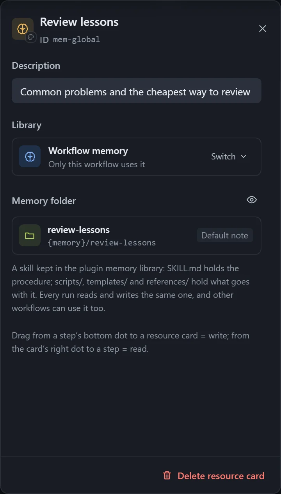
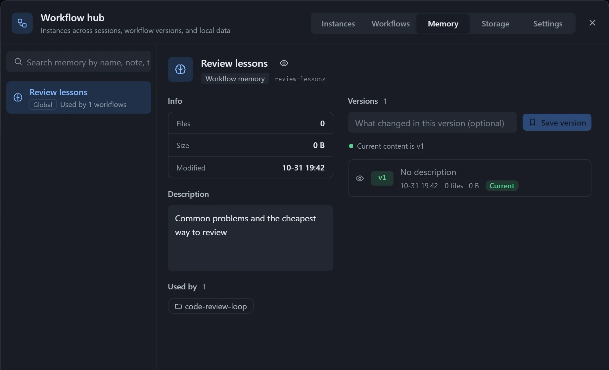

:::caution[Experimental feature]
Behavior and data formats may change later. Early tests running the same workflow repeatedly did not show a stable speed-up; feedback is welcome.
:::

Memory keeps the procedures that were worked out and the pitfalls that were hit, and reads them first next time, so there are fewer lookups and fewer rounds of thinking. A memory is a skill, and several workflows can share one.

| Type | Effect |
|---|---|
| Step memory | Attached to one step; the step writes what worked into it and follows it next time. |
| Workflow memory | Shared by the whole workflow; read-only before each step, and tidied up by the main agent at the end. |

## Use

- **Step memory**: drag from the dot at the bottom of a step to an empty spot, choose **Memory**, then pick an existing entry from the library or create one.
- **Workflow memory**: drag **Memory** from **Basics** in the step library, or right-click an empty spot and choose **Global memory**.
- Click **Turn on memory** or **Turn off memory** to switch it; when turned off, the entry stays in the library.
- The **Memory instructions** can be edited; leave them empty to use the default.

## Manage

On the **Memory** page of the **Workflow hub** you can search, rename, view files, see which workflows use a memory, and delete it.

- Tick "With memories" when saving a workflow version, and each memory is saved as a version too, up to 100 kept.
- When exporting a workflow package you choose whether to include the memory content; on import, if the same entry already exists locally you can choose **Keep mine** or save a copy.
- When exporting as a skill, memories go into the `memory/` folder.

## Notes

- When several instances change the same memory at once there is no locking; the later write overwrites the earlier one.
- Re-exporting and installing a skill over an existing one overwrites the memories it has accumulated.
- When a referenced memory is no longer in the library, the **Checks** panel warns; pick another, or start accumulating from empty.
