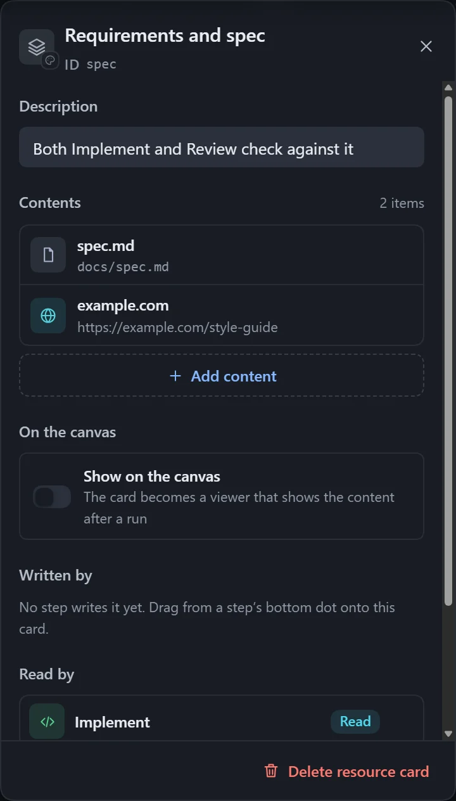

A resource is a separate card on the canvas, and lines show how steps read and write it. When several steps connect to the same resource, it is one shared copy.

| Type | Use |
|---|---|
| File | A file to read, write or update, such as a requirements document or a report. |
| Folder | A directory to read from or write to. |
| URL | The executor opens it to look. |
| Skill | The executor loads it first, then does the task the way it describes. |
| Custom | A prompt you write yourself; steps that read it receive it as written. |

## Add and connect

- Drag **Resource** from **Basics** in the step library, or right-click an empty spot and choose **Resource**.
- Drag from the dot at the bottom of a step to an empty spot and choose **Output file** to get a resource card that this step writes.
- Select a resource card and click **Add content**; one card holds up to 50 items.

The direction of the line decides read or write:

- From a **step** to the resource card: the step **writes** it. Choose to write the whole file (overwrite) or to update it in place (read first, then change, such as ticking items in a checklist).
- From the **resource card** to a step: the step **reads** it.
- A resource with no step connected belongs to the whole workflow, and every step can use it.

## How to add content

| Type | How |
|---|---|
| File, folder | Pick on the host; for an output file not yet written, type the path. |
| URL | Enter the address. |
| Skill | Choose from the skills detected, or type a name. |
| Custom | Write some text, up to 20000 characters. |

Each item can carry its own note telling the executor how to use it; for a file that is written, the note can set the format. **Change color and type** can turn an empty card into **Memory**; see [Memory](/dsh-workflow-lite/en/materials/memory/).

## Paths

- An absolute path is used as is; `~` is not supported.
- A relative path goes under the output root when a step writes it, and is relative to the workspace when it is only read.
- Two variables are available:

| Variable | Replaced with |
|---|---|
| `{workflow}` | The workflow's own folder (by default `~/.dsh/workflow-lite/assets/<workflow name>/`); the same copy in whichever workspace it runs, and exported along with the workflow. |
| `{instance}` | The instance number of this run; used in the **Output root**, so each run's output goes to its own place. |

## Notes

- An identical item shows "Duplicate"; a skill that cannot be found in the current workspace gets a warning that it may not load when running.
- To preview a file right on the canvas, see [Canvas display](/dsh-workflow-lite/en/display/overview/).
