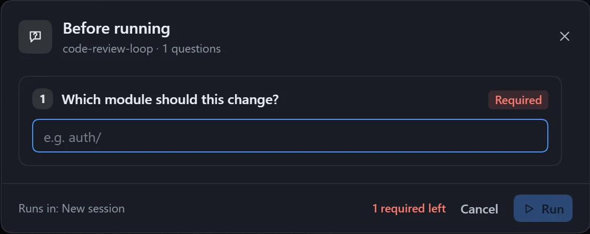
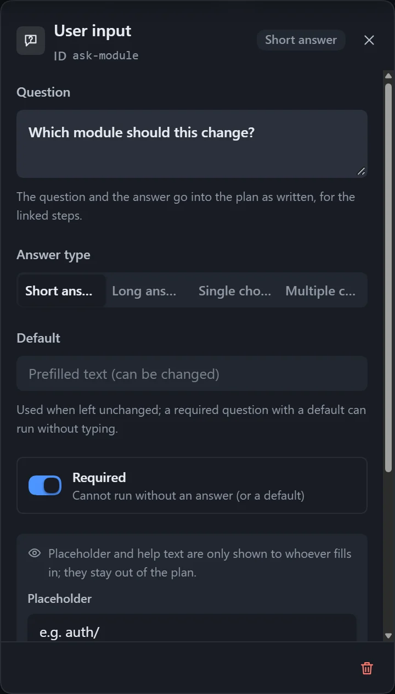

The same workflow is used again and again, but the module, the strictness and the audience differ each time. Asking for them before running means the workflow itself does not have to change.

After you click **Run**, a **Before running** window appears first. The run starts once it is answered, and the answers are passed to the relevant steps along with the plan.

## Build it

1. Pick the questions that the model must know but that may differ each time, and add one **User input** node for each. Example:

| Question | Answer type | Setting |
|---|---|---|
| Which module should be handled? | One line | Required |
| How strict should the review be? | Single choice: Loose, Standard, Strict | Default **Standard** |
| What should be produced? | Multiple choice | **Allow a custom answer** on |

2. Draw a line from the input card to the steps that need the answer: connect the module to Recon and Implement, the strictness only to Review, and the deliverables only to Summarise. Without a line, every step can see it.

For what each setting means, see [Questions before running](/dsh-workflow-lite/en/materials/inputs/).

## Tips

- Write each question as a full sentence and put extra requirements in the note.
- Do not leave placeholder options such as "Option 1" in a single-choice question; the **Checks** panel warns about them.
- A required question with a default value lets the user run right away.
- The instance shows the answers given for each run.
