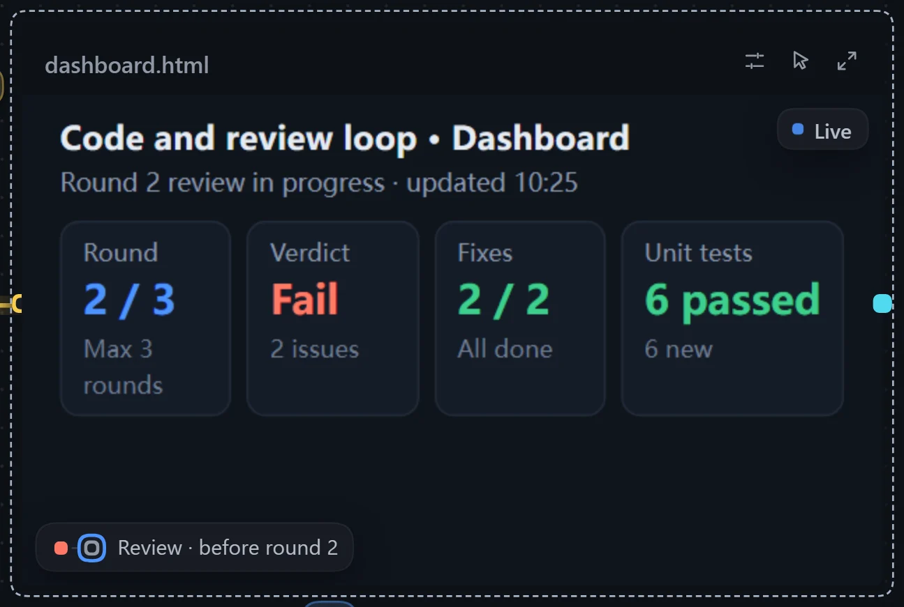
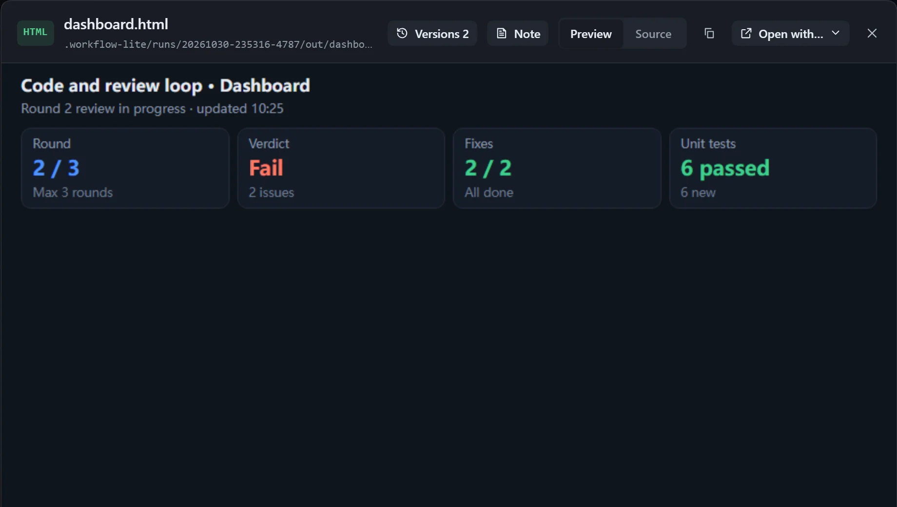
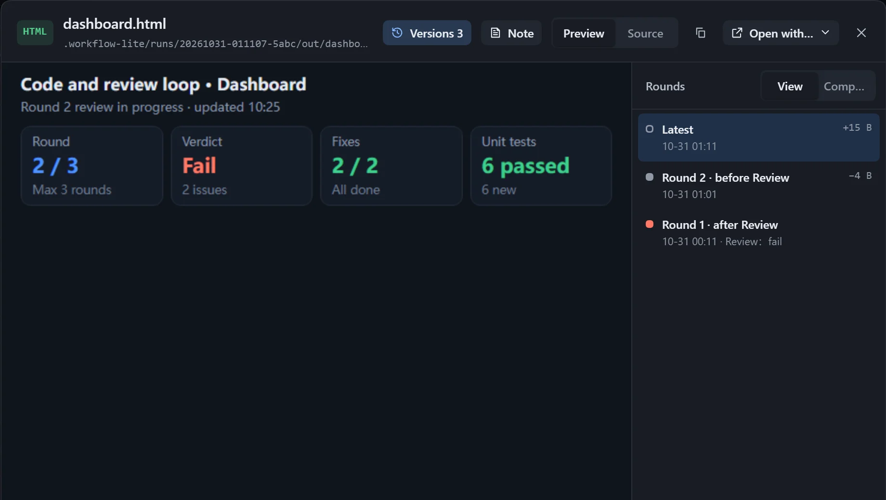

There is no need to open the file: the latest result is on the canvas, and earlier rounds can be compared.

## Build it

1. **Have a step produce a finished file**: in the prompt and generation rules of a step such as Summarise, name the file (for example `dashboard.html` or `report.md`), say how the content is organised, and state that every round overwrites the same file.
2. **Turn it into a resource card**: drag from the dot on the right of the step to an empty spot and choose **Output file**. See [Resources](/dsh-workflow-lite/en/materials/resources/).
3. **Turn on display**: select the resource card and turn on **Show on the canvas** in the right panel.

| Content | Suggestion |
|---|---|
| Web dashboard | Choose **L**; reduce the scale if needed so the whole page is visible. |
| Markdown report | **M** or **L**. |
| Image | Use **Fit** for placement. |

**Have the model fit the card** is on by default, so the step that writes the file knows how big the card is. See [Canvas display](/dsh-workflow-lite/en/display/overview/) for more settings.

## Run and look back

Turn on **Record run state** and click **Run**. While the step that writes the file is running, the card shows "Being written…"; when it finishes, the card switches to the latest content and lights up **Updated**. Click **Interact** to scroll inside the card, and double-click to open the viewer.

With a loop, a version is saved after every round, and a ruler appears under the card when the pointer is over it: hover or drag to switch versions, or use the arrow keys. In the viewer's **Versions** you can pick two rounds to compare.

See [Reviewing each round's output](/dsh-workflow-lite/en/display/rounds/) for details.

## Notes

- If the file is too large, the card shows "Too large to show on the canvas". Open the viewer, or have the step produce a leaner version.
- On the workflow canvas (not an instance), the card shows the content of the most recent run.
- Per-round versions are saved only when running inside the plugin.
