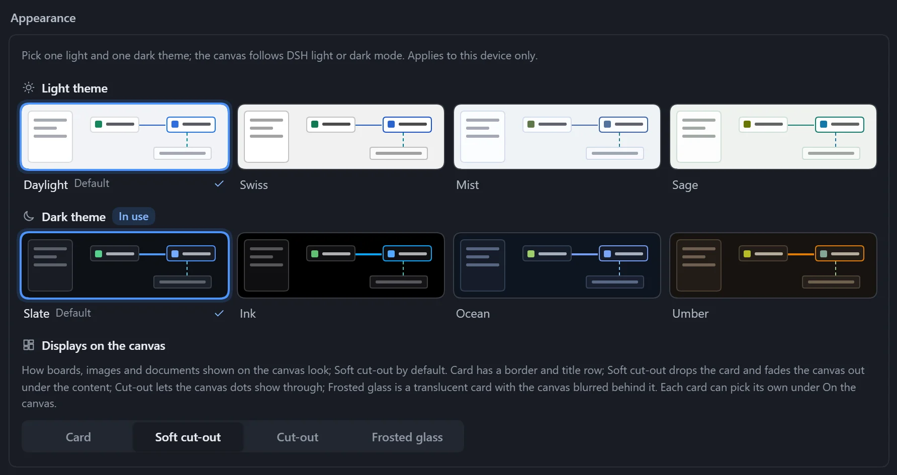
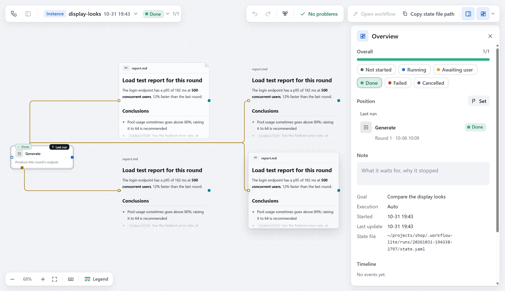

Plugin settings apply to all workflows. Open **Workflow hub** → **Settings**: the top part is **Appearance** (color themes and the look of display cards), and the rest is split into three groups, **Storage**, **Canvas** and **Model**.

## Use

1. Change a setting.
2. The bottom shows "N unsaved changes"; click **Save**, or **Discard**.
3. A setting that differs from its default has **Reset to default** on its right; hover to see the default.

For settings marked **After restart**, restart DSH after saving.

## Settings

| Group | Setting | Default | Effect |
|---|---|---|---|
| Storage | Data folder | `~/.dsh/workflow-lite` | Where workflows, versions and instance records are kept. Takes effect after restart. |
| Canvas | Max steps per workflow | 400 steps | Beyond this the canvas stops auto-arranging and the workflow cannot run. |
| Canvas | Autosave delay | 400 ms | How long the canvas waits after you stop before writing to disk. |
| Model | Model read limit | 256 KB | The most the model gets when it reads a workflow or run state; raise it if reading a very large workflow fails. |
| Model | Guides for the model | On | Registers three guides the model reads on demand: designing a workflow, recording run state, writing a canvas dashboard. Takes effect after restart. |

## Notes

- Changing the **Data folder** does not move existing data; change it back to the original path to see it again.
- Invalid input shows "Enter a whole number", "Must be at least N" or "Required"; fix it before saving.
- When the current DSH has no settings service, or its configuration does not allow editing here, the settings are read-only and the top of the page says why.

## Appearance

The canvas has four light and four dark color themes, following DSH's light and dark mode. The choice applies to the current device only and takes effect as soon as you click.

### Choose a theme

Open **Workflow hub** → **Settings** and choose a **Light theme** and a **Dark theme** under **Appearance** at the top; the one in use is marked **In use**.

| Light | Character |
|---|---|
| Daylight (default) | Light gray canvas, pure white cards, the clearest contrast. |
| Swiss | Neutral gray, square corners and hairlines, Helvetica type. |
| Mist | Cool white base with blue accents. |
| Sage | Warm white base with green accents. |

| Dark | Character |
|---|---|
| Slate (default) | Cool dark slate gray. |
| Ink | True black base with more vivid colors; saves power on OLED screens. |
| Ocean | A dark base with a hint of blue. |
| Umber | A dark base with warm brown and amber accents. |

### Displays on the canvas

**Displays on the canvas** sets the look of display cards for everything, **Soft cut-out** by default; a single card can pick another under **Canvas display**. The four looks are described in [Canvas display](/dsh-workflow-lite/en/display/overview/).

The interface language supports Chinese and English, following DSH's language setting.
