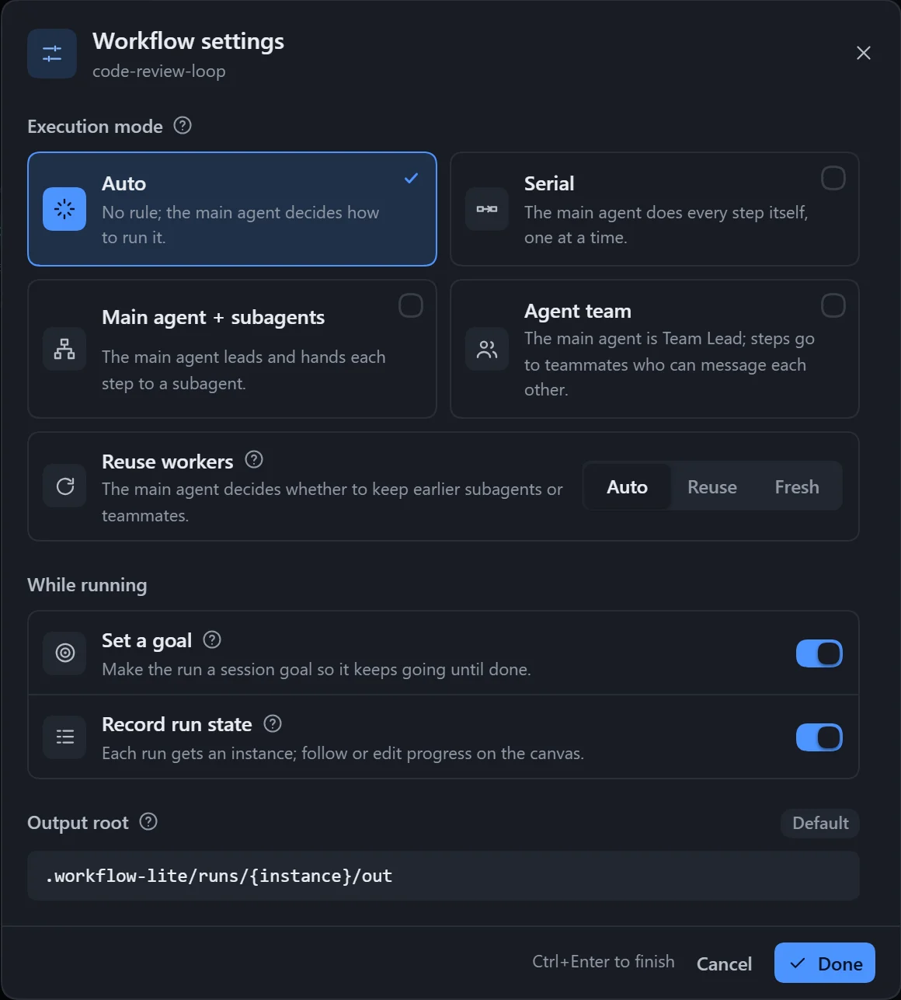

**Workflow settings** control how a single workflow runs; each workflow has its own. Click **Workflow settings** on the canvas toolbar to open them.

| Setting | Options | Default | Effect |
|---|---|---|---|
| Execution mode | Auto / Serial / Main agent + subagents / Agent team | Auto | How the main agent organises the run |
| Reuse workers | Auto / Reuse / New | Auto | Whether the same step keeps its worker when it runs again |
| Set a goal | On / Off | On | Makes this run the session goal, so unfinished work is picked up again |
| Record run state | On / Off | Off | Creates an instance for every run; follow progress and edit state on the canvas |
| Output root | Relative or absolute path | `.workflow-lite/runs/{instance}/out` | Where each step's output files go |

## Execution mode

| Option | Effect |
|---|---|
| Auto | The main agent decides. |
| Serial | The main agent finishes the steps one by one, without subagents. |
| Main agent + subagents | The main agent acts as leader and sends each step to a subagent. |
| Agent team | The main agent acts as Team Lead and creates a member for each step; members can message each other. |

In the last two modes, the main agent only dispatches, picks branches, advances loops and reports. Subagents and teams rely on the corresponding DSH tools; when they are unavailable, the main agent runs the steps itself one by one.

## Reuse workers

"Running again" covers the next round of a loop, a retry after failure, and continuing after an interruption.

| Option | Effect |
|---|---|
| Auto | The main agent decides. |
| Reuse | Hands the work back to the previous worker, continuing from its earlier context without re-reading. |
| New | A fresh worker every time, with clean context; suited to independent reviews. |

Workers are reused only within the same step; this has no effect when the execution mode is **Serial**.

## Set a goal

Before running, the run is set as the session goal, so when the main agent stops with work unfinished, DSH asks it to carry on. It is skipped automatically if the session already has a goal or has no goal feature.

## Record run state

When on, each compile creates an instance: it stores a snapshot of the workflow and creates a state file under `.workflow-lite/runs/` in the workspace. Only the main agent edits it during a run, and the plan gets an extra "Run state" section at the end. It takes effect on the next run. See [Instances and run state](/dsh-workflow-lite/en/running/run/#instances-and-run-state).

## Output root

- Empty means the default folder, one per instance, kept out of version control; `.` means the workspace root.
- A relative path starts from the workspace; an absolute path also works, but `~` is not supported.
- `{instance}` is replaced with the instance number at run time.
- The notation is tidied up automatically on save; **Reset to default** goes back to the default folder.
