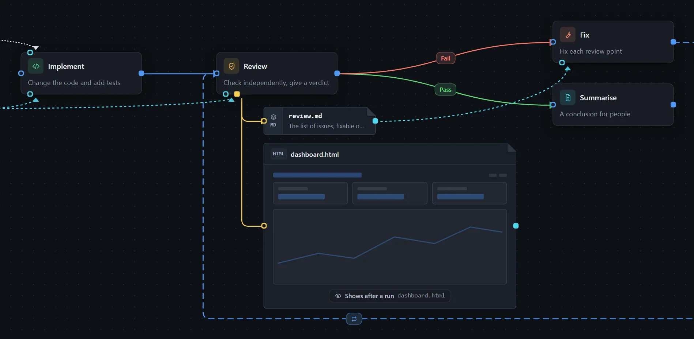

A workflow is made of **steps** and **connections**. A step says what to do; connections decide the order and can carry conditions, which is how branches and loops are expressed.

## Let the model create it

Describe the flow in the conversation, for example:

> Create a workflow: write the code, then review it; if the review fails, go back and fix it, at most three rounds.

It appears on the canvas at the same time. Once it looks right, click **Run** at the top right.

## Edit by hand

1. Open the **Workflows** tab and create a new workflow.
2. Drag steps from the step library on the left onto the canvas, fill in the prompts, and join them with connections.
3. Click **Run**.

## Follow the progress

Turn on **Record run state** in **Workflow settings**. Every run then creates an instance, and the canvas updates as it progresses.

See [Workflow settings](/dsh-workflow-lite/en/settings/workflow/) for details.
