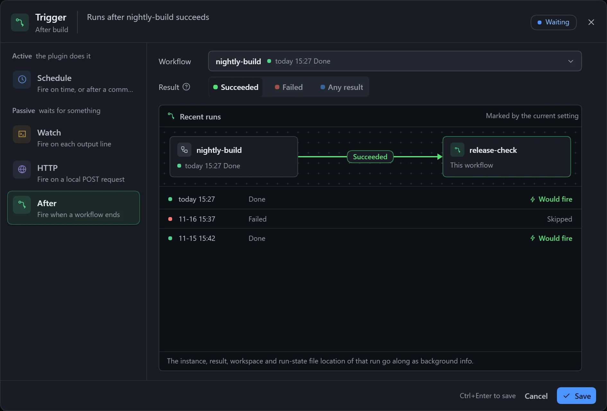

An after trigger runs a workflow when a run of another workflow ends. It suits chaining build, check and release, or cleaning up after a failure. This feature is experimental.

## Use

1. Add a trigger to this workflow, switch it to **After** from the menu in the header of **Trigger**, and click **Pick workflow**.
2. Choose one under **Which workflow** and an option under **On which result**, then click **Save**.
3. Choose the session mode and workspace under **Run settings** and turn on **Enabled**. The card shows **Waiting**.

**Which workflow** lists every workflow except this one, each with the result of its latest run, and can be searched. The workflow to wait for needs **Record run state** turned on: a row without it has **Turn on**; click it and confirm with **Turn on and use** to turn it on and pick it.

**Recent runs** below lists the latest runs of the chosen workflow and marks which ones **Would fire** under the current result option, updating as the option changes.

When a run of that workflow ends with a matching result, this workflow fires once. The background info contains that run's instance, result, workspace and the location of its run-state file, which the model reads when it needs that run's output.

## Settings

| Setting | Values | Default | Notes |
|---|---|---|---|
| Which workflow | Any workflow except this one | None | Needs **Record run state** turned on. |
| On which result | Succeeded, Failed, Any result | Succeeded | **Any result** includes cancelled runs. |

Whether a run has ended, and with what result, follows the overall status in its run state: it has ended once the model running it sets the overall status to done, failed or cancelled. Changing the overall status by hand in the [Workflow hub](/dsh-workflow-lite/en/manage/hub/#instances) counts too.

## Notes

- Only runs that end after the trigger is enabled count; earlier ones are not caught up. Each run fires this workflow once.
- If the watched workflow is renamed, deleted, or has **Record run state** turned off, the card shows **Invalid settings**; pick it again or turn the setting back on.
- Two workflows waiting for each other fire back and forth, held in check by **Hourly trigger limit**.
- After triggers have no **Filters**; **Trigger condition** still works.
- **Trigger once now** does not wait for the other workflow; the background info is only what was typed in.
