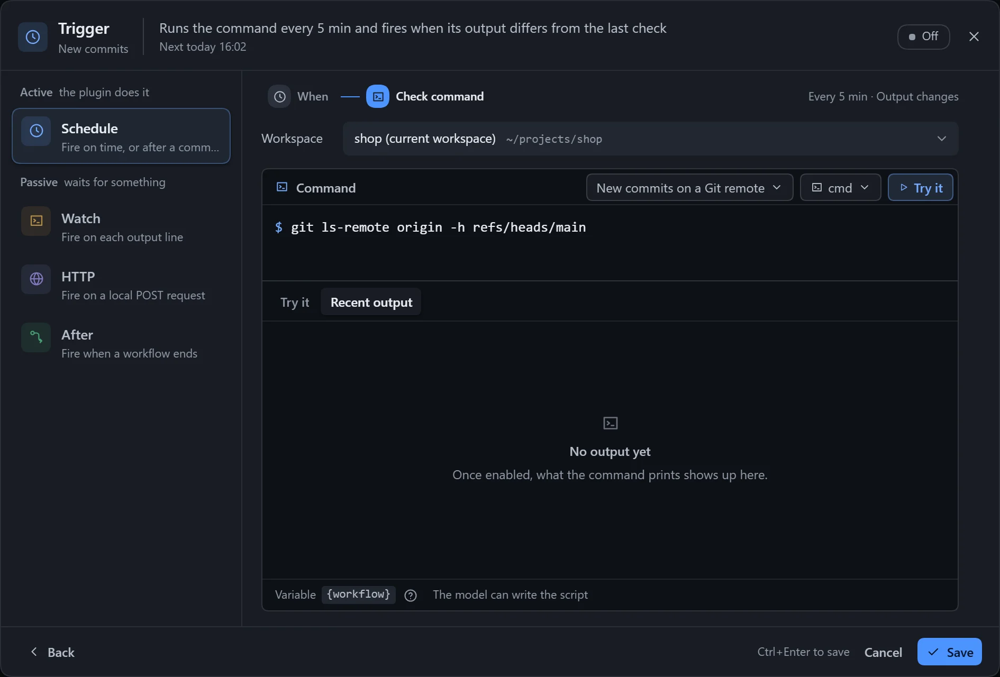
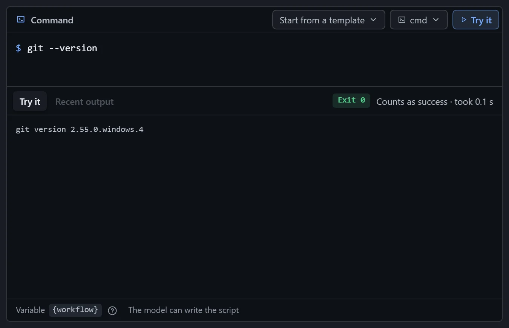

A scheduled check runs a command on this machine each time the schedule comes up and decides from the result whether to run the workflow this time. It suits things you have to look up to know, such as new commits on a remote, a web page coming up, or files in a folder changing. This feature is experimental.

## Use

1. Add a trigger, click **Edit** under **Trigger**, and set the rule on the **Schedule** page.
2. Set **Fire when** to **Every success**, **Becomes OK** or **Output changes**. The dialog then has two steps, **When** and **Check command**; click **Next: check command**.
3. Choose the **Workspace** and type the command, or pick one under **Start from a template** and adjust it; click **Try it** to see its output. Click **Save**.
4. Turn on **Enabled**, check the command, workspace and shell in the confirmation card, and click **Confirm and enable**.

The card shows **Checking** and the result of the last check, and the progress bar in its middle row runs to the next check.

| Fire when | Runs the workflow | Background info |
|---|---|---|
| Every success | Whenever the exit code is 0. | The command's standard output |
| Becomes OK | Once when it goes from failing to succeeding; not again while it keeps succeeding. | The command's standard output |
| Output changes | When standard output differs from last time. The first check only records it; failed runs are not compared. | The new standard output |

When standard output contains lines starting with `::trigger::`, only those lines (without the marker) become the background info, and **Output changes** compares only them; the rest is log, shown only in **Recent output**.

The sketch next to **Fire when** shows which of a series of checks would run the workflow, and changes with the option.

## Command

The bar above the command box holds **Start from a template**, the shell in use and **Try it**.

| Template | Fire when |
|---|---|
| New commits on a Git remote | Output changes |
| A service comes up | Becomes OK |
| Files in a folder change | Output changes |
| A port opens | Becomes OK |

A command can contain `{workflow}`, which is replaced with this workflow's folder before it runs. With a script kept there, write `node "{workflow}/triggers/check.mjs"` and it is found even after changing the workspace. The script can be [written by the model](/dsh-workflow-lite/en/trigger/model/).

Click **Try it** and confirm, and the command runs once in the chosen workspace with the chosen shell; below it are the exit code, whether it counts as success under the current option, the time taken and the output, plus how many `::trigger::` lines become the background info when there are any. A trial run does not enable the trigger or send anything to a session. Once enabled, the same place shows **Recent output**.

## Settings

| Setting | Values | Default | Notes |
|---|---|---|---|
| Rule | Interval, Times, Cron | Daily 09:00 | With a command, **Interval** can be as short as 10 seconds. |
| Fire when | On time, Every success, Becomes OK, Output changes | On time | **On time** drops the command and makes it a [scheduled trigger](/dsh-workflow-lite/en/trigger/schedule/). |
| Workspace | Workspaces you have opened | None | The command runs here, and new sessions are created here. |
| Shell | Default, installed shells, Choose another shell… | Default | **Default** uses **Default shell** in the [plugin settings](/dsh-workflow-lite/en/settings/plugin/). |

## Running commands

- Commands run as DSH in the chosen workspace, just like running them in a terminal yourself, with no sandbox. The command must be confirmed before the trigger is enabled; after the command, workspace or shell changes, the card shows **Needs confirmation** and stops until **Confirm command** is clicked in the panel.
- Commands should finish quickly and never wait for input. A run longer than the interval (5 minutes at most) times out.
- A command that cannot be found, cannot start or times out counts as a failure; after **Failures before auto-off** failures in a row, the trigger turns itself off. A non-zero exit code is not a failure.

## Notes

- After DSH restarts, checks continue from the last result, so a restart does not cause an extra run.
- **Output changes** compares the whole output: if it contains something that changes every time, such as a timestamp, every check fires. Print what matters as `::trigger::` lines, or have the script print only that.
