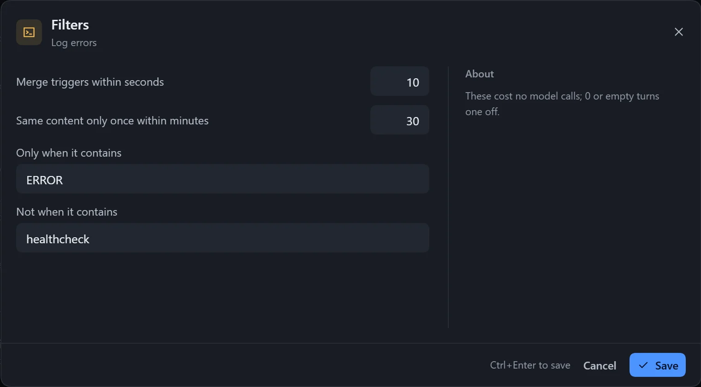

**Handling** in the panel has three rows: **Filters** drop unwanted triggers inside the plugin without any model call; **Trigger condition** lets the model read the content and decide; **Trigger note** is passed to the model with every trigger. Click a row to open a dialog, then click **Save**.

## Filters

Scheduled checks, watches and HTTP triggers bring background info and can be filtered on it; plain schedules and after triggers have no filters.

| Setting | Default | Notes |
|---|---|---|
| Merge triggers within seconds | 5 seconds for watches and HTTP, 0 for scheduled checks | Counted from the first one; triggers in that window become one, with their background info in order. |
| Same content only once within minutes | 0 | Identical content counts only the first time within that window. |
| Only when it contains | Empty | Fires only if it contains any of these, case-insensitive. |
| Not when it contains | Empty | Does not fire if it contains any of these; wins over the previous setting. |

Separate keywords with commas or new lines; a number of 0 or empty turns that setting off. Filtered-out triggers do not appear in the trigger history.

## Trigger condition

Put anything that needs reading to decide into **Trigger condition**, for example "only handle errors about the payment module". With it set, the model decides first on every trigger:

- Needed: the workflow starts as usual.
- Not needed: the model gives a reason and stops; the trigger history shows **Not needed** with the reason.

Deciding takes one model call. Drop what keywords can drop with filters first; for decisions that need reading files or looking things up, make that the first step of the workflow and use a conditional line to go straight to the end.

## Trigger note

Passed to the model as written with every trigger; good for the scope and requirements of each run, for example "only check the logs folder". It sits in the same dialog as **Trigger condition**.

When the workflow has [user inputs](/dsh-workflow-lite/en/materials/inputs/), a trigger does not open the form: the model answers from the trigger note and background info, and asks in the session only when it cannot answer a required question.

## Notes

- When the background info is long, the message to the model contains only the beginning; the full text is saved to a file for the model to read when needed.
- **Trigger once now** skips the filters; the trigger condition is still checked by the model.
