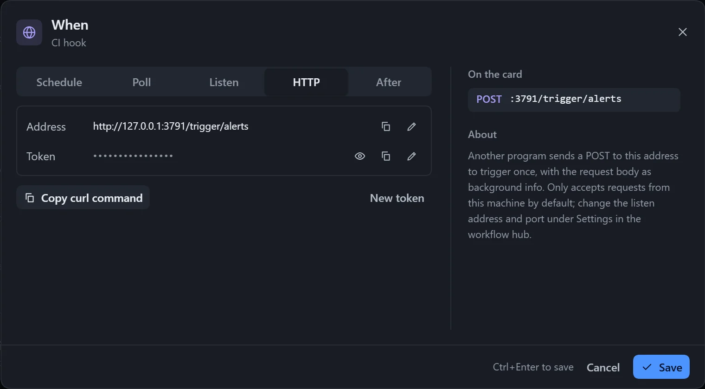

An HTTP trigger gives each card a local address and a token. When CI, a script or another tool sends a POST request to it, the workflow is triggered once, with the request body as background info. This feature is experimental.



## Use

1. Add a trigger card and choose **HTTP** under **When**.
2. Choose a workspace under **How to run** and turn on the switch. The card shows **Receiving**.
3. **Address** and **Token** appear in the panel. Click **Copy curl command** to get a command you can run as is.

Calling it:

```sh
curl -X POST http://127.0.0.1:3791/trigger/<id> \
  -H "Authorization: Bearer <token>" \
  -d '{"pipeline":"nightly","status":"failed"}'
```

The request returns 202 as soon as it arrives, without waiting for the workflow to finish.

| Response | Meaning |
|---|---|
| 202 | Received and being handled. |
| 401 | Wrong token. |
| 404 | No such address, or the card is off. |
| 413 | The request body is over 1 MiB. |

## Settings

| Setting | Where | Default | Description |
|---|---|---|---|
| HTTP trigger port | Workflow hub **Settings** → **Triggers** | 3791 | Shared by all HTTP trigger cards and only taken while one of them is on. Changing it changes the addresses. |
| New token | Panel | — | The old token stops working right away; the address stays the same. |

By default, requests within 5 seconds are merged into one trigger; see [Filters and conditions](/dsh-workflow-lite/en/trigger/filter/).

## Notes

- Only requests from this machine (127.0.0.1) are accepted.
- When another program holds the port, the card shows **Error** and the reason; it recovers on its own once the port is free or changed in Settings.
- The address and token are stored on this machine only and are not exported with the workflow. If the token leaks, click **New token**.
