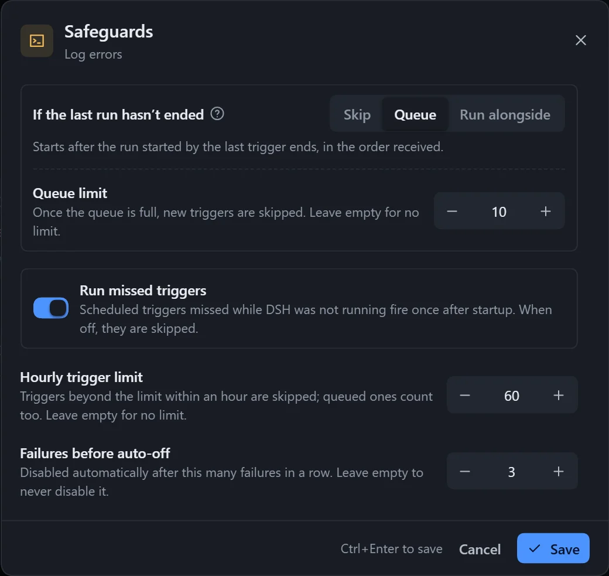

**Run settings** in the panel decide which session a trigger is sent to and what happens while the last run has not ended; **Safeguards** keep a trigger from firing too often or failing forever. They work the same for every trigger type.

## Session

| Setting | Values | Default | Notes |
|---|---|---|---|
| Session | New session, Continue last, Fixed session | New session | **Continue last** sends to the session the last trigger used, or creates a new one if it is gone. |
| Workspace | Workspaces you have opened | None | New sessions are created here, and commands run here. |
| Pin to | An existing session | None | Shown with **Fixed session**; every trigger goes to this session. |

The workspace and session are stored only on this machine and are not exported with the workflow.

## If the last run hasn’t ended

Click the **Safeguards** row under **Run settings** and set it in the dialog.

| Option | Effect |
|---|---|
| Skip (default) | If the run started by the last trigger hasn’t ended, this one is skipped. |
| Queue | Starts after the run started by the last trigger ends, in the order received; once **Queue limit** (10 by default) is reached, new triggers are skipped. |
| Run alongside | Starts right away without waiting; workflows that change the same workspace may interfere. |

Whether the last run has ended follows its run state: it has ended once the model sets the overall status to done, failed or cancelled. While the model is asking a question and waiting for a reply, or the message was sent but the model hasn’t started, the run hasn’t ended. So with **Skip** or **Queue**, the workflow needs **Record run state** turned on; if it is off, enabling the trigger first offers to turn it on.

When the model never updates the status and the last run never ends, the panel says so; click **Mark as ended** and the first queued trigger is sent right away, or the next trigger runs as usual. The last run itself is not affected.

Queued triggers show as **{n} queued** on the card, and under **Queued** in the **Timeline** tab of the [Triggers page](/dsh-workflow-lite/en/trigger/manage/), where one or all of them can be cancelled. Disabling the trigger drops the queue and records the queued ones as **Skipped**.

## Safeguards

| Setting | Default | Notes |
|---|---|---|
| Run missed triggers | On | Scheduled triggers missed while DSH was not running fire once after startup. When off, they are skipped. |
| Hourly trigger limit | 60 | Triggers beyond the limit within an hour are skipped; queued ones count too. Leave empty for no limit. |
| Failures before auto-off | 3 | Disabled automatically after this many failures in a row. Leave empty to never disable it. |

A failure means the trigger itself could not do its job: the workspace or session does not exist, a session cannot be created, the workflow has errors and cannot run, a command cannot start, or a watch program exits right after starting. Skipped triggers, unmet conditions, filtered-out triggers and the outcome of a run after it was sent do not count.

## States

**Active** at the bottom of a card means the plugin starts it on a schedule (schedules and scheduled checks); **Passive** means it waits for something outside (watches, HTTP and after triggers).

| State | Meaning |
|---|---|
| Off | Not enabled. |
| Waiting / Checking / Receiving | Running normally, followed by the next trigger, the last check or the start time. |
| Invalid settings | The rule, command or watched workflow is wrong; the panel says why. |
| Needs confirmation | A command that runs on this machine has not been confirmed, or the command, workspace or shell changed. |
| Error | The long-running part has a problem, for example the HTTP port is taken. |
| Stopped automatically | Failed too many times in a row; fix it and enable it again. |
| All paused | **Pause all** is on in the Triggers page; the enabled state is kept. |
| Handled by another DSH | With several DSH instances on the same data directory, only one handles triggers; this one takes over when that one exits. |
| Can't trigger here | This environment cannot create sessions or send messages. |

## Trigger history and origin

**Trigger history** in the panel lists recent triggers and their outcome (**Sent**, **Queued**, **Skipped**, **Failed**, **Not needed**). Click one to see the reason and the trigger note and background info it carried, and click **View this run** to open that run; **All history** opens the Triggers page.

Every instance records how it started: see **Origin** in the overview of the right panel when an instance is open on the canvas, or under **Info** on the Workflow hub **Instances** page. It says whether it was started from the canvas, in the conversation, or by which trigger, along with the note and background info that trigger carried.

## Notes

- **Trigger once now** ignores whether the trigger is enabled, does not count toward the hourly limit, and does not wait for the last run to end.
- Triggers fire only while DSH is running.
