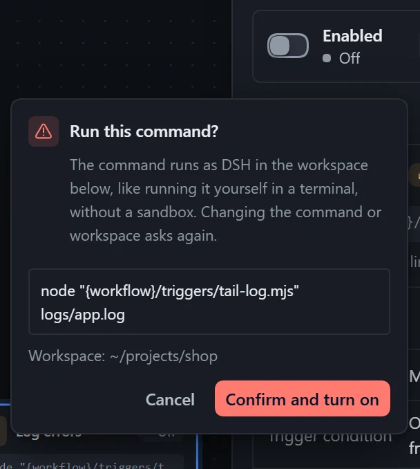

A watch runs a command that never exits: it starts when the trigger is enabled and stops when it is disabled. Each line the program prints to standard output starting with `::trigger::` fires the trigger once, with the text after the marker as background info; all other output is log, shown in **Recent output** and never fires. It suits things that need constant watching, such as errors appearing in a log, new files in a folder, or messages arriving on a queue. This feature is experimental.



## Use

1. Add a trigger, switch it to **Watch** from the menu in the header of **Trigger**, and click **Write command**.
2. Choose the **Workspace** and type the command, or pick one under **Start from a template** and adjust it; click **Save**.
3. Turn on **Enabled**, check the command, workspace and shell in the confirmation card, and click **Confirm and enable**.

The card shows **Receiving** and when the program started, and its middle row shows the latest event. In the **Trigger** dialog, **Recent output** below the command box includes error output; lines that fire are marked with `::trigger::`.

The templates are **New files in a folder**, **New lines in a log** and **A script in the workflow** (runs `triggers/watch.mjs` in the workflow folder). Before saving, click **Try it**: after confirming, the program runs in the chosen workspace for 5 seconds, and the result says how many `::trigger::` lines it printed, or warns that it would never fire when there are none; all output is below, and when an event is broken across lines, the lines without the marker are highlighted in yellow. A trial run does not enable the trigger or send anything to a session.

When a log prints many lines at once, use [filters](/dsh-workflow-lite/en/trigger/filter/) to merge, deduplicate or drop them by keyword; by default, lines within 5 seconds are merged into one trigger.

## Writing the program

```js
// One event per line: newlines become ⏎, optionally followed by some JSON
const emit = (text, data) => {
  const line = data === undefined ? String(text) : `${text} ${JSON.stringify(data)}`
  console.log(`::trigger:: ${line.replace(/\r?\n/g, ' ⏎ ')}`)
}
console.log('watching') // log: does not fire
emit('New file report.csv in D:/inbox', { size: 20481 }) // fires once
```

- Start the line that should fire with `::trigger::`, followed by one sentence saying what happened, with things like the log line or message text put straight in; any format works, plain text or text followed by JSON.
- Keep each event on one line: remove newlines from the content first, or the lines after it carry no marker and count only as log.
- Put what the fields mean and anything that is the same every time in **Trigger note**, not in every line.
- Print startup messages, progress and library output as usual; they are only log.
- On startup, record the current state without printing `::trigger::` lines; print them only for new events after that.
- Flush after each line, for example `print(..., flush=True)` in Python.
- Keep running in the foreground; do not put itself in the background (no `&`, `nohup` or `start`).
- Prefer Node scripts, which run on every system; write the command as `node "{workflow}/triggers/watch.mjs"`, where `{workflow}` becomes the workflow folder.

The script can be [written by the model](/dsh-workflow-lite/en/trigger/model/). How commands run, are confirmed and pick a shell is the same as for [scheduled checks](/dsh-workflow-lite/en/trigger/check/#running-commands).

## States

| State | Meaning |
|---|---|
| Receiving | The program is running. |
| Restarting | The program exited unexpectedly; the time of the next restart follows. The wait starts at 2 seconds and doubles each time, up to 1 minute. |
| Needs confirmation | The command, workspace or shell changed; click **Confirm command** in the panel to continue. |

A program that exits within 1 minute of starting counts as a failure (a script error, a missing command, missing dependencies); after **Failures before auto-off** failures in a row, the trigger turns itself off. After running for a full minute, the failure count resets.

## Notes

- Ready-made command-line tools (such as `tail -f` or `mosquitto_sub`) print lines without the marker, so used directly as the command they never fire: run them as a child process from a script and add `::trigger::` to the lines that should fire.
- Disabling the trigger or closing DSH ends the program together with the processes it started.
- Lines beyond **Hourly trigger limit** are dropped, and the trigger history records only one **Skipped** entry every 10 minutes.
