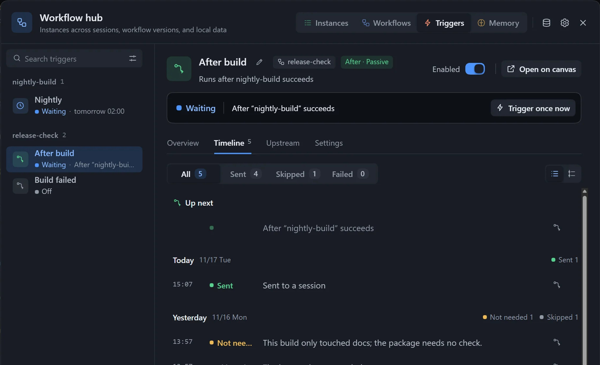

The **Triggers** page of the Workflow hub lists the triggers of every workflow, so their states, enabling and trigger history are in one place, together with **Pause all**.

## Use

1. Click **Workflow hub** at the top left of the canvas and switch to **Triggers**. **All history** in a trigger's panel opens this page with that trigger selected.
2. Each row on the left is a trigger: its type icon, name and state, an hourglass with a count when triggers are queued, and dimmed when it is off. **View options** changes the grouping (Workflow, Status, Trigger type, No grouping), sorting (Name, Last fired, Next fire), what is shown (All triggers, Enabled, Needs attention) and the row height.
3. Click a row. The top right shows its name, trigger type and a one-sentence description, with the **Enabled** switch and **Open on canvas** beside them; the bar below shows the current state and next time, with **Trigger once now**.
4. When something is wrong, the bar explains it and offers a fix, such as **Confirm and enable**, **Enable again** or **Mark as ended**.
5. Click **Open on canvas** to switch to that workflow with the trigger selected, and change its settings there.

## Tabs

| Tab | Contents |
|---|---|
| Overview | Fires and outcomes over the last 7 days, **Rhythm** drawing every fire of the last 7 days by hour, plus what is still due today and the latest records. |
| Timeline | The full trigger history, filterable by outcome, shown as **List** or **Timeline**; queued and upcoming triggers come first. |
| Schedule / Output / Calls / Upstream | Depends on the trigger type: the next 7 days for schedules, recent output for scheduled checks and watches, address, token and examples for HTTP, and the watched workflow with its recent runs for after triggers. |
| Settings | The trigger's type, handling, run settings and local settings, read-only; change them on the canvas. |

Click a record to see the full reason and the trigger note and background info it carried; click **View this run** at its right to open that run.

## Pause all

**Pause all** at the bottom of the left column stops every trigger from firing on its own for now; each one keeps its enabled state.

| Trigger type | While paused |
|---|---|
| Schedule | Does not fire when the time comes. |
| Scheduled checks, watches, HTTP | Stopped; the HTTP port is released. |
| After | Runs that end in the other workflow fire nothing. |

Enabled triggers show **All paused**, and queued ones wait too. Click **Resume** to carry on; nothing missed during the pause is caught up. **Trigger once now** works while paused.

## Notes

- The pause applies to every DSH instance on the same data directory and survives restarts.
- To stop a single trigger, just disable it.
