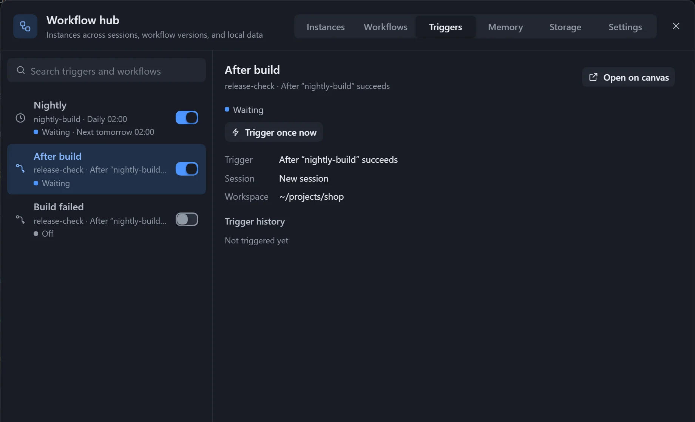

The **Triggers** page of the workflow hub lists the trigger cards of every workflow, so their status, switches and trigger history are in one place, and all of them can be paused at once.

## Use

1. Click **Workflow hub** at the top left of the canvas and switch to **Triggers**.
2. Each row on the left is one card: name, workflow, when it triggers and status. The switch at the end of the row is the same switch as in the card's settings panel.
3. Click a row to see its status, the reason for any error, when it triggers, its session, workspace and trigger history on the right; the arrow on a record opens that run. **Trigger once now** is there too.
4. Click **Open on canvas** to switch to that workflow with the card selected, where the workspace, session and other settings are changed.

The first time a card that runs a command (poll, listener) is switched on, the command and workspace appear beside the switch and need confirming, just like in the settings panel.

## Pause all

**Pause all** at the bottom of the left column stops every trigger card from firing on its own; each card's own switch stays as it is.

| Trigger | While paused |
|---|---|
| Schedule | Does not fire when the time comes. |
| Poll, listener, HTTP | Stopped; the HTTP port is released. |
| After another workflow | Runs that finish meanwhile do not trigger. |

Cards that are on show **All paused**. Click **Resume** to carry on; nothing missed while paused is caught up. **Trigger once now** is not affected by pausing.

## Notes

- Pausing applies to every DSH using the same data folder and stays in effect after a restart.
- To stop just one card, switch that card off.
