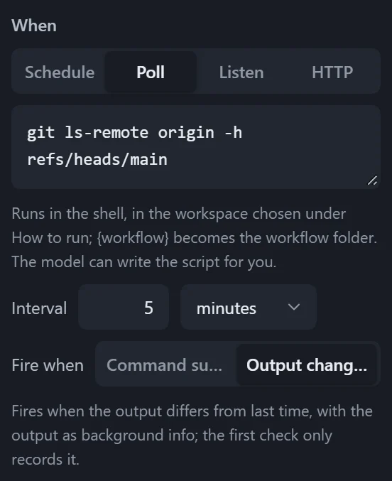

A poll trigger runs a command on this machine at an interval and decides from the result whether to trigger. It suits things you have to check to know, such as new commits on a remote, a changed web page or a file that appeared. This feature is experimental.

## Use

1. Add a trigger card and choose **Poll** under **When**.
2. Fill in **Command**, then choose the interval and **Fire when**.
3. Choose a workspace under **How to run**: both the command and new sessions run there.
4. Turn on the switch, check the command and workspace in the confirmation card, and click **Confirm and turn on**.

The card shows **Checking** and the result of the last check. Click **Show recent output** in the panel to see the command's recent output.

## Settings

| Setting | Values | Default | Description |
|---|---|---|---|
| Command | One command | Empty | Runs in the system shell (cmd on Windows, sh elsewhere); `{workflow}` becomes the workflow folder. |
| Interval | 10 seconds to 7 days | 5 minutes | How long to wait after each run; it runs once right away when switched on. |
| Fire when | Command succeeds, Output changes | Command succeeds | See the table below. |

| Fire when | Triggers | Background info |
|---|---|---|
| Command succeeds | Once when the exit code goes from non-zero to 0; staying at 0 does not trigger again. | The command's standard output |
| Output changes | When the standard output differs from last time; the first check only records it, and runs with a non-zero exit code are not compared. | The command's standard output |

For filters and trigger conditions see [Filters and conditions](/dsh-workflow-lite/en/trigger/filter/); for session modes and safeguards see [Scheduled triggers](/dsh-workflow-lite/en/trigger/schedule/).

## Running commands

- The command runs as DSH in the chosen workspace, just like running it in a terminal yourself, without a sandbox. You confirm the command before switching it on; after the command or workspace changes, the card shows **Needs confirmation** and stops until you click **Confirm command** in the panel.
- The command should finish quickly and not wait for input. Running longer than the interval (5 minutes at most) is a timeout.
- A missing command, a failure to start or a timeout counts as a failure; after **Stop after failures in a row** failures the card stops automatically. An unmet condition is not a failure.
- The model can write the script for you: describe in a conversation when the workflow should run. The model puts the script in the workflow folder, tries it, and adds a trigger card that is off; review it, choose a workspace and turn it on.

## Notes

- After DSH restarts, the check continues from the last result, so a restart does not cause an extra trigger.
- **Output changes** compares the whole output. If the output contains something that changes every time, such as a timestamp, every check triggers; have the script print only the part that matters.
