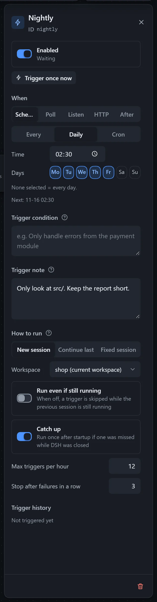
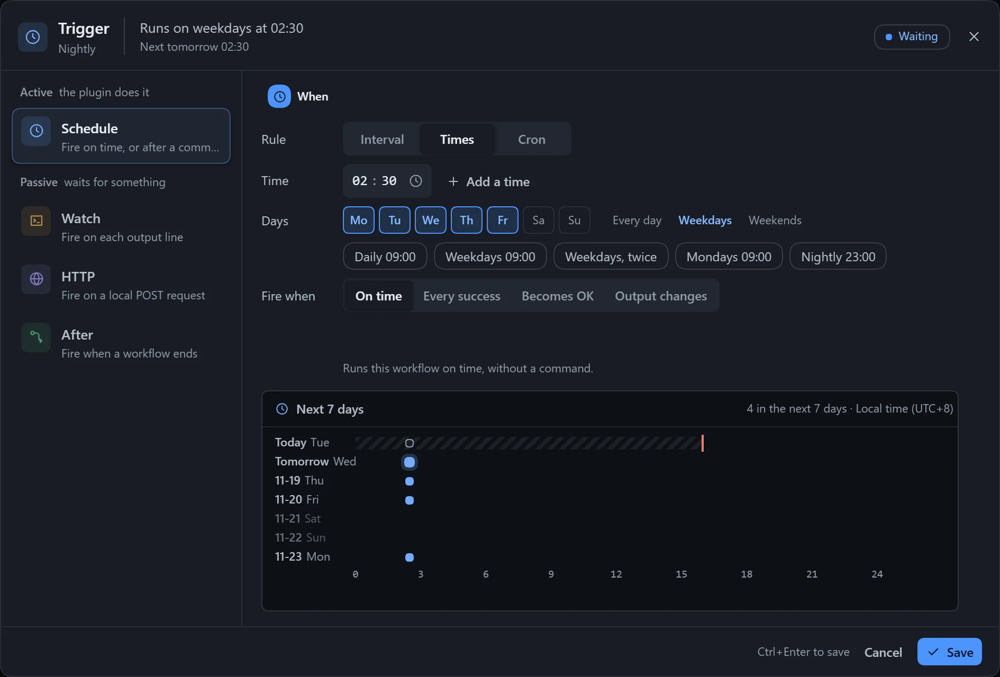

A trigger runs a workflow when something happens: the plugin sends the workflow to a session and the model runs it as usual. This feature is experimental.

| Trigger type | Runs when | See |
|---|---|---|
| Schedule | The time comes | This page |
| Schedule + check command | The time comes and a command's result says so | [Scheduled checks](/dsh-workflow-lite/en/trigger/check/) |
| Watch | A long-running program prints a line | [Watch](/dsh-workflow-lite/en/trigger/listen/) |
| HTTP | Another program sends a request | [HTTP triggers](/dsh-workflow-lite/en/trigger/http/) |
| After | Another workflow finishes | [After triggers](/dsh-workflow-lite/en/trigger/after/) |

Sessions, workspaces, what happens while the last run is still going, safeguards and states are shared by all types; see [Run settings and safeguards](/dsh-workflow-lite/en/trigger/launch/).

## Use

1. Drag **Trigger** from **Basics** in the step library, or right-click an empty spot on the canvas to add one. A trigger takes no lines; it triggers the whole workflow.
2. A new trigger uses **Schedule**, daily at 09:00. Under **Trigger** in the right panel, click **Edit**, set the rule, and click **Save**.
3. Choose the session mode and workspace under **Run settings**.
4. Turn on **Enabled** at the top of the panel. The card shows **Waiting** next to its name and the next trigger time at the bottom.

To see it work right away, click **Trigger once now** in the panel, optionally add background info for that run in the small card that opens, and click **Trigger**.

**Trigger** is a card that looks like the one on the canvas: click the trigger type in its header to pick another from the menu, which takes effect right away and can be undone; click **Edit** to change the details in a dialog. When the new type still needs something, **Edit** becomes **Write command** or **Pick workflow**.

## The Trigger dialog

The left side lists the four trigger types, split into **Active** (the plugin does it) and **Passive** (waits for something); click one to switch to it. Next to the title, one sentence says when this trigger runs, or **Takes effect once saved** while there are unsaved changes.

The top of the **Schedule** page holds the rule; with **Fire when** set to **On time** it is the plain schedule described here. **Next 7 days** below draws every trigger time in local time, so a wrong rule shows at a glance.

Changes take effect only after **Save** (Ctrl+Enter); while there are unsaved changes, Esc or a click outside does not close the dialog; click **Cancel**. With the trigger selected on the canvas, a click on the middle row of the card also opens this dialog.

## Settings

| Rule | Values | Presets |
|---|---|---|
| Interval | 1 minute to 7 days, counted from when it is enabled | 1 minute, 15 minutes, 1 hour, 1 day |
| Times | Several times of day (up to 12), optionally only on some weekdays, with **Every day**, **Weekdays** and **Weekends** shortcuts | Daily 09:00, Weekdays 09:00, Weekdays, twice, Mondays 09:00, Nightly 23:00 |
| Cron | Five fields (minute, hour, day, month, weekday) in the local time zone; clicking a field explains how to write it, a mistake marks only that field, and a whole expression can be pasted into any field | Weekdays 09:00, Work hours, every 15 min, Monthly, 1st 09:00 |

## Notes

- Triggers fire only while DSH is running. Whether a time missed while DSH was closed fires once after startup depends on **Run missed triggers**; see [Safeguards](/dsh-workflow-lite/en/trigger/launch/#safeguards).
- The enabled state, workspace and session are stored only on this machine and are not [exported](/dsh-workflow-lite/en/manage/import-export/) with the workflow; after importing, choose them again and enable the trigger.
- Do not open a workflow with triggers in plugin version 0.10.0 or earlier; saving there drops the trigger settings.
