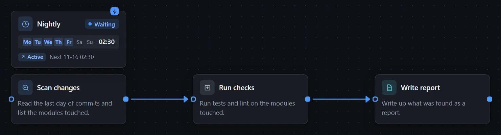

A trigger card runs a workflow on a schedule: when the time comes, the plugin sends the workflow to a session and the model runs it as usual. This feature is experimental.

Besides schedules, a trigger card can [poll a command](/dsh-workflow-lite/en/trigger/poll/), run a [listener](/dsh-workflow-lite/en/trigger/listen/), receive [HTTP requests](/dsh-workflow-lite/en/trigger/http/), or run [after another workflow](/dsh-workflow-lite/en/trigger/after/) finishes. Session modes, safeguards, status and origin are shared by all of them and described on this page.

## Use

1. Drag **Trigger** from **Basics** in the step library, or right-click an empty spot on the canvas to add one. A trigger card takes no lines; it triggers the whole workflow.
2. Under **When** in the right panel, choose **Schedule** and a rule.
3. Choose the session mode and workspace under **How to run**.
4. Turn on the switch on the card. The card shows **Waiting** and the next trigger time.

To see it work right away, click **Trigger once now** in the panel, optionally add background info for that run in the small card that opens, and click **Trigger**.

## Settings

| Setting | Values | Default | Description |
|---|---|---|---|
| When | Every, Daily, Cron | Daily 09:00 | **Every** ranges from 1 minute to 7 days, counted from the moment the switch is turned on; **Daily** can be limited to certain weekdays; **Cron** takes a five-field expression in local time. |
| Trigger note | Text | Empty | Passed to the model as is on every trigger; a good place for the scope and requirements of the run. |
| Session | New session, Continue last, Fixed session | New session | **Continue last** sends to the session used by the previous trigger, or creates one if it is gone. |
| Workspace | Workspaces opened before | None | New sessions are created here; with **Fixed session**, choose **Session** instead. |
| Run even if still running | On, off | Off | When off, a trigger is skipped while the session from the previous trigger is still running. |
| Catch up | On, off | On | Runs once after startup if a trigger was missed while DSH was closed. |
| Max triggers per hour | 1 or more | 12 | Triggers beyond the limit are skipped. |
| Stop after failures in a row | 1 or more | 3 | See **Status** below. |

## Status

| Status | Meaning |
|---|---|
| Off | The switch is off. |
| Waiting | On; followed by the next trigger time. |
| Invalid settings | The rule or command is wrong; the panel says why. |
| Stopped automatically | Several failures in a row. Fix the cause, then switch it back on. |
| All paused | Paused on the [Triggers page of the workflow hub](/dsh-workflow-lite/en/trigger/manage/); the switch stays on. |
| Handled by another DSH | When several DSH instances share one data folder, only one handles triggers; this one takes over when it exits. |
| Can't trigger here | This environment cannot create sessions or send messages. |

A failure means the trigger itself did not get through: the workspace or session is missing, the session cannot be created, the workflow has errors and cannot run, or a poll command or listener cannot run. Skipped triggers, unmet conditions, filtered triggers and the outcome of a run after delivery do not count.

**Trigger history** in the panel lists the time and result of recent triggers. Once the model starts the run, the arrow on the right of a record opens it. With a [trigger condition](/dsh-workflow-lite/en/trigger/filter/#trigger-condition), a trigger the model decided to skip shows **Not needed** and the reason.

## Questions before running

When the workflow has [user inputs](/dsh-workflow-lite/en/materials/inputs/), a trigger does not open the form. The model answers from the **Trigger note** and the background info, and only asks in the session when a required question cannot be answered.

## Origin

Every instance records how it was started. See **Origin** in the instance **Overview**: started from the canvas, started in the conversation, or triggered by a trigger card, along with the note and background info that came with the trigger. In the [workflow hub](/dsh-workflow-lite/en/manage/hub/), instances started by a trigger card show the card's name.

## Notes

- Triggers only fire while DSH is running; nothing runs after it is closed.
- The switch, workspace and session are stored on this machine only and are not [exported](/dsh-workflow-lite/en/manage/import-export/) with the workflow. After importing, choose them again and turn the switch on.
- The model can add trigger cards when asked in a conversation. Cards it adds are always off; review them and turn them on yourself.
- **Trigger once now** ignores the switch, the hourly limit and **Run even if still running**.
- Do not open a workflow that has trigger cards with plugin version 0.10.0 or earlier; the trigger settings are lost on save.
