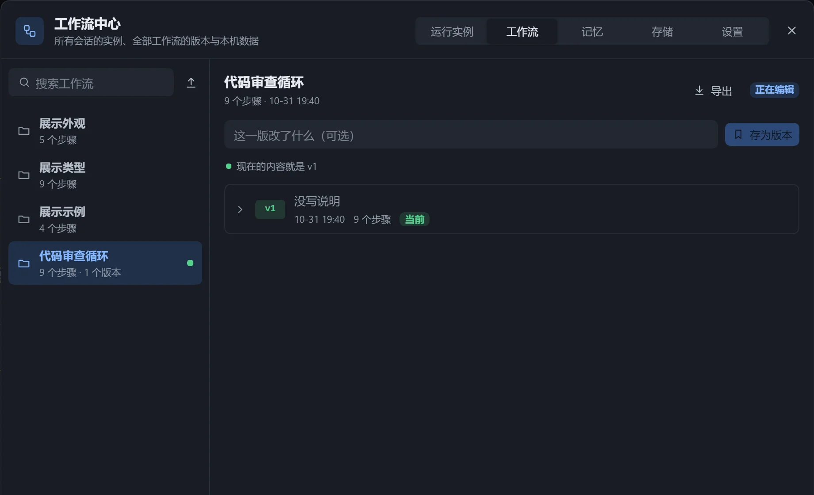
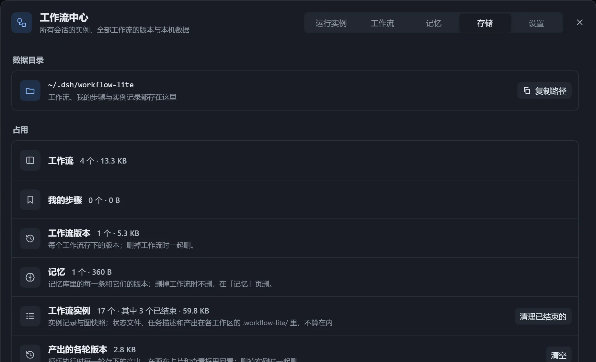
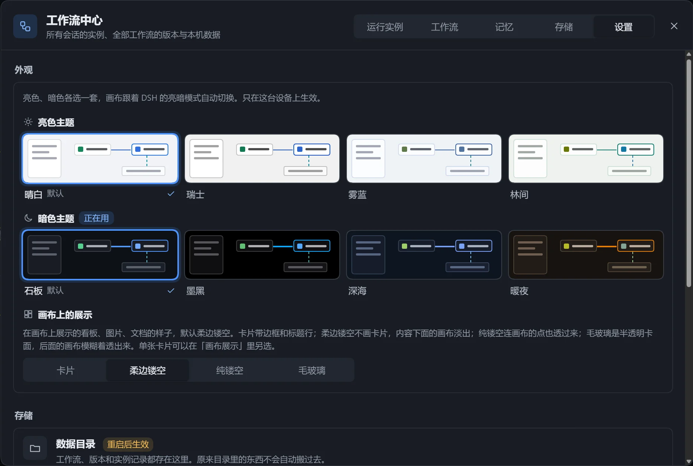

在画布左上角打开「工作流中心」，集中管理所有会话的实例、全部工作流与版本、记忆库、本机数据和设置。

| 页面 | 用途 |
|---|---|
| 运行实例 | 按工作区查看所有实例。 |
| 工作流 | 管理工作流及版本，导出与导入。 |
| 记忆 | 管理记忆库，见[记忆](/dsh-workflow-lite/materials/memory/)。 |
| 存储 | 查看本机数据占用，清理。 |
| 设置 | 界面与配色、插件设置。 |

## 运行实例

左边是工作区，右边是其中的实例；顶部搜索框跨工作区按工作流、会话、目标搜索。本工作区排在最前。

| 操作 | 说明 |
|---|---|
| 查看 | 打开实例。 |
| 改整体状态 | 点击状态标签并确认，不动各步骤；可打开「通知模型」并附一句说明。 |
| 移到本会话 | 一个实例只属于一个会话。 |
| 删除 | 删除记录和图快照，可同时删除工作区里的状态文件。 |

状态文件出问题的实例，点击「点开看原因」。

## 工作流

左边是工作流列表，右边是版本、导出和导入。可搜索、「打开」、「重命名」，或「删除工作流」（连同版本一起删，不可恢复）。

版本见[版本](/dsh-workflow-lite/manage/versions/)，导出导入见[导入与导出](/dsh-workflow-lite/manage/import-export/)。

## 存储

显示数据目录（可「复制路径」）和各类数据的占用。

| 操作 | 效果 |
|---|---|
| 「清理已结束的」 | 删除已完成、已取消的实例记录与快照，状态文件不动。 |
| 「清空」各轮版本 | 删除旧版本，现在的产出文件不动。 |
| 「删除」旧版本遗留文件 | 早先版本留下的任务描述，已不用，可放心删。 |

删除工作流时不删记忆，记忆在「记忆」页删除。

## 设置

上方是[界面与配色](/dsh-workflow-lite/settings/plugin/)，下方是[插件设置](/dsh-workflow-lite/settings/plugin/)。

## 注意

- 没记录工作区的实例显示「未记录工作区」，会话已不存在的显示「会话已不在」。
- 没有实例时，在画布点击「执行」就会建一个。
