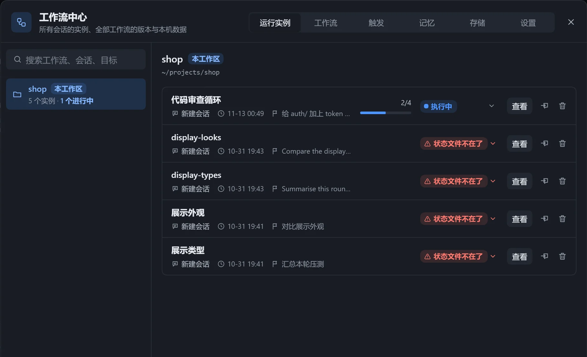
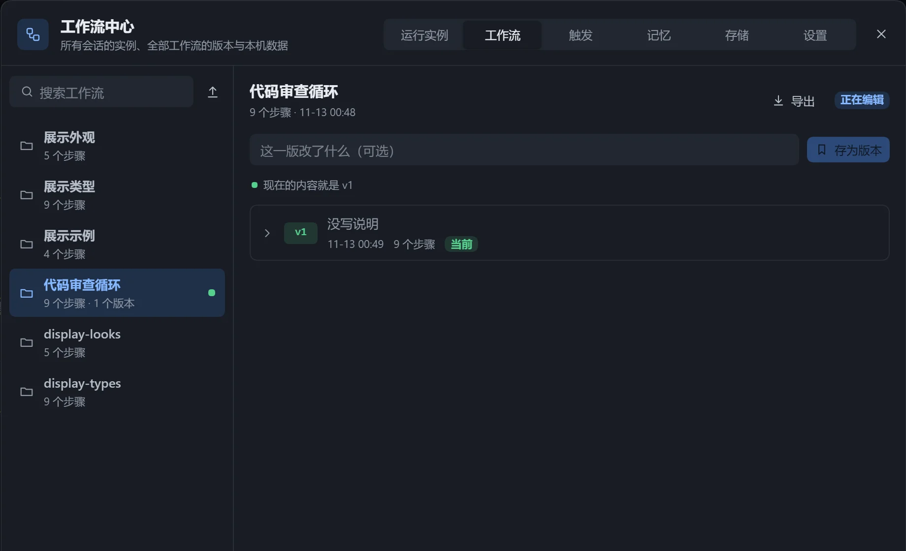
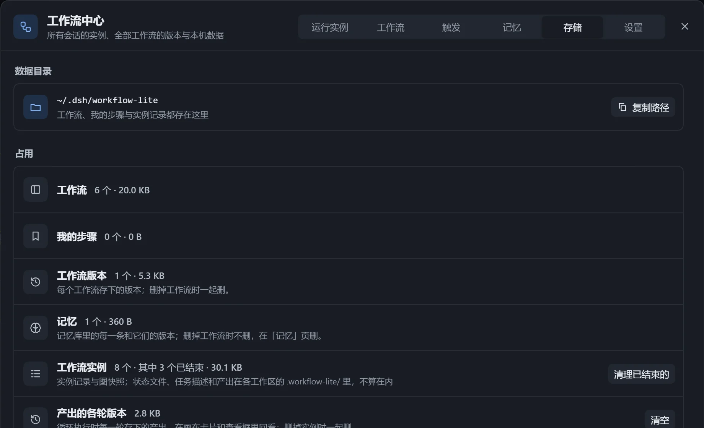
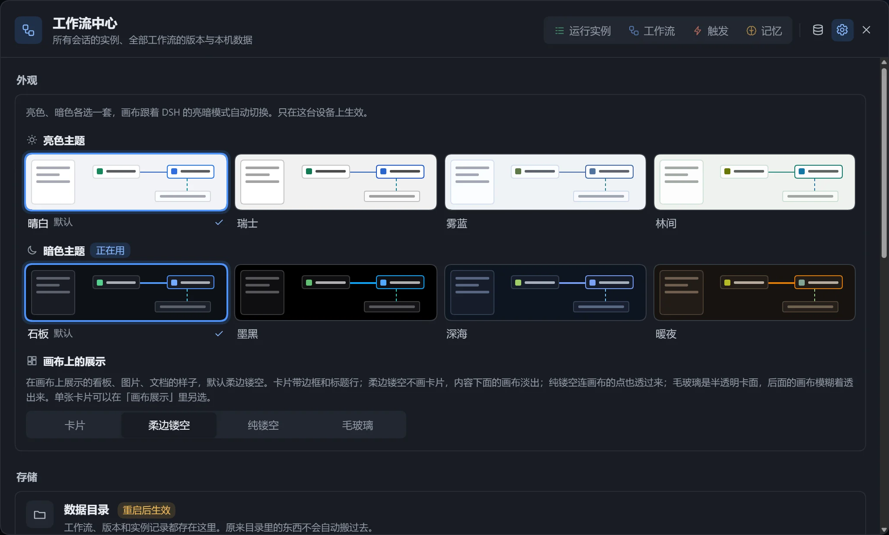

在画布左上角打开「工作流中心」，集中管理所有会话的实例、全部工作流与版本、触发器、记忆库、本机数据和设置。

| 页面 | 用途 |
|---|---|
| 运行实例 | 查看所有实例的进度、时间线和来源。 |
| 工作流 | 管理工作流、标签和版本，导出与导入。 |
| 触发 | 所有工作流的触发器与全部暂停，见[「触发」页与全部暂停](/dsh-workflow-lite/trigger/manage/)。 |
| 记忆 | 管理记忆库，见[记忆](/dsh-workflow-lite/materials/memory/)。 |
| 存储 | 查看本机数据占用，清理。在右上角关闭按钮旁。 |
| 设置 | 配色与插件设置。在右上角关闭按钮旁。 |

## 列表

各页左边是同一种列表：顶部搜索，下面按组列出。点「视图选项」可以改：

| 选项 | 说明 |
|---|---|
| 分组方式 | 各页不同，如实例按工作区、工作流、状态或会话；也可以不分组。 |
| 排序方式 | 按名称、最近修改、最近建立等。 |
| 筛选 | 只看一部分，如进行中、失败的实例；筛选着时列表顶上写明，点击「清除筛选」恢复。 |
| 行高 | 默认「紧凑」，可换成「标准」；工作流中心和画布顶栏的搜索共用行高。 |

## 运行实例

左边是实例，默认按工作区分组，本工作区排在最前；搜索跨工作区按工作流、会话、目标查找。右边是选中实例的详情。

| 页签 | 内容 |
|---|---|
| 概览 | 现在做到哪一步、各步骤的进程和摘要。 |
| 画布 | 执行时的那张图，按状态着色。 |
| 时间线 | 这个实例的步骤变化和触发，按时间排列。 |
| 信息 | 来源、会话与工作区、时间和状态文件位置。 |

| 操作 | 说明 |
|---|---|
| 查看 | 在画布上打开实例。 |
| 改整体状态 | 点击状态标签并确认，不动各步骤；可打开「通知模型」并附一句说明。 |
| 移到本会话 | 一个实例只属于一个会话。 |
| 删除 | 删除记录和图快照，可同时删除工作区里的状态文件。 |

状态文件出问题的实例，点击「点开看原因」。

## 工作流

左边是工作流，可按标签、触发、修改时间分组，或只看有触发器、有版本、有问题的；右边是选中工作流的版本和导出。搜索框旁的按钮用来导入。

1. 改名：点击右边顶部的工作流名，改完按 Enter。旁边的按钮可以删除工作流（连同版本一起删，不可恢复）。
2. 打标签：点击「标签」，搜索已有的或输入名字新建。
3. 管理标签：点击工作流上的标签，可以换颜色（所有工作流上的这个标签一起换）、从这个工作流去掉、重命名标签或删除标签。
4. 按标签筛选：在「视图选项」的「按标签筛选」里勾选。

画布顶栏的「搜索工作流或实例」默认列出全部工作流，按最近修改排序，不分组；分组、排序和筛选与「工作流」页各自保存。

版本见[版本](/dsh-workflow-lite/manage/versions/)，导出导入见[导入与导出](/dsh-workflow-lite/manage/import-export/)。

## 存储

显示数据目录（可「复制路径」）和各类数据的占用。

| 操作 | 效果 |
|---|---|
| 「清理已结束的」 | 删除已完成、已取消的实例记录与快照，状态文件不动。 |
| 「清空」各轮版本 | 删除旧版本，现在的产出文件不动。 |
| 「删除」旧版本遗留文件 | 早先版本留下的任务描述，已不用，可放心删。 |

删除工作流时不删记忆，记忆在「记忆」页删除。

## 设置

上方是[配色](/dsh-workflow-lite/settings/plugin/#外观)，下方是[插件设置](/dsh-workflow-lite/settings/plugin/)。

## 注意

- 没记录工作区的实例显示「未记录工作区」，会话已不存在的显示「会话已不在」。
- 没有实例时，在画布点击「执行」就会建一个。
