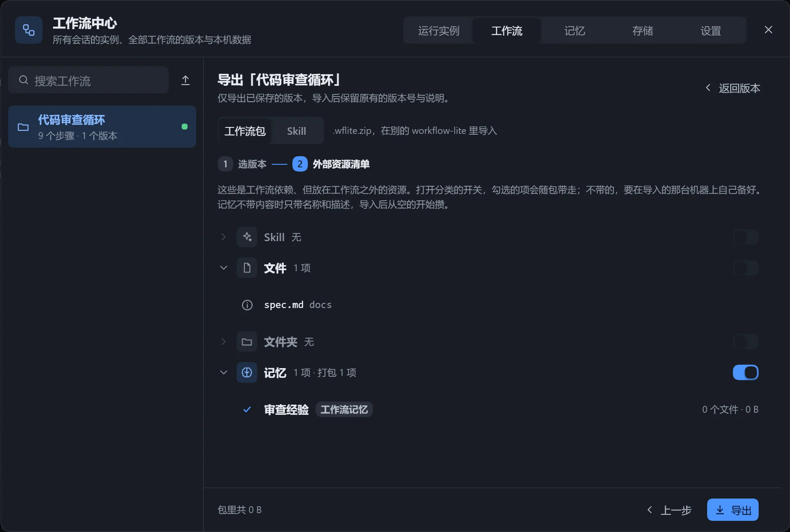
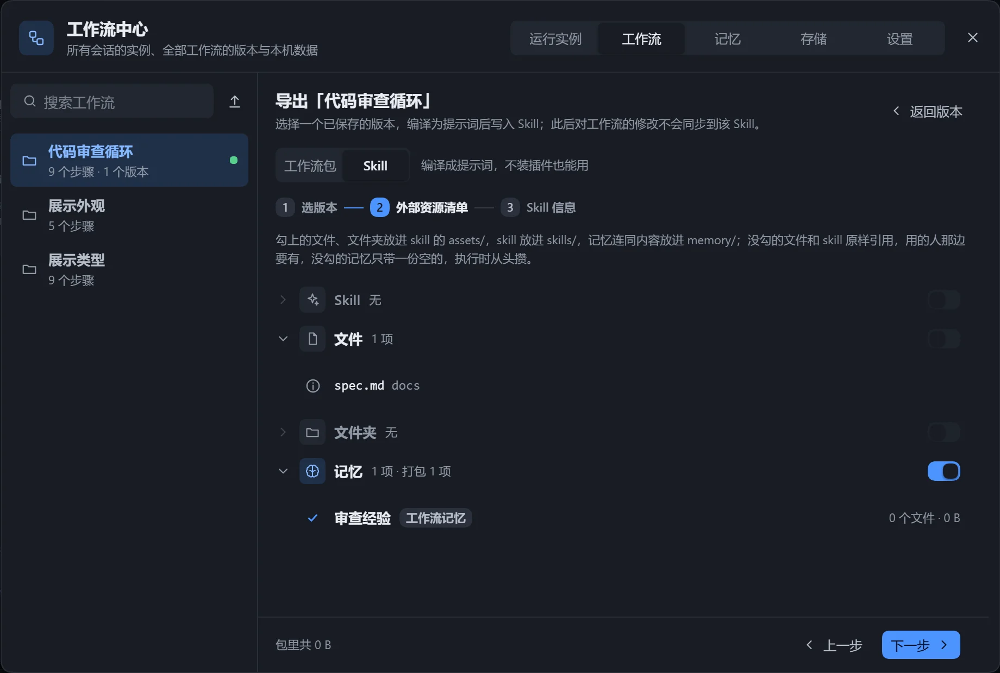

| 对方的情况 | 建议 |
|---|---|
| 也安装了本插件 | 导出为工作流包，保留画布与版本。 |
| 没有安装插件，或使用别的 agent | 导出为 Skill。 |

工作流可以导出为 `<工作流名>.wflite.zip`，包含选中的版本，以及选择带上的文件、文件夹、Skill 和记忆。在另一台机器上导入即可使用。

## 导出

点击画布顶栏「版本」旁的「导出工作流」，或在「工作流中心」的「工作流」页选中工作流点击「导出」。「导出成」选「工作流包」；选「Skill」见下文[导出为 Skill](#导出为-skill)。

**第一步：选版本。** 只导出已保存的版本，导入后保留版本号和说明。默认选中与现在内容相同的一版，至少选一个。现在的内容没存成版本时不会导出，需先在版本页存一版。

**第二步：外部资源清单。** 列出放在工作流之外的 Skill、文件、文件夹，每类一个开关，勾上的随包带走，没勾的需要导入的机器上自己准备。

| 状态 | 含义 |
|---|---|
| 本机找不到 | 不能勾选。 |
| 太大或文件太多 | 超出打包上限，不能勾选。 |
| 内置 skill，没有目录 | 不能勾选。 |
| 相对工作区，原样保留 | 路径原样留在包里。 |
| 记忆库里没有这一条 | 导不出内容。 |

网址、自定义文本、产出文件不在清单里，工作流自己的资料目录整个带上。记忆可逐条选择是否带内容，不带则只带名称和描述。没打包的绝对路径会原样留在包里，其中含有本机目录名，清单会提示有几处。

包最大 200 MB、5000 个文件，不含 `.git`、`node_modules` 和链接，超出时提示「超过上限，少勾几项」。点击「导出」后下载。

## 导入

在「工作流」页点击「导入」，选择文件，或把 `.wflite.zip` 拖到页面上。先显示清单，确认后才写入。

| 部分 | 内容 |
|---|---|
| 包里的版本 | 有哪些版本，导入后是哪一版。 |
| 导入到 | 名称已存在时选「另存为新名字」或「并入已有的」。 |
| 资料文件 | 放到数据目录下的 `assets/<工作流名>/`。 |
| 记忆 | 新的，还是本机已有。 |
| Skill | 装到哪里，本机是否已有。 |
| 包里没带的引用 | 外部路径在本机能否找到。 |

**并入已有的工作流**：内容一样的版本不再保存，其余接着编号，工作流内容换成包里的那一版。现在的内容若没存成版本会被替换，导入前先存一版。资料文件与本机不同时选「保留本机的」或「用包里的」。

**记忆**：本机已有同一条时选「用本机的」或「另存一份」。

**Skill**：装到 `~/.agents/skills/<名字>/`。本机已有同名时：

| 选择 | 效果 |
|---|---|
| 安装 | 新装。 |
| 不装 | 需要这台机器上有同名 Skill。 |
| 保留本机的 | 使用本机已有的。 |
| 覆盖 | 整个替换，找不回原内容。 |
| 换名安装 | 用新名字装，并改写引用。 |

安装 Skill 前必须勾选确认。Skill 里的脚本可能被执行，只导入信任来源的包。

确认后弹出「导入到『名称』？」，写明版本、资料文件、Skill 的数量；完成后提示「已导入『名称』：新增 N 个版本」。

## 注意

- 导入会校验路径和内容；比当前插件新的包会被拒绝，需升级插件。
- 资源路径里的 `{workflow}` 指工作流自己的资料目录，见[资源](/dsh-workflow-lite/materials/resources/)。

## 导出为 Skill

:::caution[实验性功能]
Skill 的结构以后还可能调整。
:::
导出的 Skill 包含 `SKILL.md`、每一步的任务描述和打包的文件，不依赖 DSH 的工具，在别的 agent 里也能照着执行。导出后再改工作流，不会同步到已导出的 Skill。

### 步骤

1. 在「工作流中心」的「工作流」页点击「导出」，「导出成」选「Skill」。
2. 选一个已保存的版本。
3. 勾选要带上的资源。
4. 填写名称和描述，预览。
5. 点击「装到本机」或「下载 zip」。

| 勾选情况 | 去向 |
|---|---|
| 勾上的文件、文件夹 | `assets/` 目录。 |
| 勾上的 Skill | `skills/` 目录。 |
| 勾上的记忆 | 连内容放进 `memory/` 目录。 |
| 没勾的文件和 Skill | 原样引用，对方需自己准备。 |
| 没勾的记忆 | 只带一份空的，从头积累。 |

| 项目 | 说明 |
|---|---|
| 名称 | 小写字母、数字和 `-`，最多 64 字，`-` 不能在开头、结尾或连写；也是目录名。 |
| 描述 | 必填，最多 1024 字。模型据此判断何时使用，写清做什么、何时用。 |
| 使用时机 | 可不填。 |

- 「装到本机」：安装到 `~/.agents/skills/`，同名时确认是否覆盖，覆盖后找不回原内容。
- 「下载 zip」：得到压缩包。

### 注意

导出页会针对具体情况提示：

- 开启了「记录运行状态」：由模型自己在工作区维护 `.workflow-lite/runs/<编号>/state.yaml`，没有画布上的实时查看。
- 步骤会改写工作流自己目录里的文件：导出后这些文件在 Skill 目录里，执行时会被改动。
- 产出根目录是绝对路径：换一台机器不一定存在。
- 没打包的 Skill：对方需自己装好。
- 版本有编译级问题：无法导出，修好再导。

另外，「让模型适配展示」不会带出，各轮产出版本不会保存，覆盖安装会覆盖已积累的记忆。
