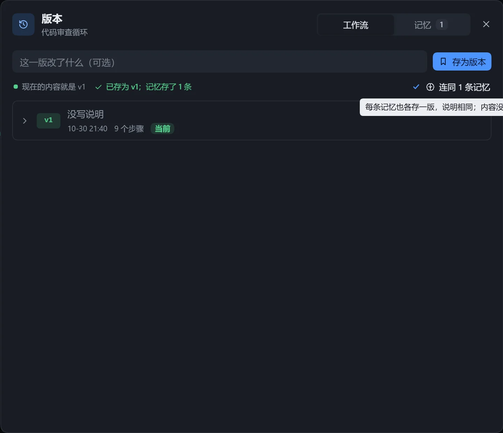

把满意的样子存成版本，改坏了可以切回。版本保存当时的步骤、连线和工作流设置。

## 使用

1. 点击画布顶栏的「版本」。
2. 写一句说明（可不填），点击「存为版本」。
3. 要回到某一版：展开该行查看「切换到这一版会」带来的变化，点击「切换到这一版」并确认。

切换前，现在的内容若没存成版本，会自动存一份，说明为「切到 vN 前自动存的」，随时可切回。

「版本」图标出现黄点，表示现在的内容还没存成版本。列表里当前内容对应的版本标有「当前」。另可「编辑说明」或「删除」某一版。

## 限制

- 说明最多 500 字；每个工作流最多 100 个版本，满了先删最旧的。

## 记忆的版本

对话框里有「工作流」和「记忆」两栏。保存工作流版本时勾选「连同 N 条记忆」，每条记忆也各存一版，没变的不存。见[记忆](/dsh-workflow-lite/materials/memory/)。

## 注意

- 删除工作流时，它的所有版本一起删除，不可恢复。
- 导出时只导出已保存的版本，见[导入与导出](/dsh-workflow-lite/manage/import-export/)。
